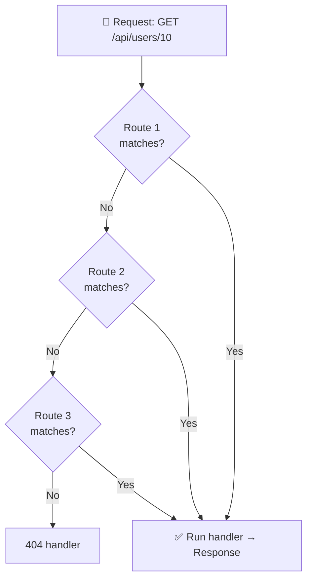
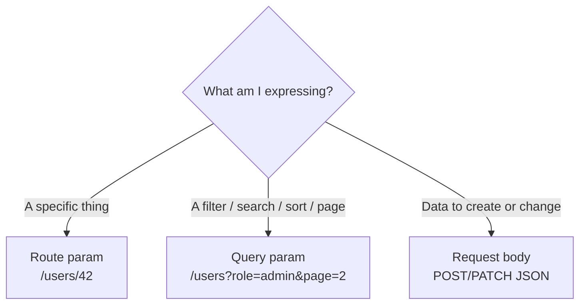
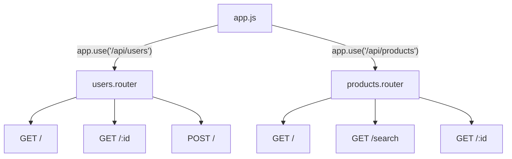
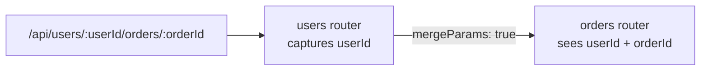

<div align="center">

# 🛣️ Day 11 — Routing & Route Parameters

### *From one messy file to a clean, scalable API structure.*


**20 Days • 20 Concepts — Node.js & Express.js Learning Series**

</div>

---

## 🗺️ How to Use This Material

This is a **workbook**. For every concept:

```text
📖 Read  →  🧪 Type it yourself  →  💥 Break it on purpose  →  ✅ Check the answer
```

| Icon | Meaning |
|---|---|
| 💡 | Key idea, remember this |
| 🧪 | Hands-on lab |
| 🎯 | Task, solve it without copy-pasting |
| 🤔 | Think question, answer before opening the hint |
| ⚠️ | Common trap |
| 🚨 | Security warning |
| 🏆 | Challenge |

> 💡 **Setup for today:** Terminal 1 runs the server (`npm run dev`). Terminal 2 is for `curl`. Postman / Thunder Client is optional but handy for POST/PATCH.

---

## 📑 Table of Contents

1. [What You Will Learn](#-1-what-you-will-learn)
2. [What Is Routing?](#-2-what-is-routing)
3. [Starter Kit (Setup)](#-3-starter-kit-setup)
4. [Static vs Dynamic Routes](#-4-static-vs-dynamic-routes)
5. [Lab 1 — Your First Dynamic Routes](#-5-lab-1--your-first-dynamic-routes)
6. [Route Parameters (`req.params`)](#-6-route-parameters-reqparams)
7. [Lab 2 — Params, Validation & Express 5 Path Syntax](#-7-lab-2--params-validation--express-5-path-syntax)
8. [Query Parameters (`req.query`)](#-8-query-parameters-reqquery)
9. [Params vs Query — Which One?](#-9-params-vs-query--which-one)
10. [Lab 3 — Filtering, Sorting & Pagination](#-10-lab-3--filtering-sorting--pagination)
11. [Route Order Matters](#-11-route-order-matters)
12. [Lab 4 — Order Bugs & `next("route")`](#-12-lab-4--order-bugs--nextroute)
13. [`express.Router()` — Modular Routes](#-13-expressrouter--modular-routes)
14. [Lab 5 — Split Your App into Routers](#-14-lab-5--split-your-app-into-routers)
15. [Nested Routes, `mergeParams` & `router.param`](#-15-nested-routes-mergeparams--routerparam)
16. [Lab 6 — Users → Orders (Nested Routers)](#-16-lab-6--users--orders-nested-routers)
17. [`router.route()` & Handling 405 Properly](#-17-routerroute--handling-405-properly)
18. [Lab 7 — Chaining Methods & 405 Responses](#-18-lab-7--chaining-methods--405-responses)
19. [Designing Good URLs (REST Naming)](#-19-designing-good-urls-rest-naming)
20. [Lab 8 — API Versioning & Automated Route Tests](#-20-lab-8--api-versioning--automated-route-tests)
21. [Production Mindset](#-21-production-mindset)
22. [🕵️ Spot the Mistakes (Code Review)](#-22-spot-the-mistakes-code-review)
23. [Debugging Challenges](#-23-debugging-challenges)
24. [Quiz Time](#-24-quiz-time)
25. [Mini Project — Product Catalog API](#-25-mini-project--product-catalog-api-capstone)
26. [Interview Questions](#-26-interview-questions)
27. [Cheat Sheet](#-27-cheat-sheet)
28. [Glossary](#-28-glossary)
29. [Progress Tracker](#-29-progress-tracker)
30. [Day 12 Preview](#-30-day-12-preview)

---

## 🎯 1. What You Will Learn

By the end of today you will be able to:

- ✅ Explain how Express matches a request to a route
- ✅ Create static and dynamic routes
- ✅ Read and **validate** `req.params` and `req.query`
- ✅ Choose between a route parameter and a query parameter
- ✅ Build filtering, searching, sorting and **pagination**
- ✅ Avoid route-order bugs (`/search` vs `/:id`)
- ✅ Split routes into files with `express.Router()`
- ✅ Build nested routes (`/users/:userId/orders`) with `mergeParams`
- ✅ Use `router.param()` and `router.route()`
- ✅ Return proper `405 Method Not Allowed` responses
- ✅ Use the **Express 5** path syntax (named wildcards, optional segments)
- ✅ Write clean, REST-style URLs
- ✅ Test your routers automatically

---

## 🧠 2. What Is Routing?

> 💡 **Routing = deciding which function answers which request**, based on the **HTTP method** and the **URL path**.

```text
GET    /api/users        →  list users
GET    /api/users/10     →  get user 10
POST   /api/users        →  create a user
PATCH  /api/users/10     →  update user 10
DELETE /api/users/10     →  delete user 10
```

Five lines, five different actions. The **method + path** pair is the key.

### 🚉 Analogy: Railway station

| Station | Express |
|---|---|
| Ticket type (express / local) | HTTP **method** |
| Destination | URL **path** |
| Platform number | Route **parameter** (`/platform/:no`) |
| Travel preferences (window seat, AC) | **Query** parameters |
| Station master pointing you to the right platform | The **router** |
| "No such train" board | **404** handler |

### How Express matches a request



> ⚠️ Express checks routes **top to bottom** and the **first match that responds wins**. It does **not** automatically pick the "most specific" route.

---

## 🧰 3. Starter Kit (Setup)

We'll reuse the helpers from Day 10 so this day is **self-contained**.

```bash
mkdir day-11-routing
cd day-11-routing
npm init -y
npm install express
```

Edit `package.json`:

```json
{
  "type": "module",
  "scripts": {
    "dev": "node --watch src/server.js",
    "start": "node src/server.js",
    "test": "node --test"
  }
}
```

### Create these files

`src/utils/HttpError.js`

```js
export class HttpError extends Error {
  constructor(status, message) {
    super(message);
    this.status = status;
  }
}
```

`src/utils/parsers.js`

```js
export function parseId(raw) {
  return typeof raw === "string" && /^[1-9]\d*$/.test(raw) ? Number(raw) : null;
}
```

`src/middleware/logger.js`

```js
export function logger(req, res, next) {
  const start = Date.now();
  res.on("finish", () => {
    console.log(`${req.method} ${req.originalUrl} → ${res.statusCode} (${Date.now() - start}ms)`);
  });
  next();
}
```

`src/middleware/notFound.js`

```js
export function notFound(req, res) {
  res.status(404).json({ success: false, error: "Route not found", path: req.originalUrl });
}
```

`src/middleware/errorHandler.js`

```js
export function errorHandler(err, req, res, next) {
  const status = err.status ?? err.statusCode ?? 500;

  if (status >= 500) console.error(err);
  if (res.headersSent) return next(err);

  const message =
    err.type === "entity.parse.failed" ? "Invalid JSON"
    : status >= 500 ? "Internal server error"
    : err.message;

  res.status(status).json({ success: false, error: message });
}
```

`src/app.js` (starting point)

```js
import express from "express";
import { logger } from "./middleware/logger.js";
import { notFound } from "./middleware/notFound.js";
import { errorHandler } from "./middleware/errorHandler.js";

const app = express();

app.disable("x-powered-by");
app.use(express.json({ limit: "100kb" }));
app.use(logger);

app.get("/api/health", (req, res) => {
  res.json({ status: "ok" });
});

// 👉 Today's routes go here (above the 404 handler)

app.use(notFound);
app.use(errorHandler);

export default app;
```

`src/server.js`

```js
import app from "./app.js";

const PORT = Number(process.env.PORT ?? 3000);

const server = app.listen(PORT, () => {
  console.log(`API running at http://localhost:${PORT}`);
});

server.on("error", (error) => {
  console.error("Server error:", error);
  process.exitCode = 1;
});
```

Run it:

```bash
npm run dev
curl http://localhost:3000/api/health
```

✅ If you see `{"status":"ok"}`, you're ready.

---

## 📍 4. Static vs Dynamic Routes

| | Static route | Dynamic route |
|---|---|---|
| Path | Fixed text | Contains a `:parameter` |
| Example | `/api/about` | `/api/users/:id` |
| Matches | Only exactly that path | Many URLs of that shape |
| Express code | `app.get("/api/about", ...)` | `app.get("/api/users/:id", ...)` |

```js
// Static: matches ONLY /api/about
app.get("/api/about", (req, res) => {
  res.json({ application: "Day 11 Routing API" });
});

// Dynamic: matches /api/users/1, /api/users/42, /api/users/abc ...
app.get("/api/users/:id", (req, res) => {
  res.json({ userId: req.params.id });
});
```

### Which URLs match `/api/users/:id`?

| URL | Matches? | `req.params` |
|---|---|---|
| `/api/users/42` | ✅ | `{ id: "42" }` |
| `/api/users/abc` | ✅ | `{ id: "abc" }` (Express doesn't care about the type!) |
| `/api/users` | ❌ | no id segment |
| `/api/users/42/orders` | ❌ | extra segment |
| `/api/users/` | ❌ | empty id |

> 💡 Dynamic routes are great for: **user IDs, product IDs, slugs, order numbers, student IDs.**

---

## 🧪 5. Lab 1 — Your First Dynamic Routes

Add to `src/app.js` (above the 404 handler):

```js
import { parseId } from "./utils/parsers.js";
import { HttpError } from "./utils/HttpError.js";

const users = [
  { id: 1, name: "Arun", role: "admin" },
  { id: 2, name: "Priya", role: "user" },
  { id: 3, name: "Aravind", role: "user" }
];

// STATIC
app.get("/api/about", (req, res) => {
  res.json({ application: "Day 11 Routing API", version: "1.0.0" });
});

// STATIC (collection)
app.get("/api/users", (req, res) => {
  res.json({ count: users.length, data: users });
});

// DYNAMIC
app.get("/api/users/:id", (req, res) => {
  const id = parseId(req.params.id);
  if (id === null) throw new HttpError(400, "id must be a positive integer");

  const user = users.find((u) => u.id === id);
  if (!user) throw new HttpError(404, "User not found");

  res.json({ success: true, data: user });
});
```

### 🧪 Test matrix

| Request | Expected |
|---|---|
| `GET /api/about` | `200` |
| `GET /api/users` | `200`, 3 users |
| `GET /api/users/2` | `200`, Priya |
| `GET /api/users/99` | `404` |
| `GET /api/users/abc` | `400` |
| `GET /api/users/-1` | `400` |
| `GET /api/users/1.5` | `400` |
| `POST /api/users/2` | `404` (no POST route yet) |

```bash
curl -i http://localhost:3000/api/users/2
curl -i http://localhost:3000/api/users/abc
```

### 🤔 Think

*`GET /api/users/abc` returned `400`, but `GET /api/users/99` returned `404`. Why different codes?*

<details>
<summary>💡 Answer</summary>

`abc` is **not a valid ID at all** (a malformed request → `400`). `99` is a valid ID, but **no such user exists** (`404`). Clients can react differently: fix the request vs. accept the resource isn't there.

</details>

### 🎯 Task 1

1. Add `GET /api/users/:id/email` that returns only `{ id, email }` (add an `email` field to your data)
2. Add `GET /api/health/details` (static, nested path) returning uptime from `process.uptime()`
3. What does `GET /api/users/2/` (trailing slash) return? Why?

<details>
<summary>💡 Answer for #3</summary>

It still returns Priya. By default Express routing is lenient about a trailing slash and about uppercase/lowercase letters (`/API/Users/2` also works). You can make it strict with `app.set("strict routing", true)` and `app.set("case sensitive routing", true)`. See Lab 7.

</details>

---

## 🏷️ 6. Route Parameters (`req.params`)

A route parameter captures **part of the URL path** into `req.params`.

```js
app.get("/api/users/:userId/orders/:orderId", (req, res) => {
  const { userId, orderId } = req.params;
  res.json({ userId, orderId });
});
```

```text
GET /api/users/10/orders/500
          │          │
          │          └─ orderId = "500"
          └──────────── userId  = "10"
```

### 🚨 The golden rule

> **Route parameter values are ALWAYS strings.** Never trust them. **Validate every one.**

```js
// ❌ Fails silently: 1 === "1" is false
users.find((u) => u.id === req.params.id);

// ✅ Validate and convert first
const id = parseId(req.params.id);
```

### Why not just `Number(req.params.id)`?

| Input | `Number(x)` | Valid ID? |
|---|---|---|
| `"5"` | `5` | ✅ |
| `"abc"` | `NaN` | ❌ |
| `""` | `0` ⚠️ | ❌ |
| `"1e2"` | `100` ⚠️ | surprising! |
| `"0x10"` | `16` ⚠️ | surprising! |
| `" 7 "` | `7` ⚠️ | spaces allowed! |
| `"-3"` | `-3` | ❌ |

A **strict regex** (`/^[1-9]\d*$/`) from our `parseId` helper avoids every surprise. 💪

### Other param styles you'll meet

| Style | Example URL | Route |
|---|---|---|
| Numeric ID | `/products/25` | `/products/:id` |
| Slug | `/posts/learn-express-routing` | `/posts/:slug` |
| UUID | `/orders/3f2a...` | `/orders/:orderId` |
| Multiple | `/users/5/orders/9` | `/users/:userId/orders/:orderId` |

A **slug** validator example:

```js
function isValidSlug(value) {
  return typeof value === "string" && /^[a-z0-9]+(?:-[a-z0-9]+)*$/.test(value);
}

isValidSlug("learn-express-routing"); // true
isValidSlug("Learn Express!");        // false
```

---

## 🧪 7. Lab 2 — Params, Validation & Express 5 Path Syntax

### Part A: Multiple params + the string trap

```js
const orders = [
  { id: 500, userId: 1, total: 1200 },
  { id: 501, userId: 1, total: 800 },
  { id: 502, userId: 2, total: 450 }
];

app.get("/api/users/:userId/orders/:orderId", (req, res) => {
  const userId = parseId(req.params.userId);
  const orderId = parseId(req.params.orderId);

  if (userId === null || orderId === null) {
    throw new HttpError(400, "userId and orderId must be positive integers");
  }

  const order = orders.find((o) => o.id === orderId && o.userId === userId);
  if (!order) throw new HttpError(404, "Order not found");

  res.json({ success: true, data: order });
});
```

```bash
curl -i http://localhost:3000/api/users/1/orders/500   # 200
curl -i http://localhost:3000/api/users/2/orders/500   # 404 (wrong owner!)
curl -i http://localhost:3000/api/users/x/orders/500   # 400
```

> 🔐 Notice `o.userId === userId`. The order must **belong to that user**. Checking only `orderId` would let anyone read anyone's order. This is the idea behind **authorization**, which you'll build properly on Day 16/18.

### Part B: Express 5 path syntax experiments

Older tutorials use Express 4 path tricks. **Several of them break in Express 5.** Try each one in a scratch file (`scratch.js`) so you can see the errors safely:

```js
import express from "express";
const app = express();

// 1️⃣ Express 4 regex-in-path (❌ NOT supported in Express 5)
app.get("/files/:id(\\d+)", (req, res) => res.send("ok"));
```

```bash
node scratch.js
```

💥 The app **fails at startup** with a path parsing error. Express 5 no longer allows regex inside path strings.

| Old Express 4 style | ✅ Express 5 replacement |
|---|---|
| `"/files/:id(\\d+)"` | Validate in the handler, **or** use a RegExp route: `app.get(/^\/files\/(\d+)$/, ...)` → `req.params[0]` |
| `"/users/:id?"` (optional) | `"/users{/:id}"` |
| `app.get("*", ...)` | `app.get("/*splat", ...)` (one or more segments) |
| `"/files/*"` then `req.params[0]` | `"/files/*filepath"` then `req.params.filepath` |

### Try the new syntax

```js
// Optional segment: matches /users AND /users/5
app.get("/optional/users{/:id}", (req, res) => {
  res.json({ id: req.params.id ?? null });
});

// Named wildcard: matches /files/a, /files/a/b/c.txt (NOT /files)
app.get("/files/*filepath", (req, res) => {
  res.json({ filepath: req.params.filepath });
});

// Zero-or-more wildcard: matches /docs AND /docs/a/b
app.get("/docs{/*rest}", (req, res) => {
  res.json({ rest: req.params.rest ?? [] });
});

// RegExp route: numeric ids only
app.get(/^\/numeric\/(\d+)$/, (req, res) => {
  res.json({ id: Number(req.params[0]) });
});
```

```bash
curl http://localhost:3000/optional/users
curl http://localhost:3000/optional/users/5
curl http://localhost:3000/files/a/b/c.txt
curl http://localhost:3000/docs
curl http://localhost:3000/numeric/42
curl -i http://localhost:3000/numeric/abc     # 404 (regex didn't match)
```

> 💡 In Express 5, a wildcard param like `filepath` is an **array of path segments**: `["a","b","c.txt"]`.

### ⚠️ Security note on wildcards

If you ever use a wildcard to **serve files**, never join `req.params.filepath` straight into a file path (`../../etc/passwd` attacks). Use `express.static` or strict validation.

### 🎯 Task 2

1. Make `GET /api/users/:userId/orders` list all orders for a valid user (400 for bad id, 404 if the user doesn't exist)
2. Add `GET /api/posts/:slug` with `isValidSlug` validation
3. Why is "validate in the handler" a good replacement for regex-in-path?

<details>
<summary>💡 Answer for #3</summary>

You can return a **helpful `400` message** ("id must be a positive integer"). With a regex path, a bad id simply doesn't match and the client gets a confusing `404`.

</details>

---

## 🔎 8. Query Parameters (`req.query`)

Query parameters are **optional options** at the end of a URL.

```text
GET /api/products?category=mobile&sort=-price&page=2&limit=5
                  └──────┬──────┘ └────┬────┘ └──┬──┘ └──┬──┘
                      filter          sort     page    page size
```

Used for: **filtering, searching, sorting, pagination**.

```js
app.get("/api/products", (req, res) => {
  const { category, limit } = req.query;
  // category → "mobile", limit → "5"   (strings!)
});
```

### 🚨 Query values are untrusted and weirdly shaped

| URL | `req.query.x` | Type |
|---|---|---|
| `?x=5` | `"5"` | string |
| `?x=` | `""` | empty string |
| `?x` | `""` | empty string |
| `?x=1&x=2` | `["1","2"]` | **array** |
| *(missing)* | `undefined` | undefined |

So `typeof value === "string"` is the **first** check you should make.

### Safe pagination parser

Create `src/utils/pagination.js`:

```js
import { HttpError } from "./HttpError.js";

function parsePositiveInt(raw, fallback, name) {
  if (raw === undefined) return fallback;

  if (typeof raw !== "string" || !/^[1-9]\d*$/.test(raw)) {
    throw new HttpError(400, `${name} must be a positive integer`);
  }

  const value = Number(raw);

  if (!Number.isSafeInteger(value)) {
    throw new HttpError(400, `${name} is too large`);
  }

  return value;
}

export function parsePagination(query, { defaultLimit = 10, maxLimit = 100 } = {}) {
  const page = parsePositiveInt(query.page, 1, "page");
  const limit = parsePositiveInt(query.limit, defaultLimit, "limit");

  if (limit > maxLimit) {
    throw new HttpError(400, `limit must be between 1 and ${maxLimit}`);
  }

  return { page, limit, offset: (page - 1) * limit };
}

export function buildMeta({ page, limit, total }) {
  const totalPages = Math.max(1, Math.ceil(total / limit));

  return {
    page,
    limit,
    total,
    totalPages,
    hasPrev: page > 1,
    hasNext: page < totalPages
  };
}
```

### Pagination maths 🧮

```text
total = 5 items, limit = 2

page 1 → offset 0 → items [0,1]
page 2 → offset 2 → items [2,3]
page 3 → offset 4 → items [4]
totalPages = ceil(5 / 2) = 3

offset = (page - 1) × limit
```


> 💡 **Design choice:** If `page` is beyond the last page, return `200` with an **empty** `data` array and correct `meta`. It's not an error. The collection exists; that page is simply empty.

---

## ⚖️ 9. Params vs Query — Which One?

| Feature | 🏷️ Route parameter | 🔎 Query parameter |
|---|---|---|
| Express property | `req.params` | `req.query` |
| Purpose | **Identify** a resource | **Shape** a result (filter/sort/page) |
| Required? | Yes (part of the path) | Usually optional |
| Example | `/products/25` | `/products?category=mobile` |
| Missing value means | Different URL/404 | Use defaults |

### 🧠 Memory trick

- **Param:** *"Which ONE?"* → `/products/25`
- **Query:** *"Which ones / how?"* → `/products?category=mobile&sort=price`



### 🎯 Task 3 — Choose the right one

| Need | Param, query, or body? |
|---|---|
| Get user 42 | ? |
| Search users named "aru" | ? |
| Page 3 of orders, 20 per page | ? |
| Create a new product | ? |
| Delete order 7 | ? |
| Sort products by price | ? |
| Get review 9 of product 3 | ? |

<details>
<summary>✅ Answers</summary>

Param (`/users/42`), Query (`?q=aru`), Query (`?page=3&limit=20`), Body (JSON), Param (`DELETE /orders/7`), Query (`?sort=price`), Params (`/products/3/reviews/9`).

</details>

---

## 🧪 10. Lab 3 — Filtering, Sorting & Pagination

Add to `src/app.js`:

```js
import { parsePagination, buildMeta } from "./utils/pagination.js";

const products = [
  { id: 1, name: "Phone X", category: "mobile", price: 15000, inStock: true },
  { id: 2, name: "Phone Y", category: "mobile", price: 22000, inStock: false },
  { id: 3, name: "Laptop A", category: "computer", price: 55000, inStock: true },
  { id: 4, name: "Laptop B", category: "computer", price: 72000, inStock: true },
  { id: 5, name: "Smartwatch", category: "wearable", price: 9000, inStock: true },
  { id: 6, name: "Earbuds", category: "audio", price: 3000, inStock: false },
  { id: 7, name: "Monitor", category: "computer", price: 18000, inStock: true }
];

const SORTABLE = ["name", "price"];

function applySort(items, sort) {
  if (sort === undefined) return items;

  if (typeof sort !== "string") throw new HttpError(400, "sort must be a single value");

  const descending = sort.startsWith("-");
  const field = descending ? sort.slice(1) : sort;

  if (!SORTABLE.includes(field)) {
    throw new HttpError(400, `sort must be one of: ${SORTABLE.join(", ")} (prefix with - for descending)`);
  }

  const sorted = [...items].sort((a, b) => (a[field] < b[field] ? -1 : a[field] > b[field] ? 1 : 0));
  return descending ? sorted.reverse() : sorted;
}

app.get("/api/products", (req, res) => {
  const { page, limit, offset } = parsePagination(req.query);
  const { category, inStock, sort } = req.query;

  let result = products;

  if (category !== undefined) {
    if (typeof category !== "string") throw new HttpError(400, "category must be a single value");
    result = result.filter((p) => p.category === category.toLowerCase());
  }

  if (inStock !== undefined) {
    if (inStock !== "true" && inStock !== "false") {
      throw new HttpError(400, 'inStock must be "true" or "false"');
    }
    result = result.filter((p) => p.inStock === (inStock === "true"));
  }

  result = applySort(result, sort);

  res.json({
    success: true,
    data: result.slice(offset, offset + limit),
    meta: buildMeta({ page, limit, total: result.length })
  });
});
```

### 🧪 Test matrix

```bash
curl "http://localhost:3000/api/products"
curl "http://localhost:3000/api/products?category=computer"
curl "http://localhost:3000/api/products?inStock=true&sort=-price"
curl "http://localhost:3000/api/products?page=2&limit=3"
curl "http://localhost:3000/api/products?category=computer&page=1&limit=2"
curl "http://localhost:3000/api/products?page=99"            # empty data, 200
```

| Request | Expected |
|---|---|
| `?limit=0` | `400` |
| `?limit=101` | `400` |
| `?page=-1` | `400` |
| `?page=abc` | `400` |
| `?page=1&page=2` | `400` (array) |
| `?sort=color` | `400` |
| `?inStock=yes` | `400` |
| `?category=computer&category=audio` | `400` (array) |
| `?limit=99999999999999999999` | `400` (too large) |

### 🤔 Think

*Why do we compute `total` **after** filtering but **before** slicing?*

<details>
<summary>💡 Answer</summary>

`total` must describe **all matching items**, not the current page and not the whole catalog. That's what lets the client calculate the number of pages ("Page 2 of 3").

</details>

### 💥 Break it on purpose

| # | Experiment | What you'll learn |
|---|---|---|
| 1 | Use `products.length` instead of `result.length` in `buildMeta` | `total` is wrong after filtering |
| 2 | Replace the regex parser with `Number(req.query.limit)` | `?limit=` becomes `0`, `?limit=1e2` becomes `100`, arrays become `NaN` |
| 3 | Do `offset + limit` where `limit` is still a **string** | `"0" + "10"` becomes `"010"`, so `slice` misbehaves |
| 4 | Remove the max `limit` check | A client can request 1,000,000 items at once |

### 🎯 Task 4

1. Add `minPrice` and `maxPrice` filters (validate both are non-negative numbers, and `minPrice <= maxPrice`)
2. Add `?search=phone` (case-insensitive name contains)
3. Create `GET /api/products/search?q=...` returning `400` if `q` is missing/array/blank. **Where must you put it?** (Hint: Lab 4)

<details>
<summary>✅ Hint for price validation</summary>

```js
function parsePrice(raw, name) {
  if (raw === undefined) return undefined;
  if (typeof raw !== "string" || !/^\d+(\.\d{1,2})?$/.test(raw)) {
    throw new HttpError(400, `${name} must be a non-negative number`);
  }
  return Number(raw);
}
```

</details>

---

## 🔀 11. Route Order Matters

Express runs routes **in the order you register them**.

```js
app.get("/api/users/:id", handlerA);
app.get("/api/users/search", handlerB);   // ❌ unreachable!
```

Request: `GET /api/users/search`

```mermaid
flowchart LR
    R[GET /api/users/search] --> A{/api/users/:id<br/>matches? YES<br/>id = search}
    A --> H[handlerA runs 😱<br/>"search" treated as an ID]
    H -.never reached.-> B[handlerB]
```

### ✅ Rule: Specific before generic

```js
app.get("/api/users/search", handlerB);   // ✅ specific first
app.get("/api/users/:id", handlerA);      // generic after
```

| Register first | Register after |
|---|---|
| `/users/search` | `/users/:id` |
| `/users/me` | `/users/:id` |
| `/users/export` | `/users/:id` |
| `/files/special` | `/files/*filepath` |

### 💡 Two more order rules

1. **Middleware** (`express.json`, logger) goes **before** routes that need it
2. **404 handler** goes **after** all routes, error handler **last**

### Related: `next("route")`

A route can have **several handlers**. Calling `next("route")` **skips the remaining handlers of the current route** and moves on to the next matching route.

```js
app.get(
  "/api/items/:id",
  (req, res, next) => {
    if (!/^\d+$/.test(req.params.id)) return next("route"); // not numeric → skip this route
    next();
  },
  (req, res) => res.json({ type: "numeric", id: Number(req.params.id) })
);

app.get("/api/items/:slug", (req, res) => {
  res.json({ type: "slug", slug: req.params.slug });
});
```

> ⚠️ This is a **demonstration**. Two overlapping patterns like `/:id` and `/:slug` make an API ambiguous. In real APIs prefer **one** identifier style per resource.

---

## 🧪 12. Lab 4 — Order Bugs & `next("route")`

### Part A: Cause the bug on purpose

Register these **in this order**:

```js
app.get("/api/people/:id", (req, res) => {
  const id = parseId(req.params.id);
  if (id === null) throw new HttpError(400, "id must be a positive integer");
  res.json({ person: id });
});

app.get("/api/people/me", (req, res) => {
  res.json({ me: "Arun" });
});
```

```bash
curl -i http://localhost:3000/api/people/me
```

You'll get **`400 id must be a positive integer`**, because `me` was captured as an id. 🐛

### Part B: Fix it

Swap the order. Test again → `{"me":"Arun"}` ✅

### Part C: `next("route")` in action

Paste the `items` example from the previous section and test:

```bash
curl http://localhost:3000/api/items/42
curl http://localhost:3000/api/items/hello-world
```

### 🎯 Task 5

1. Add `GET /api/products/search?q=...` **before** `/api/products/:id`, and confirm that `/api/products/search?q=phone` works
2. Add `GET /api/products/featured` and place it correctly
3. In one sentence, explain why Express can't just "know" `/search` is more specific

<details>
<summary>💡 Answer for #3</summary>

Express matches by **registration order**, not by "specificity scoring". A pattern like `:id` legitimately matches the text `search`; only **you** know it was meant as a keyword.

</details>

---

## 📦 13. `express.Router()` — Modular Routes

One giant `app.js` stops scaling quickly.

```text
❌ app.js (1,200 lines: users + products + orders + auth + ...)
✅ routes/users.routes.js
   routes/products.routes.js
   routes/orders.routes.js
```

A **Router** is a **mini Express app** that holds a group of related routes.

```js
import { Router } from "express";

const router = Router();

router.get("/", handler);
router.get("/:id", handler);

export default router;
```

Then **mount** it with `app.use(prefix, router)`:

```js
app.use("/api/users", usersRouter);
```

### How mounting builds the final URL

```text
app.use("/api/users", usersRouter)   +   router.get("/:id")
        └──────┬──────┘                       └───┬───┘
            mount prefix                     router path
                         ↓
                GET /api/users/:id
```

| Router path | Mounted at `/api/users` → Full endpoint |
|---|---|
| `router.get("/")` | `GET /api/users` |
| `router.get("/:id")` | `GET /api/users/:id` |
| `router.post("/")` | `POST /api/users` |
| `router.get("/search")` | `GET /api/users/search` |



### Router vs app

| | `app` | `router` |
|---|---|---|
| Created by | `express()` | `express.Router()` |
| Can listen on a port | ✅ | ❌ |
| Has `.get/.post/.use` | ✅ | ✅ |
| Purpose | Whole application | A group of routes |

### What the URL properties look like inside a router

For `GET /api/users/5?x=1` handled by a router mounted at `/api/users`:

| Property | Value |
|---|---|
| `req.originalUrl` | `/api/users/5?x=1` (the full URL, never changes) |
| `req.baseUrl` | `/api/users` (the mount path) |
| `req.path` | `/5` (**relative to the mount point**) |
| `req.params` | `{ id: "5" }` |
| `req.query` | `{ x: "1" }` |

> 💡 That's why you log **`req.originalUrl`** in loggers. `req.path` is relative inside routers.

---

## 🧪 14. Lab 5 — Split Your App into Routers

### New structure

```text
src/
├── app.js
├── server.js
├── routes/
│   ├── users.routes.js
│   └── products.routes.js
├── controllers/
│   ├── users.controller.js
│   └── products.controller.js
├── data/
│   ├── users.js
│   └── products.js
├── middleware/
└── utils/
```

> 💡 **Controllers** are plain functions holding the logic. **Routes** only map `method + path → controller`. This keeps route files short and readable.

### `src/data/users.js`

```js
export const users = [
  { id: 1, name: "Arun", role: "admin" },
  { id: 2, name: "Priya", role: "user" },
  { id: 3, name: "Aravind", role: "user" }
];
```

### `src/controllers/users.controller.js`

```js
import { users } from "../data/users.js";
import { HttpError } from "../utils/HttpError.js";
import { parseId } from "../utils/parsers.js";

export function listUsers(req, res) {
  res.json({ success: true, count: users.length, data: users });
}

export function searchUsers(req, res) {
  const q = req.query.q;

  if (typeof q !== "string" || q.trim() === "") {
    throw new HttpError(400, "A valid q search parameter is required");
  }

  const term = q.trim().toLowerCase();
  const data = users.filter((u) => u.name.toLowerCase().includes(term));

  res.json({ success: true, count: data.length, data });
}

export function getUser(req, res) {
  const id = parseId(req.params.id);
  if (id === null) throw new HttpError(400, "id must be a positive integer");

  const user = users.find((u) => u.id === id);
  if (!user) throw new HttpError(404, "User not found");

  res.json({ success: true, data: user });
}
```

### `src/routes/users.routes.js`

```js
import { Router } from "express";
import { listUsers, searchUsers, getUser } from "../controllers/users.controller.js";

const router = Router();

router.get("/", listUsers);
router.get("/search", searchUsers);   // ✅ before "/:id"
router.get("/:id", getUser);

export default router;
```

### `src/app.js` (clean!)

```js
import express from "express";
import { logger } from "./middleware/logger.js";
import { notFound } from "./middleware/notFound.js";
import { errorHandler } from "./middleware/errorHandler.js";
import usersRouter from "./routes/users.routes.js";
import productsRouter from "./routes/products.routes.js";

const app = express();

app.disable("x-powered-by");
app.use(express.json({ limit: "100kb" }));
app.use(logger);

app.get("/api/health", (req, res) => res.json({ status: "ok" }));

app.use("/api/users", usersRouter);
app.use("/api/products", productsRouter);

app.use(notFound);
app.use(errorHandler);

export default app;
```

### 🎯 Task 6

1. Move your **products** code (Lab 3) into `products.controller.js`, `data/products.js` and `products.routes.js`
2. Verify **every earlier curl test still works** (that's the point of refactoring!)
3. Add a debug route that returns `req.originalUrl`, `req.baseUrl` and `req.path` for `GET /api/users/_debug/anything`. Compare the three values.

<details>
<summary>✅ Hint for #3</summary>

```js
// in users.routes.js, BEFORE "/:id"
router.get("/_debug/:thing", (req, res) => {
  res.json({
    originalUrl: req.originalUrl,
    baseUrl: req.baseUrl,
    path: req.path,
    params: req.params
  });
});
```

Expected: `originalUrl` `/api/users/_debug/anything`, `baseUrl` `/api/users`, `path` `/_debug/anything`. Remove this route after the experiment.

</details>

### 💥 Break it on purpose

| # | Experiment | What you'll learn |
|---|---|---|
| 1 | Mount with a missing slash: `app.use("api/users", usersRouter)` | Routes don't work as expected. Always start mount paths with `/` |
| 2 | Mount the router **after** `notFound` | Every router route returns `404` |
| 3 | Define `router.get("/api/users/:id")` inside a router mounted at `/api/users` | Real URL becomes `/api/users/api/users/:id`. Router paths are **relative** |
| 4 | Forget `export default router` | `import` fails |

---

## 🪆 15. Nested Routes, `mergeParams` & `router.param`

### Nested resources

Some data **belongs to** another resource:

```text
GET /api/users/5/orders          → orders of user 5
GET /api/users/5/orders/900      → order 900 of user 5
```

You can mount a router **inside another router**:

```js
// users.routes.js
router.use("/:userId/orders", ordersRouter);
```

### 🚨 The `mergeParams` trap

By default, a child router **does not see** the parent's params!

```js
const ordersRouter = Router();                       // ❌ req.params.userId is undefined
const ordersRouter = Router({ mergeParams: true });  // ✅ can read req.params.userId
```



### `router.param()`: validate a parameter once

Instead of repeating validation in every handler:

```js
router.param("id", (req, res, next, value) => {
  const id = parseId(value);

  if (id === null) {
    return next(new HttpError(400, "id must be a positive integer"));
  }

  req.validatedId = id;   // store the clean value for handlers
  next();
});

router.get("/:id", (req, res) => {
  // req.validatedId is already a safe number here
});
```

| Pros | Cons |
|---|---|
| Validation lives in one place | Slightly "magical" for beginners |
| Runs for **every** route with `:id` in this router | **Local to the router** where it's defined. It does NOT run for params in nested/other routers |

### Keep nesting shallow ⚠️

```text
✅ /users/5/orders
✅ /users/5/orders/900
❌ /users/5/orders/900/items/3/options/2   (too deep!)
```

Rule of thumb: **at most two levels**. Deeper resources can often be addressed directly (`/order-items/3`).

---

## 🧪 16. Lab 6 — Users → Orders (Nested Routers)

### `src/data/orders.js`

```js
export const orders = [
  { id: 500, userId: 1, total: 1200 },
  { id: 501, userId: 1, total: 800 },
  { id: 502, userId: 2, total: 450 }
];
```

### `src/routes/orders.routes.js`

```js
import { Router } from "express";
import { orders } from "../data/orders.js";
import { users } from "../data/users.js";
import { HttpError } from "../utils/HttpError.js";
import { parseId } from "../utils/parsers.js";

const router = Router({ mergeParams: true });   // 👈 crucial

// Validate :userId and confirm the user exists, once, for this router
router.use((req, res, next) => {
  const userId = parseId(req.params.userId);
  if (userId === null) return next(new HttpError(400, "userId must be a positive integer"));

  if (!users.some((u) => u.id === userId)) {
    return next(new HttpError(404, "User not found"));
  }

  req.userId = userId;
  next();
});

router.get("/", (req, res) => {
  const data = orders.filter((o) => o.userId === req.userId);
  res.json({ success: true, count: data.length, data });
});

router.get("/:orderId", (req, res) => {
  const orderId = parseId(req.params.orderId);
  if (orderId === null) throw new HttpError(400, "orderId must be a positive integer");

  const order = orders.find((o) => o.id === orderId && o.userId === req.userId);
  if (!order) throw new HttpError(404, "Order not found");

  res.json({ success: true, data: order });
});

export default router;
```

### Mount it in `users.routes.js`

```js
import ordersRouter from "./orders.routes.js";

// ...existing routes above...

router.use("/:userId/orders", ordersRouter);   // placed before router.get("/:id")? see note below
```

> 💡 **Order note:** `/:userId/orders` has a **different shape** (extra segment) from `/:id`, so they don't collide. But keep specific routes like `/search` **above** both.

### 🧪 Test

```bash
curl -i http://localhost:3000/api/users/1/orders          # 200, 2 orders
curl -i http://localhost:3000/api/users/1/orders/500      # 200
curl -i http://localhost:3000/api/users/2/orders/500      # 404 (belongs to user 1)
curl -i http://localhost:3000/api/users/99/orders         # 404 user missing
curl -i http://localhost:3000/api/users/abc/orders        # 400
```

### 💥 Break it on purpose

| # | Experiment | What you'll learn |
|---|---|---|
| 1 | Remove `{ mergeParams: true }` | `req.params.userId` is `undefined` → everything returns `400` |
| 2 | Define `router.param("userId", ...)` in `orders.routes.js` | It does **not** run, because `:userId` is declared in the **parent** router's path |
| 3 | Return the order without checking `o.userId === req.userId` | `GET /users/2/orders/500` leaks user 1's order. An authorization bug! 🚨 |

### 🎯 Task 7

1. Add `router.param("id", ...)` to `users.routes.js` so `getUser` no longer validates the ID itself
2. Add `GET /api/users/:userId/orders/count` (before `/:orderId`) returning `{ count }`
3. 🏆 Add a nested reviews router for products: `/api/products/:productId/reviews` (list and create)

---

## 🔗 17. `router.route()` & Handling 405 Properly

### Chain methods on the same path with `router.route()`

Instead of repeating the path:

```js
// ❌ repetition
router.get("/:id", getProduct);
router.patch("/:id", updateProduct);
router.delete("/:id", deleteProduct);

// ✅ chained
router.route("/:id")
  .get(getProduct)
  .patch(updateProduct)
  .delete(deleteProduct);
```

Benefits: one place for the path, fewer typos.

### Remember Day 10's question?

> *"Does Express automatically return 405?"* → **No.** `DELETE /api/health` just becomes a `404`.

Now we fix it. Add an **`.all()`** at the **end** of the chain. It catches every method that the earlier handlers didn't respond to.

`src/middleware/methodNotAllowed.js`

```js
import { HttpError } from "../utils/HttpError.js";

export function methodNotAllowed(allowedMethods) {
  return (req, res) => {
    res.set("Allow", allowedMethods.join(", "));

    // Let OPTIONS (used by browsers for CORS preflight, Day 18) succeed
    if (req.method === "OPTIONS") {
      return res.status(204).end();
    }

    throw new HttpError(
      405,
      `Method ${req.method} not allowed. Use: ${allowedMethods.join(", ")}`
    );
  };
}
```

Use it:

```js
router.route("/")
  .get(listProducts)
  .post(createProduct)
  .all(methodNotAllowed(["GET", "POST"]));

router.route("/:id")
  .get(getProduct)
  .patch(updateProduct)
  .delete(deleteProduct)
  .all(methodNotAllowed(["GET", "PATCH", "DELETE"]));
```

### ⚠️ `.all()` order trap

```js
router.route("/:id")
  .all(methodNotAllowed(["GET"]))   // ❌ FIRST → every method (even GET) gets 405
  .get(getProduct);
```

Handlers run **in order**. Put `.all()` **last**.

### 🔧 A middleware factory (again!)

`methodNotAllowed(["GET"])` **returns** a middleware. You saw this pattern on Day 10.

### Strict routing & case sensitivity (optional)

```js
app.set("case sensitive routing", true);   // /Users ≠ /users
app.set("strict routing", true);           // /users ≠ /users/
```

Or per router: `Router({ caseSensitive: true, strict: true })`.

> 💡 Most APIs leave these defaults alone. Know they exist.

---

## 🧪 18. Lab 7 — Chaining Methods & 405 Responses

### Step 1

Add the `methodNotAllowed` middleware file, then convert your **products router** to use `router.route()` chains with `.all(...)` at the end.

Don't forget the **specific route** `/search` and keep it **above** `/:id`:

```js
router.route("/search")
  .get(searchProducts)
  .all(methodNotAllowed(["GET"]));
```

### Step 2: Test

```bash
curl -i -X PUT    http://localhost:3000/api/products/1      # 405 + Allow
curl -i -X POST   http://localhost:3000/api/products/1      # 405 + Allow
curl -i -X DELETE http://localhost:3000/api/products        # 405 + Allow
curl -i -X OPTIONS http://localhost:3000/api/products       # 204 + Allow
curl -i -X GET    http://localhost:3000/api/products/1      # 200
```

You should see headers like:

```text
HTTP/1.1 405 Method Not Allowed
Allow: GET, PATCH, DELETE
```

### 💥 Experiments

| # | Experiment | Observe |
|---|---|---|
| 1 | Move `.all(...)` to the **start** of a chain | Even valid methods return `405` |
| 2 | Remove the `OPTIONS` branch | OPTIONS requests return `405` (would break browser CORS preflight later) |
| 3 | `app.set("strict routing", true)` then call `/api/products/` | Now returns `404` |
| 4 | `app.set("case sensitive routing", true)` then call `/API/products` | Now returns `404` |

### 🎯 Task 8

1. Convert the **users router** to `router.route()` chains with `.all()` 405 handling
2. Make `/api/health` reject non-GET methods with 405
3. Check: does `curl -I http://localhost:3000/api/products` (a `HEAD` request) work with a `GET` route?

<details>
<summary>💡 Answer for #3</summary>

Yes. Express automatically handles `HEAD` requests with your `GET` handler (it just doesn't send the body), so `HEAD` works without extra code.

</details>

---

## 🧭 19. Designing Good URLs (REST Naming)

A good URL is **predictable**. A developer should guess it without reading docs. (REST design gets a full day on Day 14, but good habits start now.)

### ✅ The rules

| Rule | ✅ Good | ❌ Bad |
|---|---|---|
| Use **nouns**, not verbs | `POST /users` | `POST /createUser` |
| Use **plural** collections | `/products` | `/product` |
| HTTP method = the action | `DELETE /products/5` | `GET /deleteProduct?id=5` |
| lowercase, hyphen-separated | `/order-items` | `/OrderItems`, `/order_items` |
| No trailing file extensions | `/users` | `/users.php` |
| Max ~2 levels of nesting | `/users/5/orders` | `/a/1/b/2/c/3/d/4` |
| Filters go in the query | `/products?category=mobile` | `/products/category/mobile/page/2` |
| Don't expose internals | `/users/5` | `/getUserFromMysql/5` |

### Method + path = action

| Action | Method | URL | Success |
|---|---|---|---|
| List | `GET` | `/products` | `200` |
| Read one | `GET` | `/products/:id` | `200` |
| Create | `POST` | `/products` | `201` |
| Replace | `PUT` | `/products/:id` | `200` |
| Update part | `PATCH` | `/products/:id` | `200` |
| Delete | `DELETE` | `/products/:id` | `204` |
| Search | `GET` | `/products?q=phone` (or `/products/search?q=`) | `200` |

> 💡 **Search design:** `GET /products?q=phone` is the most common REST style. A dedicated `/products/search` also works, but must be registered **before** `/:id`. Either is fine if your team is consistent.

### 🎯 Task 9 — Route Design Workshop 🏫

Design the full route table for a **Library Management API**:

- Books (list, read, create, update, delete, search by title/author, filter by genre, paginate)
- Members (list, read, create)
- Borrowing: a member borrows a book, returns a book, and views a member's borrowed books

Write: **method, path, success status, and possible errors** for each.

<details>
<summary>✅ One possible answer</summary>

| Method | Path | Success | Errors |
|---|---|---|---|
| GET | `/api/books?genre=&q=&page=&limit=` | 200 | 400 |
| GET | `/api/books/:id` | 200 | 400, 404 |
| POST | `/api/books` | 201 | 400 |
| PATCH | `/api/books/:id` | 200 | 400, 404 |
| DELETE | `/api/books/:id` | 204 | 400, 404 |
| GET | `/api/members` | 200 | 400 |
| GET | `/api/members/:id` | 200 | 400, 404 |
| POST | `/api/members` | 201 | 400, 409 |
| GET | `/api/members/:id/loans` | 200 | 400, 404 |
| POST | `/api/loans` (body: `memberId`, `bookId`) | 201 | 400, 404, 409 (already borrowed) |
| PATCH | `/api/loans/:id/return` | 200 | 400, 404, 409 (already returned) |

Notice **borrowing** is modeled as its own noun (`loans`) rather than a verb like `/borrowBook`. 🎯

</details>

---

## 🧪 20. Lab 8 — API Versioning & Automated Route Tests

### Part A: API versioning

When you must change an API in a breaking way, old clients shouldn't break. A common approach is a version prefix:

```js
app.use("/api/v1/products", productsRouter);
app.use("/api/v1/users", usersRouter);
```

You can even **temporarily keep the old URLs working**:

```js
app.use("/api/products", productsRouter);      // legacy
app.use("/api/v1/products", productsRouter);   // new
```

> 💡 A router is just a value. **You can mount the same router in many places.**

### Part B: Automated tests (Node's built-in runner + `fetch`)

`tests/routes.test.js`

```js
import test, { before, after } from "node:test";
import assert from "node:assert";
import app from "../src/app.js";

let server;
let baseUrl;

before(async () => {
  await new Promise((resolve) => {
    server = app.listen(0, resolve);
  });
  baseUrl = `http://localhost:${server.address().port}`;
});

after(async () => {
  server.closeAllConnections();
  await new Promise((resolve) => server.close(resolve));
});

test("GET /api/users returns the list", async () => {
  const response = await fetch(`${baseUrl}/api/users`);
  const body = await response.json();

  assert.strictEqual(response.status, 200);
  assert.ok(Array.isArray(body.data));
});

test("GET /api/users/abc returns 400", async () => {
  const response = await fetch(`${baseUrl}/api/users/abc`);
  assert.strictEqual(response.status, 400);
});

test("GET /api/users/999 returns 404", async () => {
  const response = await fetch(`${baseUrl}/api/users/999`);
  assert.strictEqual(response.status, 404);
});

test("/api/users/search is not captured by /:id", async () => {
  const response = await fetch(`${baseUrl}/api/users/search?q=aru`);
  const body = await response.json();

  assert.strictEqual(response.status, 200);
  assert.ok(body.count >= 1);
});

test("nested route: user 2 cannot read user 1's order", async () => {
  const response = await fetch(`${baseUrl}/api/users/2/orders/500`);
  assert.strictEqual(response.status, 404);
});

test("pagination meta is correct", async () => {
  const response = await fetch(`${baseUrl}/api/products?page=2&limit=3`);
  const body = await response.json();

  assert.strictEqual(response.status, 200);
  assert.strictEqual(body.meta.page, 2);
  assert.strictEqual(body.meta.limit, 3);
  assert.strictEqual(body.data.length, 3);
});

test("limit above max returns 400", async () => {
  const response = await fetch(`${baseUrl}/api/products?limit=101`);
  assert.strictEqual(response.status, 400);
});

test("unsupported method returns 405 with Allow header", async () => {
  const response = await fetch(`${baseUrl}/api/products/1`, { method: "PUT" });

  assert.strictEqual(response.status, 405);
  assert.match(response.headers.get("allow"), /GET/);
});

test("unknown route returns JSON 404", async () => {
  const response = await fetch(`${baseUrl}/api/unicorns`);
  const body = await response.json();

  assert.strictEqual(response.status, 404);
  assert.strictEqual(body.success, false);
});
```

```bash
npm test
```

### 🎯 Task 10

1. Mount your products router at **both** `/api/products` and `/api/v1/products` and write a test proving both return identical data
2. Add 5 more tests: bad `page`, bad `sort`, array query (`?category=a&category=b`), `/search` without `q`, and `DELETE` on the collection
3. 🏆 Bonus: Add a `Deprecation: true` header on the legacy `/api/products` mount using a tiny middleware

<details>
<summary>💡 Hint for the Deprecation header</summary>

```js
function markDeprecated(req, res, next) {
  res.set("Deprecation", "true");
  next();
}

app.use("/api/products", markDeprecated, productsRouter);
```

</details>

---

## 🏭 21. Production Mindset

| Area | What to do |
|---|---|
| 🧭 **Structure** | Routers per resource; thin routes, logic in controllers |
| ✅ **Validation** | Validate every `param`, `query` and `body` value |
| 📄 **Pagination** | Always limit page size; never return "everything" |
| 🗄️ **Large data** | Filter/sort/paginate **in the database**, not in JS arrays (Day 19) |
| 🔐 **Authorization** | A valid ID ≠ permission. Check **ownership/role** (Day 16/18) |
| 🧪 **Tests** | Cover 200, 400, 404, 405 for every route |
| 📚 **Docs** | Document endpoints, params and status codes |
| 🏷️ **Versioning** | Plan `/v1` before you need it |
| 🚦 **Rate limits** | Expensive search/list endpoints need throttling (Day 18) |
| 🙈 **Errors** | Central handler, no internals leaked |

### 🔐 IDOR warning (real-world vulnerability!)

**IDOR = Insecure Direct Object Reference.** It happens when `GET /orders/501` returns the order **no matter who asks**. Attackers simply try other IDs (`502`, `503`...) and read other people's data.

```js
// ❌ Vulnerable: anyone can read any order
const order = orders.find((o) => o.id === orderId);

// ✅ Scoped to the authenticated user (you'll get req.user on Day 16)
const order = orders.find((o) => o.id === orderId && o.userId === req.user.id);
```

---

## 🕵️ 22. Spot the Mistakes (Code Review)

Find **all 12 problems**. (Hint: this is how many old tutorials look!)

```js
import express from "express";

const app = express();
const router = express.Router();

const products = [{ id: 1, name: "Phone", category: "mobile" }];

router.get("/:id", (req, res) => {
  const product = products.find((p) => p.id === req.params.id);
  res.json(product);
});

router.get("/search", (req, res) => {
  const q = req.query.q.toLowerCase();
  res.json(products.filter((p) => p.name.toLowerCase().includes(q)));
});

router.get("/", (req, res) => {
  const page = req.query.page;
  const limit = req.query.limit;
  const start = (page - 1) * limit;
  res.json(products.slice(start, start + limit));
});

router.get("/:id(\\d+)/reviews", (req, res) => {
  res.json([]);
});

app.use("api/products", router);

app.get("/api/files/*", (req, res) => {
  res.send(req.params[0]);
});

app.listen(3000);
```

<details>
<summary>✅ The 12 problems</summary>

1. `/:id` is registered **before** `/search`, so `/search` is swallowed as an id
2. `p.id === req.params.id` compares a **number to a string** and never matches
3. No `404` when the product isn't found. `res.json(undefined)` sends nothing useful
4. **No validation of the id** (`abc`, `-1`, `1.5`)
5. `req.query.q.toLowerCase()` **crashes** when `q` is missing (`undefined`) or an array
6. `page` and `limit` are **unvalidated strings** (could be `abc`, arrays, negatives)
7. **No defaults** for page/limit → `undefined` → `NaN`
8. `start + limit` → when `limit` is a **string** this becomes string concatenation (`0 + "10"` = `"010"`)
9. **No maximum `limit`.** A client can ask for a million items
10. `"/:id(\\d+)/reviews"` uses **regex-in-path, invalid in Express 5**. The app crashes at startup
11. `app.use("api/products", router)` is **missing the leading slash**
12. `app.get("/api/files/*", ...)` uses an **unnamed wildcard, invalid in Express 5** (use `/*filepath`). Also there's **no 404 handler, no error handler, no `405` handling**, and the list response has no `total`/pagination meta. (Bonus: no `express.json()` if POST is added later.)

</details>

---

## 🐞 23. Debugging Challenges

Try each **before** opening the answer.

### 🐞 Bug 1: `Cannot GET /api/users/5` (HTML page)

<details>
<summary>🔍 Likely causes & fix</summary>

- Router not mounted (`app.use("/api/users", usersRouter)` missing)
- Mount path typo or missing leading `/`
- Router mounted **after** the 404 handler
- Path **doubled** (`/api/users` mount + `router.get("/api/users/:id")` inside)
- Server wasn't restarted

Test with `curl -i` and print `req.originalUrl`, `req.baseUrl`, `req.path` in a debug route.

</details>

### 🐞 Bug 2: `req.params.userId` is `undefined` in the nested router

<details>
<summary>🔍 Cause & fix</summary>

Child router needs `Router({ mergeParams: true })` to see the parent's params.

</details>

### 🐞 Bug 3: `GET /api/users/search` returns "id must be a positive integer"

<details>
<summary>🔍 Cause & fix</summary>

`/:id` was registered before `/search`. Put specific routes first.

</details>

### 🐞 Bug 4: The app crashes at startup with a path error mentioning `(`

<details>
<summary>🔍 Cause & fix</summary>

You used Express 4 regex-in-path, e.g. `"/:id(\\d+)"`. Express 5 doesn't allow it. Validate in the handler (or `router.param`), or use a RegExp route.

</details>

### 🐞 Bug 5

```text
Missing parameter name at index 1: *
```

<details>
<summary>🔍 Cause & fix</summary>

Unnamed wildcard `*`. Use `/*splat` (or `/{*splat}` for zero-or-more).

</details>

### 🐞 Bug 6: `?page=2&page=3` crashes (`.toLowerCase is not a function` / `NaN` maths)

<details>
<summary>🔍 Cause & fix</summary>

Repeated keys create an **array**. Check `typeof value === "string"` before parsing (see `parsePagination`).

</details>

### 🐞 Bug 7: Page 2 returns the wrong items

<details>
<summary>🔍 Cause & fix</summary>

`offset + limit` used strings (`"2" + "3"` = `"23"`). Convert to numbers **after validating**, then slice using `offset` and `offset + limit` numeric values.

</details>

### 🐞 Bug 8: `meta.total` is wrong after filtering

<details>
<summary>🔍 Cause & fix</summary>

You used the **unfiltered** array's length. Compute `total` from the **filtered** list **before** slicing.

</details>

### 🐞 Bug 9: Every method on a route returns `405`, even GET

<details>
<summary>🔍 Cause & fix</summary>

`.all(methodNotAllowed(...))` is **first** in the chain. Put `.all()` **last**.

</details>

### 🐞 Bug 10: `router.param("userId")` never runs for the nested orders router

<details>
<summary>🔍 Cause & fix</summary>

`router.param` callbacks only apply to params in **routes defined on that same router**. The `:userId` lives in the parent router's mount path. Validate in the parent (`router.param("userId", ...)` there) or in a middleware inside the child router.

</details>

### 🐞 Bug 11

```text
Error [ERR_HTTP_HEADERS_SENT]: Cannot set headers after they are sent to the client
```

<details>
<summary>🔍 Cause & fix</summary>

A handler responded twice (missing `return`), or middleware responded **and** called `next()`.

</details>

### 🐞 Bug 12: `GET /api/users/2/orders/500` returns user **1's** order

<details>
<summary>🔍 Cause & fix</summary>

Missing ownership check. Filter by **both** `orderId` and `userId`. This is an **IDOR** bug, a real security vulnerability.

</details>

---

## 📝 24. Quiz Time

Answer on paper first.

**Q1.** What is routing?

**Q2.** Static vs dynamic route?

**Q3.** What type are `req.params` values?
- A) number  B) string  C) depends on the URL  D) boolean

**Q4.** `req.params` vs `req.query`: when do you use each?

**Q5.** What is `req.query.x` for `?x=1&x=2`?
- A) `"1"`  B) `"2"`  C) `["1","2"]`  D) `undefined`

**Q6.** What does `app.use("/api/users", usersRouter)` do?

**Q7.** Inside a router mounted at `/api/users`, what is `req.path` for `GET /api/users/5`?

**Q8.** Why must `/users/search` come before `/users/:id`?

**Q9.** What does `Router({ mergeParams: true })` do?

**Q10.** What's the formula for `offset`, and for `totalPages`?

**Q11.** Why should `page`/`limit` be validated and capped?

**Q12.** Which Express 5 syntax is **valid**?
- A) `"/users/:id?"`  B) `"/users{/:id}"`  C) `"/files/*"`  D) `"/:id(\\d+)"`

**Q13.** Why put `.all()` **last** in a `router.route()` chain?

**Q14.** What is IDOR?

**Q15.** `400` vs `404` for `/users/abc` vs `/users/9999`?

**Q16.** Why prefer plural nouns and no verbs in URLs?

<details>
<summary>✅ Answers</summary>

1. Matching an HTTP method + URL path to the handler that should respond
2. Static = fixed path (`/about`). Dynamic = contains `:param` (`/users/:id`)
3. **B**: strings
4. `params` identify one resource (`/users/42`). `query` filters/sorts/paginates (`?role=admin`)
5. **C**: `["1","2"]`
6. Mounts the router under that prefix, so router paths are relative to `/api/users`
7. `/5`. `req.path` is relative to the mount point (`req.originalUrl` stays full)
8. Express matches in registration order. `/:id` would capture the word `search` as an id
9. Lets the child router access params defined in the parent's mount path
10. `offset = (page - 1) × limit`; `totalPages = ceil(total / limit)`
11. To block invalid maths and abuse (huge responses, memory/DB load)
12. **B**: `"/users{/:id}"` (the others are Express 4 syntax)
13. Handlers run in order. A first `.all()` would catch every method before the specific ones
14. Insecure Direct Object Reference: access by ID without checking the caller is allowed to access it
15. `400` = malformed id. `404` = valid id but no such resource
16. The HTTP method already states the action; plural nouns make URLs predictable and consistent

</details>

### 🏅 Scoring

| Score | Level |
|---|---|
| 14-16 | 🏆 Routing Master |
| 11-13 | 🥈 Almost there |
| 7-10 | 🥉 Redo Labs 3-6 |
| 0-6 | 📚 Re-read and redo the labs |

---

## 🚀 25. Mini Project — Product Catalog API (Capstone)

### 📋 Goal

Build a **Product Catalog API** using **Express Router, controllers and clean routing**, with full validation, pagination, search, and 405 handling.

### 📌 Endpoints

| Method | Endpoint | Behavior | Success | Errors |
|---|---|---|---|---|
| `GET` | `/api/health` | Status | `200` | |
| `GET` | `/api/products` | List with filters, sort, pagination | `200` | `400` |
| `GET` | `/api/products/search?q=` | Search by name (paginated) | `200` | `400` |
| `GET` | `/api/products/:id` | One product | `200` | `400`, `404` |
| `POST` | `/api/products` | Create | `201` | `400` |
| `PATCH` | `/api/products/:id` | Update fields | `200` | `400`, `404` |
| `DELETE` | `/api/products/:id` | Delete | `204` | `400`, `404` |
| other methods on known routes | | | | `405` + `Allow` |
| anything else | | | | `404` JSON |

### 📐 Product shape

```json
{ "id": 1, "name": "Phone X", "category": "mobile", "price": 15000, "inStock": true }
```

### ✅ Validation rules

| Field | Rule |
|---|---|
| `name` | string, 2-100 chars after trim |
| `category` | non-empty string (stored lowercase) |
| `price` | finite number, 0 to 1,000,000 |
| `inStock` | boolean (default `true`) |
| `id` | server-generated. **Reject** if the client sends it |
| unknown fields | `400` |
| `PATCH` | at least one valid field |

### ✅ Query rules for `GET /api/products`

| Query | Rule |
|---|---|
| `page` | positive integer (default 1) |
| `limit` | positive integer 1-100 (default 10) |
| `category` | single string |
| `inStock` | exactly `"true"` or `"false"` |
| `sort` | `name`, `-name`, `price`, `-price` only |

### ✅ Checklist

#### Part A: Setup

- [ ] `npm init -y`, `"type": "module"`, install `express`
- [ ] Scripts: `dev`, `start`, `test`
- [ ] `.gitignore` with `node_modules/` and `.env`
- [ ] Starter kit files from Section 3

#### Part B: Structure

- [ ] `routes/products.routes.js` uses `router.route()` chains
- [ ] `controllers/products.controller.js` holds all logic
- [ ] `data/products.js` holds the in-memory data and helpers
- [ ] `utils/pagination.js`, `utils/parsers.js`, `utils/HttpError.js`
- [ ] `middleware/methodNotAllowed.js`
- [ ] Router mounted at `/api/products`; `/search` registered **before** `/:id`

#### Part C: Behavior

- [ ] List supports filter + sort + pagination with `meta`
- [ ] Search validates `q` (string, not blank, max 50 chars)
- [ ] `404` for missing products, `400` for bad ids/queries/bodies
- [ ] `PATCH` rejects empty bodies and unknown fields
- [ ] `POST` rejects a client-supplied `id`
- [ ] No stack traces in responses

#### Part D: Robustness

- [ ] `405` + `Allow` on every route
- [ ] `404` JSON handler + central error handler registered last
- [ ] `PORT` from env, validated

#### Part E: Tests (at least 15)

- [ ] Health, unknown route `404`, `405` on wrong methods
- [ ] List, filter by category, filter `inStock`, sort asc/desc, pagination meta
- [ ] Bad `page`, bad `limit`, `limit` > max, bad `sort`, array query
- [ ] Search success, search missing `q` (400)
- [ ] `/search` isn't captured by `/:id`
- [ ] Get one, `404`, bad id `400`
- [ ] Create `201`, invalid `400`, unknown field `400`, client `id` rejected
- [ ] Patch valid, patch empty `400`, patch missing `404`
- [ ] Delete `204`, delete again `404`

#### Part F: Documentation

- [ ] `README.md` with setup steps, an endpoint table, query parameter table and 3 curl examples

### 🏆 Bonus Challenges

| Level | Challenge |
|---|---|
| 🥉 Easy | Add `minPrice` / `maxPrice` filters |
| 🥈 Medium | Mount the router at both `/api/products` and `/api/v1/products` and test both |
| 🥇 Hard | Add nested `GET/POST /api/products/:productId/reviews` with `mergeParams` |
| 💎 Expert | Add `HEAD`/`OPTIONS` handling tests and a `Link` header (`rel="next"`, `rel="prev"`) for pagination |

<details>
<summary>💡 Stuck? Reference solution for the core (try on your own first!)</summary>

**`src/data/products.js`**

```js
const products = [
  { id: 1, name: "Phone X", category: "mobile", price: 15000, inStock: true },
  { id: 2, name: "Phone Y", category: "mobile", price: 22000, inStock: false },
  { id: 3, name: "Laptop A", category: "computer", price: 55000, inStock: true },
  { id: 4, name: "Laptop B", category: "computer", price: 72000, inStock: true },
  { id: 5, name: "Smartwatch", category: "wearable", price: 9000, inStock: true }
];

let nextId = 6;

export const db = {
  all: () => products,
  find: (id) => products.find((p) => p.id === id),
  add: (data) => {
    const product = { id: nextId++, ...data };
    products.push(product);
    return product;
  },
  remove: (id) => {
    const index = products.findIndex((p) => p.id === id);
    if (index === -1) return false;
    products.splice(index, 1);
    return true;
  }
};
```

**`src/controllers/products.controller.js`**

```js
import { db } from "../data/products.js";
import { HttpError } from "../utils/HttpError.js";
import { parseId } from "../utils/parsers.js";
import { parsePagination, buildMeta } from "../utils/pagination.js";

const SORTABLE = ["name", "price"];

function getProductOr404(rawId) {
  const id = parseId(rawId);
  if (id === null) throw new HttpError(400, "id must be a positive integer");

  const product = db.find(id);
  if (!product) throw new HttpError(404, "Product not found");

  return product;
}

function applySort(items, sort) {
  if (sort === undefined) return items;
  if (typeof sort !== "string") throw new HttpError(400, "sort must be a single value");

  const descending = sort.startsWith("-");
  const field = descending ? sort.slice(1) : sort;

  if (!SORTABLE.includes(field)) {
    throw new HttpError(400, `sort must be one of: ${SORTABLE.join(", ")} (prefix with - for descending)`);
  }

  const sorted = [...items].sort((a, b) => (a[field] < b[field] ? -1 : a[field] > b[field] ? 1 : 0));
  return descending ? sorted.reverse() : sorted;
}

function validateProduct(body, { partial = false } = {}) {
  if (typeof body !== "object" || body === null || Array.isArray(body)) {
    return "Request body must be a JSON object";
  }

  const allowed = ["name", "category", "price", "inStock"];
  const unknown = Object.keys(body).filter((key) => !allowed.includes(key));
  if (unknown.length > 0) return `Unknown field(s): ${unknown.join(", ")}`;

  if (partial && Object.keys(body).length === 0) return "Provide at least one field";

  if (!partial || "name" in body) {
    const name = typeof body.name === "string" ? body.name.trim() : "";
    if (name.length < 2 || name.length > 100) return "name must be 2-100 characters";
  }

  if (!partial || "category" in body) {
    if (typeof body.category !== "string" || body.category.trim() === "") {
      return "category is required";
    }
  }

  if (!partial || "price" in body) {
    if (typeof body.price !== "number" || !Number.isFinite(body.price) || body.price < 0 || body.price > 1_000_000) {
      return "price must be a number between 0 and 1,000,000";
    }
  }

  if ("inStock" in body && typeof body.inStock !== "boolean") {
    return "inStock must be true or false";
  }

  return null;
}

export function listProducts(req, res) {
  const { page, limit, offset } = parsePagination(req.query);
  const { category, inStock, sort } = req.query;

  let result = db.all();

  if (category !== undefined) {
    if (typeof category !== "string") throw new HttpError(400, "category must be a single value");
    result = result.filter((p) => p.category === category.toLowerCase());
  }

  if (inStock !== undefined) {
    if (inStock !== "true" && inStock !== "false") {
      throw new HttpError(400, 'inStock must be "true" or "false"');
    }
    result = result.filter((p) => p.inStock === (inStock === "true"));
  }

  result = applySort(result, sort);

  res.json({
    success: true,
    data: result.slice(offset, offset + limit),
    meta: buildMeta({ page, limit, total: result.length })
  });
}

export function searchProducts(req, res) {
  const q = req.query.q;

  if (typeof q !== "string" || q.trim() === "" || q.trim().length > 50) {
    throw new HttpError(400, "q must be a non-empty string of at most 50 characters");
  }

  const { page, limit, offset } = parsePagination(req.query);
  const term = q.trim().toLowerCase();
  const result = db.all().filter((p) => p.name.toLowerCase().includes(term));

  res.json({
    success: true,
    data: result.slice(offset, offset + limit),
    meta: buildMeta({ page, limit, total: result.length })
  });
}

export function getProduct(req, res) {
  res.json({ success: true, data: getProductOr404(req.params.id) });
}

export function createProduct(req, res) {
  const body = req.body ?? {};
  const problem = validateProduct(body);
  if (problem) throw new HttpError(400, problem);

  const product = db.add({
    name: body.name.trim(),
    category: body.category.trim().toLowerCase(),
    price: body.price,
    inStock: body.inStock ?? true
  });

  res.status(201).json({ success: true, data: product });
}

export function updateProduct(req, res) {
  const product = getProductOr404(req.params.id);

  const body = req.body ?? {};
  const problem = validateProduct(body, { partial: true });
  if (problem) throw new HttpError(400, problem);

  if ("name" in body) product.name = body.name.trim();
  if ("category" in body) product.category = body.category.trim().toLowerCase();
  if ("price" in body) product.price = body.price;
  if ("inStock" in body) product.inStock = body.inStock;

  res.json({ success: true, data: product });
}

export function deleteProduct(req, res) {
  const product = getProductOr404(req.params.id);
  db.remove(product.id);
  res.status(204).end();
}
```

**`src/routes/products.routes.js`**

```js
import { Router } from "express";
import * as controller from "../controllers/products.controller.js";
import { methodNotAllowed } from "../middleware/methodNotAllowed.js";

const router = Router();

router.route("/")
  .get(controller.listProducts)
  .post(controller.createProduct)
  .all(methodNotAllowed(["GET", "POST"]));

router.route("/search")                                  // ✅ before "/:id"
  .get(controller.searchProducts)
  .all(methodNotAllowed(["GET"]));

router.route("/:id")
  .get(controller.getProduct)
  .patch(controller.updateProduct)
  .delete(controller.deleteProduct)
  .all(methodNotAllowed(["GET", "PATCH", "DELETE"]));

export default router;
```

Mount it in `app.js` with `app.use("/api/products", productsRouter);` **above** the `notFound` handler. Notice how short and readable the route file is! 🎯

</details>

### ✅ Self-evaluation rubric

| Criteria | Done? |
|---|---|
| All endpoints return the correct status codes | ☐ |
| `/search` is registered before `/:id` | ☐ |
| Every param, query and body value is validated | ☐ |
| Pagination capped, `meta` correct after filtering | ☐ |
| `405` + `Allow` implemented with `.all()` last | ☐ |
| Routes, controllers and data are separated | ☐ |
| No stack traces or internals in responses | ☐ |
| At least 15 passing tests | ☐ |
| README documents routes and query parameters | ☐ |

---

## 💼 26. Interview Questions

### 🟢 Beginner

<details>
<summary><b>1. What is routing in Express?</b></summary>

Mapping an HTTP method and URL path to a handler function that produces the response.

</details>

<details>
<summary><b>2. Static vs dynamic routes?</b></summary>

Static routes have fixed paths (`/about`). Dynamic routes contain parameters (`/users/:id`) whose values are captured in `req.params`.

</details>

<details>
<summary><b>3. <code>req.params</code> vs <code>req.query</code>?</b></summary>

`params` identify a specific resource and come from the path. `query` carries optional filters/sort/pagination from the `?key=value` part. Both are strings (query values may be arrays) and need validation.

</details>

<details>
<summary><b>4. What is <code>express.Router()</code>?</b></summary>

A mini application for grouping related routes/middleware into a module, mounted with `app.use(prefix, router)`.

</details>

<details>
<summary><b>5. Why split routes into files?</b></summary>

Maintainability, readability, testability and clear ownership as the API grows.

</details>

### 🟡 Intermediate

<details>
<summary><b>6. Why does route order matter?</b></summary>

Express matches in registration order. A broad `/:id` placed before `/search` captures `search` as an id. Specific routes go first.

</details>

<details>
<summary><b>7. How do you implement pagination?</b></summary>

Validate `page`/`limit`, cap `limit`, compute `offset = (page-1)*limit`, slice (or `LIMIT/OFFSET` in a DB), and return metadata like `total`, `totalPages`, `hasNext`.

</details>

<details>
<summary><b>8. What is <code>mergeParams</code>?</b></summary>

A Router option that exposes the parent route's params (e.g. `:userId`) inside a nested router.

</details>

<details>
<summary><b>9. What is <code>router.param()</code>?</b></summary>

A hook that runs whenever a route in that router includes the named parameter, useful for centralized validation. It's local to the router where it's defined.

</details>

<details>
<summary><b>10. How do you return 405 correctly?</b></summary>

Use `router.route(path)` with specific methods, then `.all()` last to send `405` plus an `Allow` header listing supported methods.

</details>

### 🔴 Advanced

<details>
<summary><b>11. What changed about route path syntax in Express 5?</b></summary>

Regex inside path strings was removed, wildcards must be named (`/*splat`), optional segments use braces (`/users{/:id}`), and wildcard params are arrays.

</details>

<details>
<summary><b>12. What is <code>req.originalUrl</code> vs <code>req.baseUrl</code> vs <code>req.path</code>?</b></summary>

`originalUrl` is the full original URL. `baseUrl` is the router's mount path. `path` is the remainder relative to that mount point.

</details>

<details>
<summary><b>13. What is IDOR and how do you prevent it?</b></summary>

Insecure Direct Object Reference: accessing resources by guessing IDs without authorization checks. Prevent by scoping queries to the authenticated user and enforcing ownership/role checks on every access.

</details>

<details>
<summary><b>14. Why is offset pagination sometimes a problem?</b></summary>

Large offsets get slow in databases and results can shift when data changes between requests. Cursor/keyset pagination avoids both.

</details>

<details>
<summary><b>15. 400 vs 404 for a bad id?</b></summary>

`400` when the id is malformed (can't ever be valid). `404` when it's well-formed but no such resource exists.

</details>

<details>
<summary><b>16. How do you version an API with routers?</b></summary>

Mount the router under a version prefix (`/api/v1/...`), and keep or deprecate older mounts. The same router can be mounted at several prefixes.

</details>

<details>
<summary><b>17. How would you keep a large Express API maintainable?</b></summary>

Routers per resource, thin routes with controllers/services, shared validation utilities, centralized error handling, consistent naming, versioning, tests, and documentation.

</details>

<details>
<summary><b>18. What does <code>next("route")</code> do?</b></summary>

Skips the remaining handlers of the current route and continues to the next matching route.

</details>

---

## 🧾 27. Cheat Sheet

### 🧱 Router skeleton

```js
import { Router } from "express";
import * as c from "../controllers/things.controller.js";
import { methodNotAllowed } from "../middleware/methodNotAllowed.js";

const router = Router();

router.route("/")
  .get(c.list)
  .post(c.create)
  .all(methodNotAllowed(["GET", "POST"]));

router.route("/search")                    // specific BEFORE /:id
  .get(c.search)
  .all(methodNotAllowed(["GET"]));

router.route("/:id")
  .get(c.getOne)
  .patch(c.update)
  .delete(c.remove)
  .all(methodNotAllowed(["GET", "PATCH", "DELETE"]));

export default router;
```

```js
// app.js
app.use("/api/things", router);   // mount (leading slash!)
```

### 📋 Quick reference

| I want to... | Code |
|---|---|
| Define a route | `app.get("/path", handler)` |
| Read a path param | `req.params.id` |
| Read a query param | `req.query.page` |
| Validate an id | `parseId(req.params.id)` |
| Create a router | `const router = Router()` |
| Mount a router | `app.use("/api/users", router)` |
| Chain methods | `router.route("/:id").get(a).patch(b)` |
| Nested router sees parent params | `Router({ mergeParams: true })` |
| Validate a param once | `router.param("id", (req,res,next,value) => ...)` |
| Skip to the next route | `next("route")` |
| Send 405 | `res.set("Allow", "GET"); throw new HttpError(405, ...)` |
| Full original URL | `req.originalUrl` |
| Mount path | `req.baseUrl` |
| Path relative to mount | `req.path` |

### 🔁 Express 4 → Express 5 path syntax

| Express 4 | Express 5 |
|---|---|
| `"/users/:id?"` | `"/users{/:id}"` |
| `"*"` | `"/*splat"` |
| `"/files/*"` + `req.params[0]` | `"/files/*filepath"` + `req.params.filepath` (array) |
| `"/:id(\\d+)"` | validate in handler **or** `/^\/(\d+)$/` RegExp route |

### 🧮 Pagination formulas

```text
offset      = (page - 1) × limit
totalPages  = ceil(total / limit)
hasNext     = page < totalPages
hasPrev     = page > 1
```

### 🧊 Before you say "done"

```text
□ Specific routes BEFORE parameterized routes
□ Mount paths start with "/"
□ Routers mounted ABOVE the 404 handler
□ Every param / query / body value validated (strings! arrays!)
□ Pagination limit capped; total computed after filtering
□ Nested routers use mergeParams: true
□ .all() (405) is LAST in a route chain
□ Ownership/authorization checked (no IDOR)
□ Tested 200 / 400 / 404 / 405
```

---

## 📖 28. Glossary

| Term | Simple meaning |
|---|---|
| **Route** | Method + path + handler |
| **Router** | Mini app grouping related routes |
| **Mount** | Attaching a router under a prefix with `app.use` |
| **Route parameter** | Path variable like `:id` |
| **Query parameter** | `?key=value` option |
| **Static route** | Fixed path |
| **Dynamic route** | Path with parameters |
| **Wildcard** | Pattern matching multiple segments (`/*splat`) |
| **Controller** | Function holding route logic |
| **Nested route** | Route inside another resource (`/users/:id/orders`) |
| **`mergeParams`** | Lets a child router see parent params |
| **Pagination** | Returning data in pages |
| **Offset** | Number of items to skip |
| **Slug** | Human-readable URL id (`learn-express`) |
| **405** | Route exists but the method isn't allowed |
| **Allow header** | Lists the methods a route supports |
| **IDOR** | Reading others' data by guessing IDs |
| **Versioning** | Prefixing URLs (`/v1`) to evolve APIs safely |
| **Idempotent** | Repeating the call has the same effect |

---

## ✅ 29. Progress Tracker

### Knowledge

- [ ] I can explain how Express matches routes
- [ ] I can create static and dynamic routes
- [ ] I always validate `req.params` and `req.query`
- [ ] I know params vs query vs body
- [ ] I can build filtering, sorting and pagination
- [ ] I understand route order problems
- [ ] I can split code into routers and controllers
- [ ] I can use `mergeParams` and `router.param`
- [ ] I can use `router.route()` and send proper `405`s
- [ ] I know the Express 5 path syntax changes
- [ ] I can design clean REST-style URLs
- [ ] I understand IDOR

### Practice

- [ ] Completed Labs 1-8
- [ ] Completed Tasks 1-10
- [ ] Did the Code Review and Debugging challenges
- [ ] Scored 12+ on the quiz
- [ ] Finished the Product Catalog API with tests

### 🎖️ Badges

| Badge | Earned when |
|---|---|
| 🥉 **Route Starter** | Labs 1-2 done |
| 🥈 **Query Master** | Lab 3 and Task 4 done |
| 🥇 **Router Builder** | Labs 4-5 done |
| 🪆 **Nesting Pro** | Lab 6 done |
| 🛡️ **405 Guardian** | Lab 7 done |
| 🧪 **Route Tester** | Lab 8 done |
| 🏆 **Routing Master** | Product Catalog API and quiz done |

---

## 🔮 30. Day 12 Preview

### 🧅 Middleware (Deep Dive)

You've already used middleware (logger, `express.json`, error handler). Tomorrow you'll master it:

- How the middleware pipeline really works
- Application-level vs **router-level** middleware
- Built-in and third-party middleware
- Writing custom middleware (auth, validation, rate limits)
- Authentication and authorization middleware
- Error-handling middleware in depth
- Middleware order and the most common mistakes

> 💡 Today you built the **roads** (routes). Tomorrow you'll build the **checkpoints** on them.

---

## ⭐ Series Progress

```text
Day 0  → Getting Started & Roadmap             ✅
Day 1  → Node.js Runtime & Event Loop          ✅
Day 2  → CommonJS vs ES Modules                ✅
Day 3  → File System & File Handling           ✅
Day 4  → EventEmitter                          ✅
Day 5  → Streams & Buffers                     ✅
Day 6  → Callbacks, Promises & Async/Await     ✅
Day 7  → NPM & Package Management              ✅
Day 8  → Environment Variables & Configuration ✅
Day 9  → Creating HTTP Servers with Node.js    ✅
Day 10 → Express.js Fundamentals               ✅
Day 11 → Routing & Route Parameters            ✅ ← You are here
Day 12 → Middleware                            🔜
...
Day 20 → Production-Ready Express Architecture 🔜
```

---

<div align="center">

## 🧠 Final Mental Model

```text
Request: METHOD + /path?query
        ↓
app.use("/api/products", productsRouter)     ← mount
        ↓
router.route("/:id")                         ← match path
   .get(getProduct)                          ← match method
   .all(methodNotAllowed)                    ← wrong method → 405
        ↓
validate params + query → controller → response
        ↓
No match anywhere → 404 handler
```

### *Roads are routes. Routers are neighborhoods. Order decides who answers first.*

**Specific before generic. Validate everything. Never trust an ID.**

⭐ **Day 11 Complete** ⭐

*Keep learning. Keep building. Keep shipping.*

</div>
