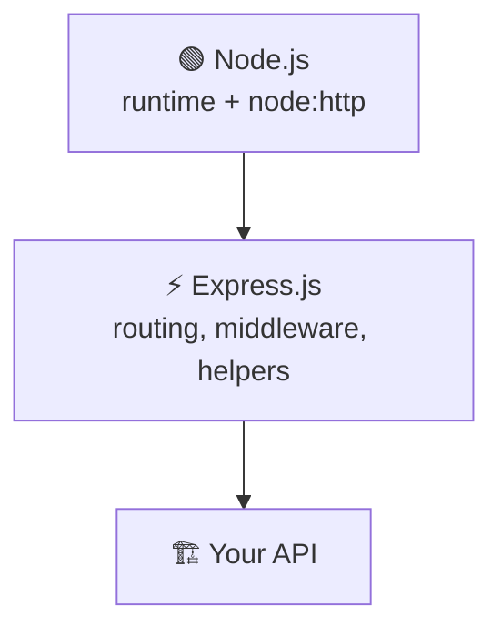
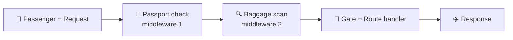
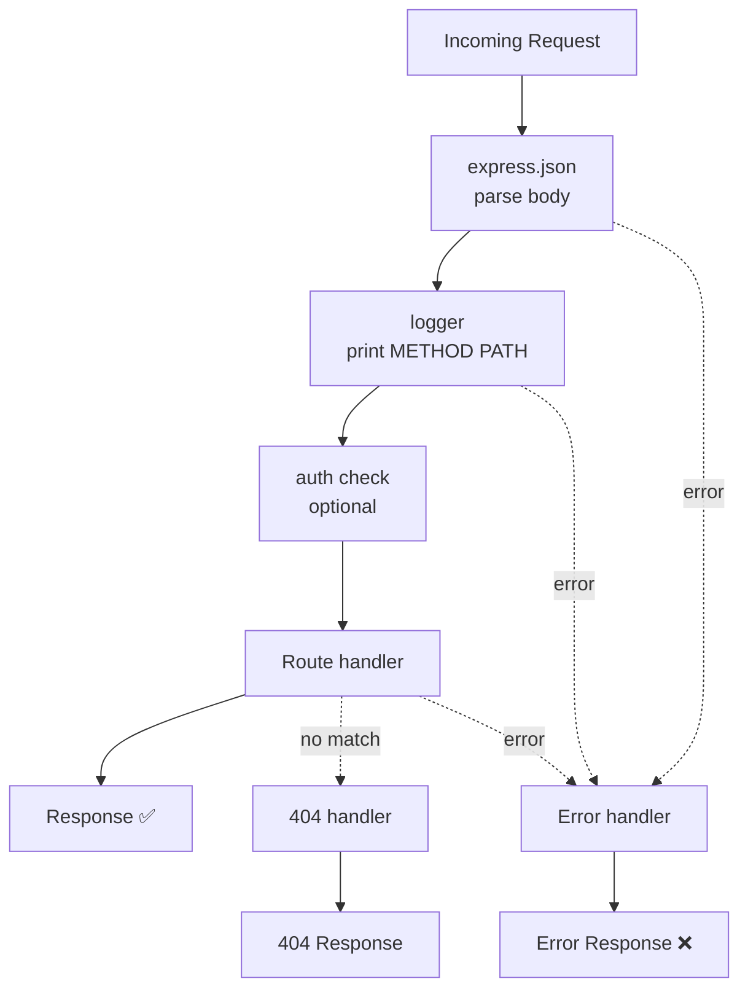
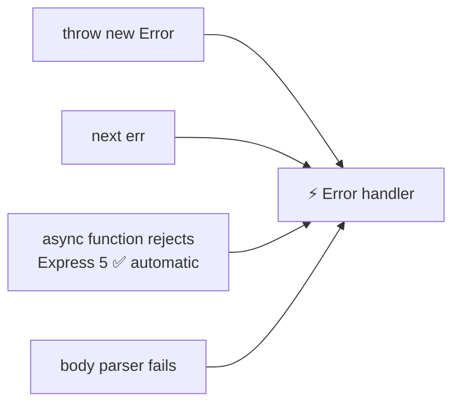

<div align="center">

# ⚡ Day 10 — Express.js Fundamentals

### *Yesterday you built it by hand. Today you build it in a fraction of the code.*


**20 Days • 20 Concepts — Node.js & Express.js Learning Series**

</div>

---

## 🗺️ How to Use This Material

This is a **workbook**. For every concept:

```text
📖 Read  →  🧪 Type it yourself  →  💥 Break it on purpose  →  ✅ Check the answer
```

| Icon | Meaning |
|---|---|
| 💡 | Key idea, remember this |
| 🧪 | Hands-on lab |
| 🎯 | Task, solve it without copy-pasting |
| 🤔 | Think question, answer before opening the hint |
| ⚠️ | Common trap |
| 🚨 | Security warning |
| 🏆 | Challenge |

> 💡 **Setup for today:** Terminal 1 runs the server (`npm run dev`). Terminal 2 is for `curl`. Keep your **Day 9 code** nearby. We will compare it with Express line by line.

---

## 📑 Table of Contents

1. [What You Will Learn](#-1-what-you-will-learn)
2. [What Is Express.js?](#-2-what-is-expressjs)
3. [Express 5 vs Express 4 (Important!)](#-3-express-5-vs-express-4-important)
4. [Lab 1 — Your First Express Server](#-4-lab-1--your-first-express-server)
5. [Day 9 → Day 10 Translation Table](#-5-day-9--day-10-translation-table)
6. [Routes & HTTP Methods](#-6-routes--http-methods)
7. [Lab 2 — Routes for Every Method](#-7-lab-2--routes-for-every-method)
8. [`req` — Everything the Client Sent](#-8-req--everything-the-client-sent)
9. [`res` — Everything You Send Back](#-9-res--everything-you-send-back)
10. [Lab 3 — The Request Explorer](#-10-lab-3--the-request-explorer)
11. [Route Params & Query Params](#-11-route-params--query-params)
12. [Lab 4 — Users API (Params + Query)](#-12-lab-4--users-api-params--query)
13. [Middleware — The Heart of Express](#-13-middleware--the-heart-of-express)
14. [Lab 5 — Write Your Own Middleware](#-14-lab-5--write-your-own-middleware)
15. [Reading JSON Bodies with `express.json()`](#-15-reading-json-bodies-with-expressjson)
16. [Lab 6 — Create & Validate with POST / PATCH](#-16-lab-6--create--validate-with-post--patch)
17. [404 Handler & Error Middleware](#-17-404-handler--error-middleware)
18. [Lab 7 — Break Things, Handle Errors](#-18-lab-7--break-things-handle-errors)
19. [Project Structure: `app.js` vs `server.js`](#-19-project-structure-appjs-vs-serverjs)
20. [Lab 8 — Refactor & Add Automated Tests](#-20-lab-8--refactor--add-automated-tests)
21. [Production Mindset](#-21-production-mindset)
22. [🕵️ Spot the Mistakes (Code Review)](#-22-spot-the-mistakes-code-review)
23. [Debugging Challenges](#-23-debugging-challenges)
24. [Quiz Time](#-24-quiz-time)
25. [Mini Project — Student Management API](#-25-mini-project--student-management-api-capstone)
26. [Interview Questions](#-26-interview-questions)
27. [Cheat Sheet](#-27-cheat-sheet)
28. [Glossary](#-28-glossary)
29. [Progress Tracker](#-29-progress-tracker)
30. [Day 11 Preview](#-30-day-11-preview)

---

## 🎯 1. What You Will Learn

By the end of today you will be able to:

- ✅ Explain what Express is and how it relates to Node.js
- ✅ Know the key differences between Express 4 and Express 5
- ✅ Create an Express server and routes for every HTTP method
- ✅ Use `req.params`, `req.query`, `req.body`, `req.headers`
- ✅ Respond with `res.json()`, `res.status()`, `res.send()`
- ✅ Explain middleware and the `next()` function
- ✅ Write your own middleware (logger, timer, API-key check)
- ✅ Parse and **validate** JSON request bodies
- ✅ Handle unknown routes (404) and errors (central handler)
- ✅ Split code into `app.js` and `server.js`
- ✅ Test your API automatically
- ✅ Rebuild yesterday's Student API with far less code

---

## 🧠 2. What Is Express.js?

**Express is a web framework for Node.js.** It's a layer on top of `node:http`, which you used yesterday.



> 💡 **Express does NOT replace Node.js. Express runs ON Node.js.**

### 🧰 Analogy

| Without a framework (Day 9) | With Express (Day 10) |
|---|---|
| Building a house by cutting wood yourself | Using ready-made doors, windows and walls |
| You still need to know how a house works | And now you can build faster |

### What Express gives you

| Feature | Day 9 (raw Node) | Day 10 (Express) |
|---|---|---|
| Routing | `if (method === ... && pathname === ...)` | `app.get("/users", ...)` |
| JSON response | `JSON.stringify` + headers | `res.json(data)` |
| Status code | `res.statusCode = 201` | `res.status(201)` |
| Body parsing | You wrote `readJsonBody` | `express.json()` |
| Route params | Regex | `/users/:id` |
| Reusable steps | You design them | **Middleware** |

---

## 🔄 3. Express 5 vs Express 4 (Important!)

Install today with `npm install express` and you get **Express 5** (the current major version). But many tutorials online still show **Express 4**. Knowing the differences saves hours of confusion.

| Topic | Express 4 (older tutorials) | Express 5 (what you'll use) |
|---|---|---|
| Errors in `async` handlers | ❌ Not caught automatically. You needed `try/catch` + `next(err)` | ✅ A thrown error or rejected promise is **forwarded automatically** to the error handler |
| `req.body` with no body | `{}` (empty object) | **`undefined`** unless a parser filled it |
| Wildcard route | `app.get("*", ...)` | Wildcards must be **named**: `app.get("/*splat", ...)` |
| Optional route params | `/users/:id?` | `/users{/:id}` |
| Default query parser | extended (nested objects) | **simple** (flat keys) |
| `res.json(status, obj)` | allowed (deprecated) | **removed.** Use `res.status(s).json(obj)` |
| Minimum Node.js | older versions | **Node 18+** |

> 💡 **Rule:** If a tutorial uses `app.get("*", ...)` or says "async errors need a try/catch wrapper", it's written for Express 4. Check which version you have:

```bash
npm ls express
```

---

## 🧪 4. Lab 1 — Your First Express Server

### Step 1 — Setup

```bash
mkdir day-10-express
cd day-10-express
npm init -y
npm install express
```

Edit `package.json`:

```json
{
  "type": "module",
  "scripts": {
    "dev": "node --watch server.js",
    "start": "node server.js"
  }
}
```

> 💡 We use **ES Modules** (`import`) as in the earlier days. For CommonJS use `const express = require("express");` and remove `"type": "module"`.

### Step 2 — `server.js`

```js
import express from "express";

const app = express();
const PORT = 3000;

app.get("/", (req, res) => {
  res.send("Hello from Express.js!");
});

app.listen(PORT, () => {
  console.log(`Server running at http://localhost:${PORT}`);
});
```

### Step 3 — Run

```bash
npm run dev
```

Open `http://localhost:3000` 🎉

### 🔍 Line by line

| Code | Meaning |
|---|---|
| `import express from "express"` | Load Express |
| `express()` | Create an application object (`app`) |
| `app.get("/", handler)` | When a **GET** request arrives for **`/`**, run `handler` |
| `res.send(...)` | Send a response (and **finish** it) |
| `app.listen(PORT, cb)` | Start the server (like `server.listen` yesterday) |

### 💥 Break it on purpose

| # | Experiment | What you'll learn |
|---|---|---|
| 1 | Visit `http://localhost:3000/about` | Express's **default 404** page: `Cannot GET /about`. It's HTML, not JSON! |
| 2 | Send `curl -X POST http://localhost:3000/` | Also `Cannot POST /`. Express routes **by method too** |
| 3 | Run `curl -i http://localhost:3000/` | Look for the **`X-Powered-By: Express`** header and an **`ETag`** header. Express adds these for you |
| 4 | Remove `res.send(...)` | Request **hangs** (same as Day 9: you must respond) |
| 5 | Change `res.send("Hello")` to `res.send("<h1>Hello</h1>")` | Strings are sent as **HTML**. Check `Content-Type` |

### 🎯 Task 1

1. Add `GET /about` returning your name
2. Add `GET /api/health` returning `{ "status": "ok" }` using `res.json()`
3. Run `curl -i` on the health route. What `Content-Type` did Express set **without you asking**?

<details>
<summary>✅ Observation</summary>

`Content-Type: application/json; charset=utf-8`. `res.json()` serializes the object **and** sets the header for you. That's three lines from Day 9 replaced by one.

</details>

---

## 🔁 5. Day 9 → Day 10 Translation Table

Keep this table close. Every Day 9 habit has an Express equivalent.

| Task | 🟤 Day 9 (raw `node:http`) | ⚡ Day 10 (Express) |
|---|---|---|
| Create server | `http.createServer(handler)` | `const app = express()` |
| Start listening | `server.listen(3000)` | `app.listen(3000)` |
| Match a route | `if (req.method === "GET" && pathname === "/x")` | `app.get("/x", handler)` |
| Get the path | `new URL(req.url, base).pathname` | `req.path` |
| Read a query param | `url.searchParams.get("limit")` | `req.query.limit` |
| Path parameter | regex `/^\/users\/(\d+)$/` | `app.get("/users/:id")` → `req.params.id` |
| Read JSON body | your `readJsonBody()` helper | `app.use(express.json())` → `req.body` |
| Send JSON | `sendJson(res, 201, data)` | `res.status(201).json(data)` |
| Send 204 | `res.writeHead(204); res.end()` | `res.status(204).end()` or `res.sendStatus(204)` |
| Unknown route | final `sendJson(res, 404, ...)` | `app.use((req, res) => ...)` placed **last** |
| Central error handling | `try/catch` + `handleError` | Error middleware `(err, req, res, next)` |
| Reusable pre-steps | manual function calls | **Middleware** with `app.use()` |

### 🤔 Think

*Yesterday, `DELETE /api/health` returned `405 Method Not Allowed`. What do you think Express returns by default for the same request?*

<details>
<summary>💡 Answer</summary>

`404`. Express doesn't automatically send `405`. If no route matches the method + path, the request falls through to the 404 handler. If you want `405` + `Allow`, you add it yourself (you'll see how with `app.route()` and `.all()` on Day 11).

</details>

---

## 🛣️ 6. Routes & HTTP Methods

A **route** = **HTTP method + path + handler**.

```text
app.METHOD(PATH, HANDLER)
     │       │      │
     │       │      └─ function (req, res) that runs when matched
     │       └──────── URL path, e.g. "/api/users"
     └──────────────── get, post, put, patch, delete
```

```js
app.get("/api/users", (req, res) => { /* read all */ });
app.post("/api/users", (req, res) => { /* create */ });
app.put("/api/users/:id", (req, res) => { /* replace */ });
app.patch("/api/users/:id", (req, res) => { /* partial update */ });
app.delete("/api/users/:id", (req, res) => { /* delete */ });
```

| Method | CRUD | Typical success status |
|---|---|---|
| `GET` | Read | `200` |
| `POST` | Create | `201` |
| `PUT` | Replace | `200` |
| `PATCH` | Partial update | `200` |
| `DELETE` | Delete | `204` |

### Routes run in order (top to bottom)

Express checks routes **in the order you wrote them**. The first match that sends a response **wins**.

```js
app.get("/api/users/me", (req, res) => res.json({ me: true }));       // specific FIRST
app.get("/api/users/:id", (req, res) => res.json({ id: req.params.id }));  // generic AFTER
```

Reverse them and `/api/users/me` would be caught by `/:id` with `id = "me"`. 😱

---

## 🧪 7. Lab 2 — Routes for Every Method

Replace `server.js` contents (keep the import and `listen`):

```js
app.get("/users", (req, res) => {
  res.json({ message: "Fetch users" });
});

app.post("/users", (req, res) => {
  res.status(201).json({ message: "Create user" });
});

app.put("/users/:id", (req, res) => {
  res.json({ message: `Replace user ${req.params.id}` });
});

app.patch("/users/:id", (req, res) => {
  res.json({ message: `Update user ${req.params.id}` });
});

app.delete("/users/:id", (req, res) => {
  res.status(204).end();
});
```

### 🧪 Test with curl

```bash
curl -i http://localhost:3000/users
curl -i -X POST   http://localhost:3000/users
curl -i -X PUT    http://localhost:3000/users/5
curl -i -X PATCH  http://localhost:3000/users/5
curl -i -X DELETE http://localhost:3000/users/5
```

### 💥 Experiments

| # | Try | Observe |
|---|---|---|
| 1 | `curl -i -X DELETE http://localhost:3000/users` (no id) | `404`. The route needs an id |
| 2 | Swap the order of two routes that overlap | The earlier one wins |
| 3 | Visit `http://localhost:3000/users/` (trailing slash) in the browser | Still matches the `/users` route. Express is **lenient** here, unlike Day 9! |
| 4 | Visit `http://localhost:3000/USERS` | Matches too. Express routing is **case-insensitive** by default |

### 🎯 Task 2

Add `GET /api/products` and `POST /api/products` routes, returning the correct status codes. Then add `app.all("/api/ping", ...)` that responds the same to **any** method. Test it with GET and POST.

<details>
<summary>✅ Solution for `app.all`</summary>

```js
app.all("/api/ping", (req, res) => {
  res.json({ pong: true, method: req.method });
});
```

</details>

---

## 📥 8. `req` — Everything the Client Sent

| Property | Meaning | Example for `GET /api/users/5?limit=2` |
|---|---|---|
| `req.method` | HTTP method | `"GET"` |
| `req.path` | Path **without** query | `"/api/users/5"` |
| `req.originalUrl` | Full URL as received | `"/api/users/5?limit=2"` |
| `req.params` | Route parameters | `{ id: "5" }` |
| `req.query` | Query string | `{ limit: "2" }` |
| `req.headers` | All headers (lowercase names) | `{ host: "...", ... }` |
| `req.get("Header-Name")` | Read one header (case-insensitive) | `req.get("Content-Type")` |
| `req.body` | Parsed body (needs middleware!) | `{ name: "Arun" }` |
| `req.ip` | Client IP | `"::1"` |
| `req.protocol` | `http` or `https` | `"http"` |

> ⚠️ `req.params` and `req.query` values are **strings** (or arrays/`undefined`). **Validate them. Never trust them.**

---

## 📤 9. `res` — Everything You Send Back

| Method | What it does |
|---|---|
| `res.send(x)` | Sends a string/Buffer/object. A **string** → HTML, an **object** → JSON |
| `res.json(obj)` | Sends JSON with the right `Content-Type` |
| `res.status(code)` | Sets the status. **Chainable**: `res.status(201).json(...)` |
| `res.sendStatus(404)` | Sets the status **and** sends its text ("Not Found") as the body |
| `res.set(name, value)` | Sets a header |
| `res.end()` | Ends the response with no body |
| `res.redirect(url)` | Redirects the client |
| `res.sendFile(path)` | Sends a file |

### `send` vs `json` vs `end`

| | `res.send("hi")` | `res.json({ a: 1 })` | `res.end()` |
|---|---|---|---|
| Content-Type | `text/html` | `application/json` | none |
| Best for | HTML/text | **APIs** ✅ | 204 / no body |

### ⚠️ Golden rules (same as Day 9)

1. **Respond exactly once** per request
2. Use `return` after sending, if more code follows
3. Pick the right **status code**

```js
// ❌ Sends TWICE → ERR_HTTP_HEADERS_SENT
app.get("/x", (req, res) => {
  res.json({ a: 1 });
  res.json({ b: 2 });
});

// ✅ Early return pattern
app.get("/users/:id", (req, res) => {
  const user = findUser(req.params.id);
  if (!user) return res.status(404).json({ error: "User not found" });
  res.json(user);
});
```

---

## 🧪 10. Lab 3 — The Request Explorer

Build a route that **echoes back** everything Express knows about a request.

```js
app.get("/explore/:section", (req, res) => {
  res.json({
    method: req.method,
    path: req.path,
    originalUrl: req.originalUrl,
    params: req.params,
    query: req.query,
    userAgent: req.get("user-agent"),
    contentType: req.get("content-type") ?? null
  });
});
```

### 🧪 Try these

```bash
curl "http://localhost:3000/explore/books?limit=5&sort=price"
curl "http://localhost:3000/explore/books?tag=a&tag=b"
curl -H "Content-Type: application/json" "http://localhost:3000/explore/x"
```

### 🤯 What do you notice?

For `?tag=a&tag=b`, `req.query.tag` is an **array** `["a","b"]`, not a string! This surprises many developers.

| URL | `req.query.limit` |
|---|---|
| `?limit=5` | `"5"` (string) |
| `?limit=5&limit=10` | `["5","10"]` (array) |
| *(missing)* | `undefined` |
| `?limit=` | `""` (empty string) |

> 💡 So `Number(req.query.limit)` can give `NaN` for arrays. **Always validate.**

### 🎯 Task 3

1. Compare `req.path` and `req.originalUrl` for a URL with a query string
2. What is `req.params` for `/explore/books`? And what would it be if the route was `/explore/:section/:id`?
3. Send a request with a custom header `X-Student: YourName` and read it using `req.get("x-student")`

---

## 🔎 11. Route Params & Query Params

### Route parameters: *which* resource

```js
app.get("/api/users/:id", (req, res) => {
  console.log(req.params.id); // "42" (string!)
});
```

```text
GET /api/users/42    →  req.params = { id: "42" }
```

Multiple params:

```js
app.get("/api/users/:userId/posts/:postId", (req, res) => {
  const { userId, postId } = req.params;
});
```

### Query parameters: *how* to filter, sort, page

```text
GET /api/products?category=mobile&limit=5
→ req.query = { category: "mobile", limit: "5" }
```

| | Route param | Query param |
|---|---|---|
| Purpose | Identify **one resource** | Filter / search / sort / paginate |
| Example | `/users/42` | `/users?role=admin&page=2` |
| Required? | Yes (part of the path) | Usually optional |
| Access | `req.params` | `req.query` |

### ✅ A safe ID parser (use this everywhere!)

```js
function parseId(raw) {
  return /^[1-9]\d*$/.test(raw) ? Number(raw) : null;
}

parseId("5");     // 5
parseId("0");     // null
parseId("-3");    // null
parseId("1.5");   // null
parseId("abc");   // null
parseId("1e2");   // null   (Number("1e2") would be 100!)
```

### ✅ A safe limit parser

```js
function parseLimit(raw, fallback = 10) {
  if (raw === undefined) return fallback;
  if (typeof raw !== "string" || !/^\d+$/.test(raw)) return null;
  const limit = Number(raw);
  return limit >= 1 && limit <= 100 ? limit : null;
}
```

It rejects arrays, empty strings, decimals and out-of-range values. 💪

---

## 🧪 12. Lab 4 — Users API (Params + Query)

```js
const users = [
  { id: 1, name: "Arun", role: "admin" },
  { id: 2, name: "Priya", role: "user" },
  { id: 3, name: "Karthik", role: "user" }
];
```

```js
// GET /api/users?role=user&limit=2
app.get("/api/users", (req, res) => {
  const limit = parseLimit(req.query.limit);

  if (limit === null) {
    return res.status(400).json({ error: "limit must be an integer between 1 and 100" });
  }

  let result = users;

  if (typeof req.query.role === "string") {
    result = result.filter((u) => u.role === req.query.role);
  }

  res.json({ count: result.length, data: result.slice(0, limit) });
});

// GET /api/users/:id
app.get("/api/users/:id", (req, res) => {
  const id = parseId(req.params.id);

  if (id === null) {
    return res.status(400).json({ error: "id must be a positive integer" });
  }

  const user = users.find((u) => u.id === id);

  if (!user) {
    return res.status(404).json({ error: "User not found" });
  }

  res.json(user);
});
```

(Paste `parseId` and `parseLimit` from Section 11 above these routes.)

### 🧪 Test matrix

| Request | Expected |
|---|---|
| `GET /api/users` | `200`, 3 users |
| `GET /api/users?role=user` | `200`, 2 users |
| `GET /api/users?limit=1` | `200`, 1 user |
| `GET /api/users?limit=abc` | `400` |
| `GET /api/users?limit=1&limit=2` | `400` (array rejected) |
| `GET /api/users/2` | `200`, Priya |
| `GET /api/users/99` | `404` |
| `GET /api/users/abc` | `400` |

### 🤔 Think

*Open `GET /api/users` in your browser twice. In DevTools → Network you may see `304 Not Modified` the second time. Where did that come from?*

<details>
<summary>💡 Answer</summary>

Express automatically adds an **`ETag`** header. The browser sends it back next time; if the data hasn't changed, Express replies `304` with no body, and the browser reuses its cached copy. It's normal and helpful, but confusing when you don't know about it.

</details>

### 🎯 Task 4

1. Add `?search=ar` (case-insensitive name search)
2. Add `?sort=name` or `?sort=-name` and reject other values with `400`
3. Put `GET /api/users/me` (returns `{ id: 1, name: "Arun" }`) **after** `/:id`. What happens? Move it **before**. What changes?

<details>
<summary>✅ Observation for #3</summary>

When `/me` is **after** `/:id`, the request is caught by `/:id` with `id = "me"` and returns `400` from our parser. Moving the specific route **before** the generic one fixes it. Route order matters.

</details>

---

## 🧅 13. Middleware — The Heart of Express

> 💡 **Middleware = a function that runs *between* the request arriving and the response being sent.**

```js
function myMiddleware(req, res, next) {
  // do something with req / res
  next();   // pass control to the next function
}
```

### 🏭 Analogy: Airport security



Each checkpoint can:

1. ✅ **Let you pass** → `next()`
2. ⛔ **Stop you** → send a response (no `next()`)
3. 📝 **Add something** (stamp on passport) → modify `req`/`res`, then `next()`

### Middleware pipeline



### `app.use()` registers middleware

```js
app.use(myMiddleware);                 // runs for EVERY request
app.use("/api", myMiddleware);         // runs for paths starting with /api
app.get("/x", myMiddleware, handler);  // runs only for this route
```

### The 3 outcomes of a middleware

| Outcome | Code | Result |
|---|---|---|
| Continue | `next()` | Next middleware/route runs |
| Respond | `res.status(401).json(...)` | Pipeline **stops** here |
| Fail | `next(error)` or `throw` | Skips to the **error handler** |

### ⚠️ Order matters!

```js
app.use(logger);          // 1️⃣ runs first
app.use(express.json());  // 2️⃣
app.get("/x", handler);   // 3️⃣
app.use(notFound);        // 4️⃣ after all routes
app.use(errorHandler);    // 5️⃣ LAST
```

> 💡 **Recommended order:** parsers → logger/security → routes → 404 handler → error handler.

---

## 🧪 14. Lab 5 — Write Your Own Middleware

### 1️⃣ A request logger

```js
function logger(req, res, next) {
  console.log(`${req.method} ${req.originalUrl}`);
  next();
}

app.use(logger);
```

### 2️⃣ A timer (how long did it take?)

```js
function timer(req, res, next) {
  const start = Date.now();

  res.on("finish", () => {
    const ms = Date.now() - start;
    console.log(`${req.method} ${req.originalUrl} → ${res.statusCode} (${ms}ms)`);
  });

  next();
}

app.use(timer);
```

`res.on("finish", ...)` fires when the response has been fully handed off, so you can log the **final status code**.

### 3️⃣ An API-key guard (short-circuits!)

```js
function requireApiKey(req, res, next) {
  const key = req.get("x-api-key");

  if (key !== "learn-express-123") {
    return res.status(401).json({ error: "Missing or invalid API key" });
  }

  next();
}

// Protect only /api/admin routes
app.use("/api/admin", requireApiKey);

app.get("/api/admin/stats", (req, res) => {
  res.json({ users: 3, secret: "only for admins" });
});
```

> 🚨 This is a **learning example only**. A hardcoded key is not real security. Real authentication (JWT) comes on Day 16, and secrets belong in environment variables (Day 8).

### 4️⃣ Attach data for later (request-scoped info)

```js
import { randomUUID } from "node:crypto";

function requestId(req, res, next) {
  req.id = randomUUID();
  res.set("X-Request-Id", req.id);
  next();
}

app.use(requestId);
```

### 🧪 Test

```bash
curl -i http://localhost:3000/api/admin/stats
curl -i -H "x-api-key: learn-express-123" http://localhost:3000/api/admin/stats
curl -i http://localhost:3000/api/users
```

### 💥 Break it on purpose

| # | Experiment | What you'll learn |
|---|---|---|
| 1 | Remove `next()` from `logger` | Every request **hangs**. The pipeline stopped |
| 2 | Call `next()` **and** `res.json(...)` in the same middleware | `ERR_HTTP_HEADERS_SENT`. You responded and continued |
| 3 | Register `logger` **after** your routes | It never logs. The route already responded |
| 4 | Make `requireApiKey` global (`app.use(requireApiKey)`) | **Every** route, even `/`, is locked |
| 5 | Add `console.log("A")` / `("B")` / `("C")` in three middleware and call `next()` | They run in registration order: A → B → C |

### 🎯 Task 5

Write a middleware `blockMethod(...methods)` that returns `405` for the listed methods. Use it so `DELETE` is blocked on `/api/health`.

<details>
<summary>✅ Solution (a "middleware factory")</summary>

```js
function blockMethods(...methods) {
  return (req, res, next) => {
    if (methods.includes(req.method)) {
      res.set("Allow", "GET");
      return res.status(405).json({ error: `${req.method} not allowed here` });
    }
    next();
  };
}

app.use("/api/health", blockMethods("POST", "PUT", "PATCH", "DELETE"));
```

A function that **returns** a middleware is called a *factory*. You'll see this pattern a lot.

</details>

---

## 📦 15. Reading JSON Bodies with `express.json()`

Yesterday you wrote ~30 lines for `readJsonBody`. Express gives you **one line**:

```js
app.use(express.json({ limit: "100kb" }));
```

After this, `req.body` contains the parsed object.

```js
app.post("/api/users", (req, res) => {
  console.log(req.body);   // { name: "Arun" }
});
```

### What `express.json()` does for you

| ✅ It does | ❌ It does NOT |
|---|---|
| Parse JSON when `Content-Type: application/json` | Validate your fields |
| Enforce a size `limit` (`413` if too big) | Check types or required fields |
| Reject malformed JSON (`400`) | Protect against bad data |

### 🚨 The Express 5 trap: `req.body` can be `undefined`

If the client sends **no body**, or the **wrong `Content-Type`**, then `req.body` is **`undefined`**.

```js
app.post("/api/users", (req, res) => {
  const { name } = req.body;   // 💥 TypeError if req.body is undefined
});
```

### ✅ Safe pattern

```js
const body = req.body ?? {};
const name = typeof body.name === "string" ? body.name.trim() : "";
```

### Other body parser

```js
app.use(express.urlencoded({ extended: false }));  // HTML form data (a=1&b=2)
```

### ⚠️ Registration order

`express.json()` must be registered **before** the routes that need `req.body`. If you register it after, `req.body` stays `undefined` there.

---

## 🧪 16. Lab 6 — Create & Validate with POST / PATCH

Add the body parser **at the top**, and a validation helper:

```js
app.use(express.json({ limit: "100kb" }));
```

```js
function validateUserInput(body, { partial = false } = {}) {
  if (typeof body !== "object" || body === null || Array.isArray(body)) {
    return "Request body must be a JSON object";
  }

  const allowed = ["name", "role"];
  const unknown = Object.keys(body).filter((key) => !allowed.includes(key));
  if (unknown.length > 0) return `Unknown field(s): ${unknown.join(", ")}`;

  if (partial && Object.keys(body).length === 0) return "Provide at least one field";

  if (!partial || "name" in body) {
    if (typeof body.name !== "string" || body.name.trim().length < 2 || body.name.trim().length > 50) {
      return "name must be 2-50 characters";
    }
  }

  if ("role" in body && !["admin", "user"].includes(body.role)) {
    return 'role must be "admin" or "user"';
  }

  return null; // null = valid
}
```

```js
let nextId = 4;

// CREATE
app.post("/api/users", (req, res) => {
  const problem = validateUserInput(req.body);
  if (problem) return res.status(400).json({ error: problem });

  const user = {
    id: nextId++,
    name: req.body.name.trim(),
    role: req.body.role ?? "user"
  };

  users.push(user);
  res.status(201).json(user);
});

// PARTIAL UPDATE
app.patch("/api/users/:id", (req, res) => {
  const id = parseId(req.params.id);
  if (id === null) return res.status(400).json({ error: "id must be a positive integer" });

  const user = users.find((u) => u.id === id);
  if (!user) return res.status(404).json({ error: "User not found" });

  const problem = validateUserInput(req.body, { partial: true });
  if (problem) return res.status(400).json({ error: problem });

  if ("name" in req.body) user.name = req.body.name.trim();
  if ("role" in req.body) user.role = req.body.role;

  res.json(user);
});

// DELETE
app.delete("/api/users/:id", (req, res) => {
  const id = parseId(req.params.id);
  if (id === null) return res.status(400).json({ error: "id must be a positive integer" });

  const index = users.findIndex((u) => u.id === id);
  if (index === -1) return res.status(404).json({ error: "User not found" });

  users.splice(index, 1);
  res.status(204).end();
});
```

> 💡 Notice we **whitelist** allowed fields. Rejecting unknown fields stops clients from sneaking in things like `{"id": 1, "role": "admin"}`.

### 🧪 Test cases

```bash
# ✅ 201
curl -i -X POST http://localhost:3000/api/users \
  -H "Content-Type: application/json" \
  -d '{"name":"Divya","role":"user"}'

# ❌ 400: missing name
curl -i -X POST http://localhost:3000/api/users \
  -H "Content-Type: application/json" -d '{}'

# ❌ 400: unknown field
curl -i -X POST http://localhost:3000/api/users \
  -H "Content-Type: application/json" -d '{"name":"Hack","isAdmin":true}'

# ❌ No body at all → req.body is undefined → 400 (not a crash!)
curl -i -X POST http://localhost:3000/api/users

# ✅ PATCH
curl -i -X PATCH http://localhost:3000/api/users/2 \
  -H "Content-Type: application/json" -d '{"role":"admin"}'

# ✅ 204, then 404 on repeat
curl -i -X DELETE http://localhost:3000/api/users/3
curl -i -X DELETE http://localhost:3000/api/users/3
```

> 🪟 **Windows:** Use `curl.exe` in PowerShell, or Postman / Thunder Client to avoid JSON quoting pain.

### 💥 Break it on purpose

| # | Experiment | What you'll learn |
|---|---|---|
| 1 | Send `-d '{"name":'` (broken JSON) | You'll get an error response. **What status code?** (see Lab 7) |
| 2 | Move `express.json()` **below** the POST route | `req.body` is `undefined`. Validation says "must be a JSON object" |
| 3 | Send with `Content-Type: text/plain` | `req.body` is `undefined`. The parser skipped it |
| 4 | Send a 200 KB body | `413 Payload Too Large` from the `limit` |

### 🎯 Task 6

1. Add an `email` field (must contain `@`) and reject **duplicates** with `409 Conflict`
2. Add `PUT /api/users/:id` that **requires all fields** (replace semantics)
3. Why is `PATCH` allowed to send only `{ "role": "admin" }` but `PUT` isn't?

<details>
<summary>💡 Answer for #3</summary>

`PUT` means **replace the whole resource**, so the client must send the complete representation. `PATCH` means **partial update**, so only changed fields are needed.

</details>

---

## 🚧 17. 404 Handler & Error Middleware

### 🔍 The 404 handler: *no route matched*

Put it **after all routes**:

```js
app.use((req, res) => {
  res.status(404).json({
    success: false,
    error: "Route not found",
    path: req.originalUrl
  });
});
```

### 🔥 The error handler: *something failed*

Error middleware has **four** parameters, and it must be registered **last**:

```js
app.use((err, req, res, next) => {
  const status = err.status ?? err.statusCode ?? 500;

  if (status >= 500) {
    console.error(err);                       // full details stay on the SERVER
  }

  if (res.headersSent) {
    return next(err);                         // too late to send a new response
  }

  const message =
    err.type === "entity.parse.failed" ? "Invalid JSON"
    : status >= 500 ? "Internal server error"
    : err.message;

  res.status(status).json({ success: false, error: message });
});
```

> ⚠️ **Express recognizes error middleware by its 4 parameters.** If you write `(err, req, res)` with 3, Express treats it as normal middleware and it will **never** receive errors.

### 🤔 Why `err.status ?? 500`?

The built-in `express.json()` throws errors that **already carry a status**:

| Problem | `err.status` |
|---|---|
| Malformed JSON | `400` |
| Body larger than `limit` | `413` |
| Unsupported charset/encoding | `415` |

If your handler always returned `500`, a client's **typo in JSON** would look like **your server's bug**. Wrong.

### How errors reach the handler



| Situation | Express 4 | Express 5 |
|---|---|---|
| `throw` in a sync handler | ✅ caught | ✅ caught |
| `throw` in an `async` handler | ❌ must use `try/catch` + `next(err)` | ✅ **caught automatically** |
| `next(err)` | ✅ | ✅ |

### 🧩 A custom error class (very useful)

```js
class HttpError extends Error {
  constructor(status, message) {
    super(message);
    this.status = status;
  }
}
```

Now handlers can simply **throw**:

```js
app.get("/api/users/:id", (req, res) => {
  const id = parseId(req.params.id);
  if (id === null) throw new HttpError(400, "id must be a positive integer");

  const user = users.find((u) => u.id === id);
  if (!user) throw new HttpError(404, "User not found");

  res.json(user);
});
```

The error handler turns it into JSON with the right status. Less repetition! 🎯

### 🚨 Never leak internals

```js
// ❌ BAD
res.status(500).json({ error: err.stack });

// ✅ GOOD
res.status(500).json({ error: "Internal server error" });
```

---

## 🧪 18. Lab 7 — Break Things, Handle Errors

Add all three at the **bottom** of your file (before `listen`): the `HttpError` class, the 404 handler, and the error handler.

### Part A: Test the 404

```bash
curl -i http://localhost:3000/does-not-exist
```

You should see **JSON** now, not the default HTML page.

### Part B: Forced crash route

```js
app.get("/api/crash", () => {
  throw new Error("Boom! Simulated bug");
});

app.get("/api/crash-async", async () => {
  await Promise.resolve();
  throw new Error("Async boom!");
});
```

```bash
curl -i http://localhost:3000/api/crash
curl -i http://localhost:3000/api/crash-async
```

Both should return `500` with a **generic** message, while the **terminal** shows the real error. The server survives. ✅

### Part C: Parser errors

```bash
curl -i -X POST http://localhost:3000/api/users \
  -H "Content-Type: application/json" -d '{"name":'
```

You should now see `400` with `"Invalid JSON"`.

### 💥 Experiments

| # | Experiment | What you'll learn |
|---|---|---|
| 1 | Change the error handler to `(err, req, res)` (3 params) | Express **ignores** it. You get the default HTML error page |
| 2 | Move the 404 handler **above** your routes | All routes below it become unreachable 😱 |
| 3 | Remove the `err.status ?? ...` logic (always 500) | Broken JSON now returns `500`. Wrong! |
| 4 | Print `err.stack` in the response | You just leaked file paths. Don't do this in production |

### 🎯 Task 7

1. Throw `new HttpError(404, "User not found")` from your `GET /api/users/:id` route instead of manually responding
2. Add a `/api/teapot` route that throws `new HttpError(418, "I'm a teapot ☕")`. Does your handler show the message? (Yes, since status < 500.)
3. Why do we hide the message for 5xx but show it for 4xx?

<details>
<summary>💡 Answer for #3</summary>

4xx errors are **the client's mistake**, so a helpful message ("name is required") is safe and useful. 5xx errors are **our bugs**; the message could expose internal details (file paths, SQL, library names). Log those on the server, show a generic message to clients.

</details>

---

## 🏗️ 19. Project Structure: `app.js` vs `server.js`

Same idea as Day 9: **separate defining the app from starting the server.**

```text
day-10-express/
├── src/
│   ├── app.js                  ← creates & configures the app, exports it
│   ├── server.js               ← listen() + graceful shutdown
│   ├── middleware/
│   │   ├── logger.js
│   │   ├── notFound.js
│   │   └── errorHandler.js
│   ├── utils/
│   │   ├── HttpError.js
│   │   └── parsers.js          ← parseId, parseLimit
│   └── data/
│       └── students.js         ← in-memory data
├── tests/
│   └── api.test.js
├── .env
├── .env.example
├── .gitignore
├── package.json
└── README.md
```

> 💡 In **Day 11** you'll add a `routes/` folder using `express.Router()` to split the endpoints into separate files. For today, keep route definitions in `app.js`.

### `src/app.js`

```js
import express from "express";
import { logger } from "./middleware/logger.js";
import { notFound } from "./middleware/notFound.js";
import { errorHandler } from "./middleware/errorHandler.js";

const app = express();

app.disable("x-powered-by");              // hide the "X-Powered-By: Express" header
app.use(express.json({ limit: "100kb" }));
app.use(logger);

app.get("/api/health", (req, res) => {
  res.json({ status: "ok" });
});

// ...your routes here...

app.use(notFound);
app.use(errorHandler);

export default app;
```

### `src/server.js`

```js
import app from "./app.js";

const rawPort = process.env.PORT ?? "3000";
const PORT = Number(rawPort);

if (!Number.isInteger(PORT) || PORT < 1 || PORT > 65535) {
  throw new Error(`Invalid PORT "${rawPort}"`);
}

const server = app.listen(PORT, () => {
  console.log(`API running at http://localhost:${PORT}`);
});

server.on("error", (error) => {
  console.error("Server error:", error);
  process.exitCode = 1;
});

function shutdown(signal) {
  console.log(`\n${signal} received. Closing server...`);

  server.close((error) => process.exit(error ? 1 : 0));
  server.closeIdleConnections();

  setTimeout(() => process.exit(1), 10_000).unref();   // safety net
}

process.on("SIGINT", () => shutdown("SIGINT"));
process.on("SIGTERM", () => shutdown("SIGTERM"));
```

> 💡 In a bigger project, replace the port logic with the validated `config/env.js` from **Day 8**.

---

## 🧪 20. Lab 8 — Refactor & Add Automated Tests

### Step 1: Create the files

`src/middleware/logger.js`

```js
export function logger(req, res, next) {
  const start = Date.now();

  res.on("finish", () => {
    console.log(`${req.method} ${req.originalUrl} → ${res.statusCode} (${Date.now() - start}ms)`);
  });

  next();
}
```

`src/middleware/notFound.js`

```js
export function notFound(req, res) {
  res.status(404).json({ success: false, error: "Route not found", path: req.originalUrl });
}
```

`src/middleware/errorHandler.js`

```js
export function errorHandler(err, req, res, next) {
  const status = err.status ?? err.statusCode ?? 500;

  if (status >= 500) console.error(err);
  if (res.headersSent) return next(err);

  const message =
    err.type === "entity.parse.failed" ? "Invalid JSON"
    : status >= 500 ? "Internal server error"
    : err.message;

  res.status(status).json({ success: false, error: message });
}
```

`src/utils/HttpError.js`

```js
export class HttpError extends Error {
  constructor(status, message) {
    super(message);
    this.status = status;
  }
}
```

`src/utils/parsers.js`

```js
export function parseId(raw) {
  return typeof raw === "string" && /^[1-9]\d*$/.test(raw) ? Number(raw) : null;
}

export function parseLimit(raw, fallback = 10) {
  if (raw === undefined) return fallback;
  if (typeof raw !== "string" || !/^\d+$/.test(raw)) return null;
  const limit = Number(raw);
  return limit >= 1 && limit <= 100 ? limit : null;
}
```

### Step 2: Automated tests (Node's built-in runner + `fetch`)

`tests/api.test.js`

```js
import test, { before, after } from "node:test";
import assert from "node:assert";
import app from "../src/app.js";

let server;
let baseUrl;

before(async () => {
  await new Promise((resolve) => {
    server = app.listen(0, resolve);               // port 0 = any free port
  });
  baseUrl = `http://localhost:${server.address().port}`;
});

after(async () => {
  server.closeAllConnections();
  await new Promise((resolve) => server.close(resolve));
});

test("GET /api/health returns ok", async () => {
  const response = await fetch(`${baseUrl}/api/health`);
  assert.strictEqual(response.status, 200);
  assert.deepStrictEqual(await response.json(), { status: "ok" });
});

test("unknown route returns JSON 404", async () => {
  const response = await fetch(`${baseUrl}/nope`);
  const body = await response.json();
  assert.strictEqual(response.status, 404);
  assert.strictEqual(body.success, false);
});

test("malformed JSON returns 400, not 500", async () => {
  const response = await fetch(`${baseUrl}/api/health`, {
    method: "POST",
    headers: { "Content-Type": "application/json" },
    body: '{"name":'
  });
  assert.strictEqual(response.status, 400);
});

test("x-powered-by header is hidden", async () => {
  const response = await fetch(`${baseUrl}/api/health`);
  assert.strictEqual(response.headers.get("x-powered-by"), null);
});
```

`package.json`:

```json
{ "scripts": { "dev": "node --watch src/server.js", "start": "node src/server.js", "test": "node --test" } }
```

```bash
npm test
```

### 🎯 Task 8

1. Move your Users routes into `app.js` (above the 404 handler) and write **at least 6 more tests** (list, get by id, missing id → 404, bad id → 400, create → 201, create invalid → 400)
2. 🏆 Bonus: install `supertest` (`npm install -D supertest`) and rewrite one test with it. Compare the readability

<details>
<summary>💡 supertest preview</summary>

```js
import request from "supertest";
import app from "../src/app.js";

test("health", async () => {
  const res = await request(app).get("/api/health");
  assert.strictEqual(res.status, 200);
});
```

`supertest` starts and stops the server for you, so you don't need `before`/`after`.

</details>

---

## 🏭 21. Production Mindset

Express makes building fast. It does **not** make your app safe by default.

| Area | What to do | When you'll learn it |
|---|---|---|
| ⚙️ **Config** | Env variables + validation | ✅ Day 8 |
| ✅ **Validation** | Validate every body/param/query | Day 17 (schema libraries) |
| 🙈 **Errors** | Central handler, no stack traces | ✅ Today / Day 15 |
| 🛡️ **Security headers** | `helmet` middleware | Day 18 |
| 🌐 **CORS** | Allow only specific origins (`cors`) | Day 18 |
| 🚦 **Rate limiting** | Block abuse (`express-rate-limit`) | Day 18 |
| 🔑 **Authentication** | JWT / sessions | Day 16 |
| 📏 **Body limits** | `express.json({ limit })` | ✅ Today |
| 🛑 **Shutdown** | Handle SIGTERM/SIGINT | ✅ Today |
| 🔒 **HTTPS** | TLS via reverse proxy/platform | Deployment |
| 📝 **Logging** | Structured logs, request ids | Later |
| 🔄 **Updates** | Keep Express and dependencies patched (`npm audit`, Day 7) | Ongoing |

> 💡 **Remember:** A working Express app is **not** a production-ready Express app.

---

## 🕵️ 22. Spot the Mistakes (Code Review)

Find **all 12 problems**. (Hint: it's written like many old tutorials!)

```js
import express from "express";

const app = express();
const users = [{ id: 1, name: "Arun" }];

app.use((req, res) => {
  res.status(404).json({ error: "not found" });
});

app.use((req, res, next) => {
  console.log(req.method, req.url);
});

app.get("/api/users/:id", (req, res) => {
  const user = users.find((u) => u.id === req.params.id);
  res.json(user);
});

app.post("/api/users", (req, res) => {
  users.push(req.body);
  res.send("created");
});

app.use(express.json());

app.get("*", (req, res) => {
  res.status(404).send("Page not found");
});

app.use((err, req, res) => {
  res.status(500).json({ error: err.stack });
});

app.listen(3000);
```

<details>
<summary>✅ The 12 problems</summary>

1. The **404 handler is registered first**, so every route below it is unreachable
2. The logger middleware **never calls `next()`** → requests hang (and it's also after the 404 handler)
3. `u.id === req.params.id` compares a **number to a string**, so it never matches
4. No `404` when the user isn't found. `res.json(undefined)` sends an empty/odd response
5. **No ID validation** (`abc`, `-1`, `1.5`)
6. `express.json()` is registered **after** the POST route, so `req.body` is `undefined` there
7. `users.push(req.body)` pushes **unvalidated** data (could be `undefined`!), with no generated `id`
8. Returns `200` and plain text for a creation instead of **`201` + JSON**
9. `app.get("*", ...)` is **invalid in Express 5**. Wildcards must be named (`/*splat`). It also only handles GET
10. The error handler has **3 parameters**, so Express won't treat it as an error handler
11. It returns `err.stack` to the client, **leaking internals**
12. It always returns `500`, ignoring `err.status`, so client errors like bad JSON look like server bugs. (Bonus: no `server.on("error")`, no port validation, no body size `limit`, no graceful shutdown.)

</details>

---

## 🐞 23. Debugging Challenges

Try each **before** opening the answer.

### 🐞 Bug 1: Browser shows an HTML page: `Cannot GET /api/users`

<details>
<summary>🔍 Cause & fix</summary>

That's Express's **default 404**. Causes: typo in the path, wrong HTTP method, route defined **after** a handler that already responded, or the server wasn't restarted. Check `curl -i` and your route list, and add a JSON 404 handler so errors are consistent.

</details>

### 🐞 Bug 2

```text
TypeError: Cannot destructure property 'name' of 'req.body' as it is undefined.
```

<details>
<summary>🔍 Cause & fix</summary>

`req.body` is `undefined` (Express 5). Either `express.json()` isn't registered before the route, the client didn't send a body, or the `Content-Type` isn't `application/json`. Fix the order, and use `const body = req.body ?? {}`.

</details>

### 🐞 Bug 3: Requests hang forever

<details>
<summary>🔍 Cause & fix</summary>

Some middleware or route neither sends a response nor calls `next()`. Check every middleware ends with `next()` or a response.

</details>

### 🐞 Bug 4

```text
TypeError: Missing parameter name at index 1: *
```

<details>
<summary>🔍 Cause & fix</summary>

You used the Express 4 wildcard `app.get("*", ...)`. In Express 5, wildcards must be named: `app.get("/*splat", ...)`. For a catch-all **404**, just use `app.use((req, res) => ...)` with no path.

</details>

### 🐞 Bug 5: Malformed JSON returns `500`

<details>
<summary>🔍 Cause & fix</summary>

Your error handler ignores `err.status`. The body parser sets `err.status = 400`. Use `const status = err.status ?? 500`.

</details>

### 🐞 Bug 6

```text
Error [ERR_HTTP_HEADERS_SENT]: Cannot set headers after they are sent to the client
```

<details>
<summary>🔍 Cause & fix</summary>

You responded twice (missing `return`), or called `next()` after responding. Use `return res.json(...)` and never both respond **and** call `next()`.

</details>

### 🐞 Bug 7: `GET /api/users/me` returns "id must be a positive integer"

<details>
<summary>🔍 Cause & fix</summary>

The generic `/:id` route is registered **before** `/me`. Put specific routes before parameterized ones.

</details>

### 🐞 Bug 8

```text
ReferenceError: require is not defined in ES module scope
```

<details>
<summary>🔍 Cause & fix</summary>

`package.json` has `"type": "module"`, but your file uses `require(...)`. Use `import`, or remove `"type": "module"` and use CommonJS consistently (Day 2).

</details>

### 🐞 Bug 9: Frontend `fetch` fails with a CORS error, but Postman works

<details>
<summary>🔍 Cause & fix</summary>

Browsers enforce **CORS**; Postman/curl don't. Your API must send CORS headers for the allowed origin (the `cors` package, covered on Day 18). Never "fix" it with a wildcard origin on a credentialed API.

</details>

### 🐞 Bug 10: `?limit=5&limit=10` crashes `Number(req.query.limit)` logic

<details>
<summary>🔍 Cause & fix</summary>

`req.query.limit` is an **array** `["5","10"]`. Check `typeof value === "string"` before parsing (see `parseLimit`).

</details>

### 🐞 Bug 11: Changed the code but the server shows old behavior

<details>
<summary>🔍 Cause & fix</summary>

Node doesn't reload automatically. Restart, or use `node --watch`. Also check you aren't running **two servers** on different ports.

</details>

### 🐞 Bug 12

```text
Error: listen EADDRINUSE: address already in use :::3000
```

<details>
<summary>🔍 Cause & fix</summary>

Port 3000 is taken (probably your previous server). Stop it, change the port, or find the process (`lsof -i :3000` on macOS/Linux, `netstat -ano | findstr :3000` on Windows).

</details>

---

## 📝 24. Quiz Time

Answer on paper first.

**Q1.** What is Express in relation to Node.js?

**Q2.** What does `app.listen()` do?

**Q3.** `req.params` vs `req.query`?

**Q4.** What type are `req.params` values?
- A) number  B) string  C) boolean  D) depends on the URL

**Q5.** What's the difference between `res.send()` and `res.json()`?

**Q6.** What does `next()` do?

**Q7.** What happens if middleware neither calls `next()` nor responds?

**Q8.** Why must `express.json()` be registered before routes?

**Q9.** In Express 5, what is `req.body` if no body was sent?
- A) `{}`  B) `null`  C) `undefined`  D) `""`

**Q10.** How does Express recognize an error-handling middleware?

**Q11.** Where should the 404 handler go? And the error handler?

**Q12.** In Express 5, do you need `try/catch` + `next(err)` in an async handler?

**Q13.** Why shouldn't you send `err.stack` to clients?

**Q14.** What status does a malformed JSON body produce, and from where?

**Q15.** Why separate `app.js` from `server.js`?

**Q16.** Name three differences between Express 4 and 5.

<details>
<summary>✅ Answers</summary>

1. A web framework that runs **on top of** Node.js (`node:http`)
2. Starts the HTTP server on a port
3. `params` = path variables identifying a resource (`/users/:id`). `query` = optional `?key=value` filters
4. **B**: strings
5. `send` sends text/HTML/Buffer (objects become JSON). `json` always sends JSON with the right header. Prefer `json` for APIs
6. Passes control to the next middleware/route
7. The request **hangs**: no response is ever sent
8. Express runs middleware **in order**. If it's after the route, `req.body` isn't populated yet
9. **C**: `undefined`
10. By its **four parameters**: `(err, req, res, next)`
11. 404 handler: **after all routes**. Error handler: **last of all**
12. **No.** Errors/rejections in async handlers are forwarded automatically (they were not in Express 4)
13. It leaks internal details (file paths, library info) that help attackers
14. `400`, thrown by the `express.json()` body parser. Your error handler must respect `err.status`
15. So tests can import the app without it listening on a fixed port
16. Any three: async error handling, `req.body` default `undefined`, named wildcards (`/*splat`), optional param syntax `{/:id}`, default query parser, removal of `res.json(status, obj)`, Node 18+ requirement

</details>

### 🏅 Scoring

| Score | Level |
|---|---|
| 14-16 | 🏆 Express Master |
| 11-13 | 🥈 Almost there |
| 7-10 | 🥉 Redo Labs 4-7 |
| 0-6 | 📚 Re-read and redo the labs |

---

## 🚀 25. Mini Project — Student Management API (Capstone)

### 📋 Goal

Rebuild yesterday's Student API with **Express**, and add `PATCH`. Compare how much shorter and cleaner it is.

### 📌 Endpoints

| Method | Endpoint | Behavior | Success | Errors |
|---|---|---|---|---|
| `GET` | `/api/health` | Service status | `200` | |
| `GET` | `/api/students` | List (supports `?course=` and `?limit=`) | `200` | `400` |
| `GET` | `/api/students/:id` | Get one | `200` | `400`, `404` |
| `POST` | `/api/students` | Validate and create | `201` | `400` |
| `PATCH` | `/api/students/:id` | Update allowed fields | `200` | `400`, `404` |
| `DELETE` | `/api/students/:id` | Delete | `204` | `400`, `404` |
| anything else | | | | `404` JSON |

### 📐 Student shape

```json
{ "id": 1, "name": "Arun", "age": 21, "course": "Node.js" }
```

### ✅ Validation rules

| Field | Rule |
|---|---|
| `name` | string, 2-50 chars after trim |
| `age` | integer, 5-100 |
| `course` | non-empty string |
| `id` | server-generated. **Reject** if the client sends it |
| unknown fields | rejected with `400` |
| `PATCH` | at least **one** valid field |

### ✅ Checklist

#### Part A: Setup

- [ ] `npm init -y`, `"type": "module"`, install `express`
- [ ] Scripts: `dev`, `start`, `test`
- [ ] `.gitignore` with `node_modules/` and `.env`
- [ ] Folder structure from Section 19

#### Part B: App

- [ ] `app.js` exports the app, `server.js` only starts it
- [ ] `express.json({ limit: "100kb" })` registered first
- [ ] `logger` middleware (method, URL, status, time)
- [ ] `HttpError` class + `parseId` helper
- [ ] `notFound` and `errorHandler` registered last

#### Part C: Behavior

- [ ] All 6 endpoints implemented with correct statuses
- [ ] `req.body ?? {}` safety, whitelist of allowed fields
- [ ] Malformed JSON → `400` JSON (not `500`, not HTML)
- [ ] No stack traces in responses
- [ ] Consistent response shape (`success`, `data` / `error`)

#### Part D: Robustness

- [ ] `PORT` from env, validated
- [ ] Graceful shutdown
- [ ] `app.disable("x-powered-by")`

#### Part E: Tests (at least 12)

- [ ] Health, unknown route `404`, malformed JSON `400`
- [ ] List, filter by course, bad `limit`
- [ ] Get by id, missing `404`, bad id `400`
- [ ] Create `201`, invalid `400`, extra field `400`, client-sent `id` rejected
- [ ] Patch valid, patch empty body `400`, patch missing `404`
- [ ] Delete `204`, delete again `404`

#### Part F: Documentation

- [ ] `README.md` with install/run/test steps, endpoint table and 3 curl examples

### 🏆 Bonus Challenges

| Level | Challenge |
|---|---|
| 🥉 Easy | Add `?search=` (name contains, case-insensitive) |
| 🥈 Medium | Add pagination `?page=2&limit=5` with `total` and `totalPages` in the response |
| 🥇 Hard | Protect `DELETE` with the `requireApiKey` middleware (key from `process.env`) |
| 💎 Expert | Add a `PUT /api/students/:id` and respond `405` + `Allow` for unsupported methods using `app.route()` |

<details>
<summary>💡 Stuck? Reference solution for the core (try on your own first!)</summary>

```js
// src/app.js
import express from "express";
import { logger } from "./middleware/logger.js";
import { notFound } from "./middleware/notFound.js";
import { errorHandler } from "./middleware/errorHandler.js";
import { HttpError } from "./utils/HttpError.js";
import { parseId, parseLimit } from "./utils/parsers.js";

const app = express();

app.disable("x-powered-by");
app.use(express.json({ limit: "100kb" }));
app.use(logger);

const students = [
  { id: 1, name: "Arun", age: 21, course: "Node.js" },
  { id: 2, name: "Priya", age: 22, course: "Express" }
];
let nextId = 3;

function validateStudent(body, { partial = false } = {}) {
  if (typeof body !== "object" || body === null || Array.isArray(body)) {
    return "Request body must be a JSON object";
  }

  const allowed = ["name", "age", "course"];
  const unknown = Object.keys(body).filter((key) => !allowed.includes(key));
  if (unknown.length > 0) return `Unknown field(s): ${unknown.join(", ")}`;

  if (partial && Object.keys(body).length === 0) return "Provide at least one field";

  if (!partial || "name" in body) {
    const name = typeof body.name === "string" ? body.name.trim() : "";
    if (name.length < 2 || name.length > 50) return "name must be 2-50 characters";
  }

  if (!partial || "age" in body) {
    if (!Number.isInteger(body.age) || body.age < 5 || body.age > 100) {
      return "age must be an integer between 5 and 100";
    }
  }

  if (!partial || "course" in body) {
    if (typeof body.course !== "string" || body.course.trim() === "") {
      return "course is required";
    }
  }

  return null;
}

function findStudentOr404(rawId) {
  const id = parseId(rawId);
  if (id === null) throw new HttpError(400, "id must be a positive integer");

  const student = students.find((s) => s.id === id);
  if (!student) throw new HttpError(404, "Student not found");

  return student;
}

app.get("/api/health", (req, res) => {
  res.json({ status: "ok" });
});

app.get("/api/students", (req, res) => {
  const limit = parseLimit(req.query.limit, 100);
  if (limit === null) throw new HttpError(400, "limit must be an integer between 1 and 100");

  let result = students;

  if (typeof req.query.course === "string") {
    const course = req.query.course.toLowerCase();
    result = result.filter((s) => s.course.toLowerCase() === course);
  }

  res.json({ success: true, count: result.length, data: result.slice(0, limit) });
});

app.get("/api/students/:id", (req, res) => {
  res.json({ success: true, data: findStudentOr404(req.params.id) });
});

app.post("/api/students", (req, res) => {
  const body = req.body ?? {};
  const problem = validateStudent(body);
  if (problem) throw new HttpError(400, problem);

  const student = {
    id: nextId++,
    name: body.name.trim(),
    age: body.age,
    course: body.course.trim()
  };

  students.push(student);
  res.status(201).json({ success: true, data: student });
});

app.patch("/api/students/:id", (req, res) => {
  const student = findStudentOr404(req.params.id);

  const body = req.body ?? {};
  const problem = validateStudent(body, { partial: true });
  if (problem) throw new HttpError(400, problem);

  if ("name" in body) student.name = body.name.trim();
  if ("age" in body) student.age = body.age;
  if ("course" in body) student.course = body.course.trim();

  res.json({ success: true, data: student });
});

app.delete("/api/students/:id", (req, res) => {
  const student = findStudentOr404(req.params.id);
  students.splice(students.indexOf(student), 1);
  res.status(204).end();
});

app.use(notFound);
app.use(errorHandler);

export default app;
```

Notice how **short** this is compared with yesterday's raw-HTTP version, and how `throw new HttpError(...)` keeps handlers clean.

</details>

### ✅ Self-evaluation rubric

| Criteria | Done? |
|---|---|
| All endpoints work with correct status codes | ☐ |
| Validation covers every field, unknown fields rejected | ☐ |
| Malformed JSON gives a clean `400` | ☐ |
| `404` handler and error handler registered last | ☐ |
| No stack traces or internals in responses | ☐ |
| `req.body` safely handled when undefined | ☐ |
| `app.js` / `server.js` separated | ☐ |
| Graceful shutdown works | ☐ |
| At least 12 passing tests | ☐ |
| README documents the API | ☐ |

---

## 💼 26. Interview Questions

### 🟢 Beginner

<details>
<summary><b>1. What is Express.js?</b></summary>

A minimal, popular web framework for Node.js that provides routing, middleware and helpful request/response methods on top of `node:http`.

</details>

<details>
<summary><b>2. Express vs Node's <code>http</code> module?</b></summary>

Node `http` is the low-level built-in server. Express builds on it, adding routing, middleware, route params, `res.json()`, body parsing, etc.

</details>

<details>
<summary><b>3. What does <code>app.listen()</code> do?</b></summary>

Starts an HTTP server on the given port and returns the underlying `http.Server`.

</details>

<details>
<summary><b>4. What is a route?</b></summary>

An HTTP method + path + handler, e.g. `app.get("/users", handler)`.

</details>

<details>
<summary><b>5. <code>req.params</code> vs <code>req.query</code>?</b></summary>

`params` are path variables (`/users/:id`) identifying a resource. `query` are `?key=value` options for filtering/sorting/pagination. Both are strings (or arrays) and need validation.

</details>

### 🟡 Intermediate

<details>
<summary><b>6. What is middleware?</b></summary>

A function `(req, res, next)` that runs during the request lifecycle. It can modify `req`/`res`, respond, or call `next()` to continue.

</details>

<details>
<summary><b>7. Why does middleware order matter?</b></summary>

Express runs middleware/routes in registration order. A parser registered after a route won't affect it, and a 404 handler registered early swallows later routes.

</details>

<details>
<summary><b>8. What does <code>express.json()</code> do, and what doesn't it do?</b></summary>

Parses JSON request bodies into `req.body` (with a size limit, and errors for malformed JSON). It does **not** validate the data.

</details>

<details>
<summary><b>9. How do you handle unknown routes?</b></summary>

Register a catch-all middleware `app.use((req, res) => res.status(404).json(...))` **after** all routes.

</details>

<details>
<summary><b>10. How does Express recognize error middleware?</b></summary>

By its four parameters `(err, req, res, next)`. It must be registered after routes and other middleware.

</details>

### 🔴 Advanced

<details>
<summary><b>11. How are async errors handled in Express 5 vs 4?</b></summary>

Express 5 forwards thrown errors and rejected promises from async handlers to the error middleware automatically. Express 4 required `try/catch` + `next(err)` or a wrapper.

</details>

<details>
<summary><b>12. Why separate <code>app.js</code> and <code>server.js</code>?</b></summary>

So tests can import and start the app on an ephemeral port without it auto-listening, and so startup concerns (port, shutdown, signals) stay separate from app configuration.

</details>

<details>
<summary><b>13. What changed with <code>req.body</code> in Express 5?</b></summary>

It's `undefined` unless a body parser populated it (previously `{}`), so handlers must guard against that.

</details>

<details>
<summary><b>14. Why should a global error handler respect <code>err.status</code>?</b></summary>

Libraries like the body parser attach proper 4xx statuses (400, 413, 415). Always returning 500 would misreport client mistakes as server failures.

</details>

<details>
<summary><b>15. What is a middleware factory?</b></summary>

A function that returns a middleware, letting you configure it, e.g. `requireRole("admin")` or `blockMethods("POST")`.

</details>

<details>
<summary><b>16. Does Express automatically return 405?</b></summary>

No. Unmatched method+path falls through to the 404 handler. You must implement `405` + `Allow` yourself (e.g. with `app.route()` / `.all()`).

</details>

<details>
<summary><b>17. Express adds an ETag. What effect does it have?</b></summary>

Clients can send conditional requests and receive `304 Not Modified` with no body when the content hasn't changed, which saves bandwidth.

</details>

<details>
<summary><b>18. What security measures should be considered before deploying an Express app?</b></summary>

Input validation, body limits, authentication/authorization, security headers (Helmet), deliberate CORS, rate limiting, HTTPS, secret management, safe error responses, dependency audits and updates.

</details>

---

## 🧾 27. Cheat Sheet

### 🧱 Express skeleton

```js
import express from "express";

const app = express();

app.disable("x-powered-by");
app.use(express.json({ limit: "100kb" }));     // parsers first
app.use(logger);                               // then middleware

app.get("/api/things/:id", (req, res) => {     // routes
  res.json({ id: req.params.id });
});

app.use(notFound);                             // 404 after routes
app.use(errorHandler);                         // error handler LAST

export default app;
```

### 📋 Quick reference

| I want to... | Code |
|---|---|
| Create a route | `app.get("/path", (req, res) => ...)` |
| Run middleware for everything | `app.use(fn)` |
| Run middleware for one path | `app.use("/api", fn)` |
| Run middleware for one route | `app.get("/x", fn, handler)` |
| Read a path param | `req.params.id` |
| Read a query param | `req.query.limit` |
| Read a header | `req.get("x-api-key")` |
| Read the body | `req.body ?? {}` |
| Send JSON | `res.json(data)` |
| Send with status | `res.status(201).json(data)` |
| Send 204 | `res.status(204).end()` |
| Set a header | `res.set("Allow", "GET")` |
| Throw an HTTP error | `throw new HttpError(404, "Not found")` |
| Pass an error on | `next(err)` |
| Catch-all 404 | `app.use((req, res) => ...)` (last route) |
| Error handler | `app.use((err, req, res, next) => ...)` (last) |
| Named wildcard (Express 5) | `app.get("/*splat", ...)` |
| Hide Express header | `app.disable("x-powered-by")` |

### 🧅 Middleware order

```text
1. parsers       (express.json)
2. logging / request id / security
3. routes
4. 404 handler
5. error handler
```

### 🚦 Status codes quick list

| Code | Meaning |
|---|---|
| `200` | OK |
| `201` | Created |
| `204` | No Content |
| `400` | Bad Request |
| `401` | Unauthorized |
| `403` | Forbidden |
| `404` | Not Found |
| `409` | Conflict |
| `413` | Payload Too Large |
| `415` | Unsupported Media Type |
| `500` | Internal Server Error |

### 🧊 Before you say "done"

```text
□ Every path responds exactly once (return after responding)
□ express.json() registered BEFORE routes
□ req.body / params / query validated (strings! arrays! undefined!)
□ Specific routes BEFORE parameterized routes
□ 404 handler after routes, error handler last (4 params!)
□ Error handler respects err.status and hides 5xx details
□ No stack traces in responses
□ Tested success AND failure cases
```

---

## 📖 28. Glossary

| Term | Simple meaning |
|---|---|
| **Framework** | Ready-made structure and helpers for building apps |
| **Express** | Minimal web framework for Node.js |
| **Route** | Method + path + handler |
| **Handler** | The function that answers a matched request |
| **Middleware** | Function `(req, res, next)` in the request pipeline |
| **`next()`** | Passes control to the next middleware |
| **Pipeline** | The ordered chain of middleware and routes |
| **Route parameter** | Variable part of a path (`/users/:id`) |
| **Query string** | `?key=value` options in a URL |
| **Body parser** | Middleware that turns the raw body into `req.body` |
| **Validation** | Checking input is correct and safe |
| **404 handler** | Fallback when no route matches |
| **Error middleware** | Handler with four params `(err, req, res, next)` |
| **Middleware factory** | Function that returns a configured middleware |
| **ETag** | Fingerprint of a response used for caching |
| **Whitelist** | Only allowing known-good fields/values |
| **Idempotent** | Repeating it has the same effect |
| **CORS** | Browser rule for cross-origin requests |

---

## ✅ 29. Progress Tracker

### Knowledge

- [ ] I can explain Express and its relationship to Node.js
- [ ] I know the main Express 4 vs 5 differences
- [ ] I can define routes for all HTTP methods
- [ ] I understand `req.params`, `req.query`, `req.body`
- [ ] I can use `res.status().json()` correctly
- [ ] I can explain middleware and `next()`
- [ ] I know why middleware order matters
- [ ] I can write custom middleware (logger, guard, factory)
- [ ] I can validate JSON bodies safely
- [ ] I can write a 404 handler and an error handler
- [ ] I know why `err.status` matters
- [ ] I can structure an app with `app.js` and `server.js`

### Practice

- [ ] Completed Labs 1-8
- [ ] Completed Tasks 1-8
- [ ] Did the Code Review and Debugging challenges
- [ ] Scored 12+ on the quiz
- [ ] Finished the Student Management API with tests

### 🎖️ Badges

| Badge | Earned when |
|---|---|
| 🥉 **Express Starter** | Labs 1-3 done |
| 🥈 **Param Pro** | Lab 4 and Task 4 done |
| 🥇 **Middleware Maker** | Lab 5 and Task 5 done |
| 🛡️ **Error Tamer** | Labs 6-7 done |
| 🧪 **Tester** | Lab 8 done |
| 🏆 **Express Master** | Student API and quiz done |

---

## 🔮 30. Day 11 Preview

### 🛣️ Routing & Route Parameters

Tomorrow you'll organize routes like a pro:

- `express.Router()` and splitting routes into files
- Mounting routers (`app.use("/api/students", studentsRouter)`)
- Route parameters in depth, plus `router.param`
- Route-level middleware
- `app.route()` for chaining methods on one path
- Handling `405 Method Not Allowed` properly
- Building a clean, maintainable routing structure

> 💡 Today everything lived in a few files. Tomorrow you'll see how real projects keep **hundreds** of routes tidy.

---

## ⭐ Series Progress

```text
Day 0  → Getting Started & Roadmap             ✅
Day 1  → Node.js Runtime & Event Loop          ✅
Day 2  → CommonJS vs ES Modules                ✅
Day 3  → File System & File Handling           ✅
Day 4  → EventEmitter                          ✅
Day 5  → Streams & Buffers                     ✅
Day 6  → Callbacks, Promises & Async/Await     ✅
Day 7  → NPM & Package Management              ✅
Day 8  → Environment Variables & Configuration ✅
Day 9  → Creating HTTP Servers with Node.js    ✅
Day 10 → Express.js Fundamentals               ✅ ← You are here
Day 11 → Routing & Route Parameters            🔜
...
Day 20 → Production-Ready Express Architecture 🔜
```

---

<div align="center">

## 🧠 Final Mental Model

```text
Request
   ↓
express.json()  →  logger  →  (auth / guards)
   ↓
Route handler  →  res.status().json()
   ↓              ↘ error? → Error handler
No match? → 404 handler
```

### *Express = node:http + routing + middleware + helpers.*

**You built the hard way first. Now the easy way makes sense.**

⭐ **Day 10 Complete** ⭐

*Keep learning. Keep building. Keep shipping.*

</div>
