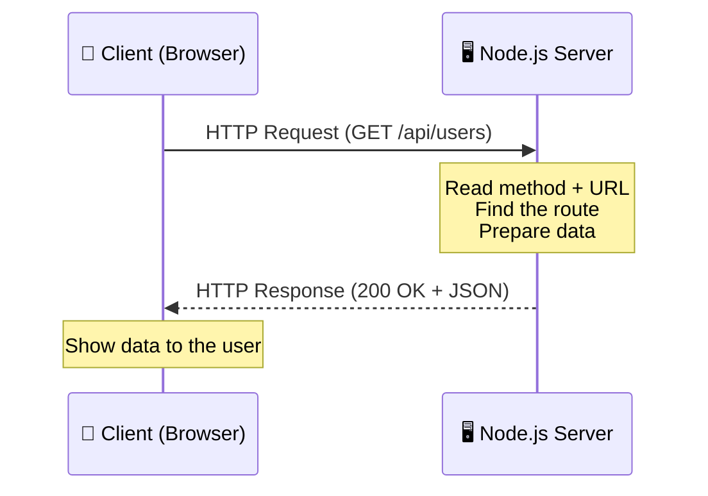
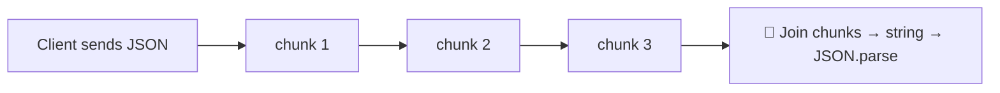
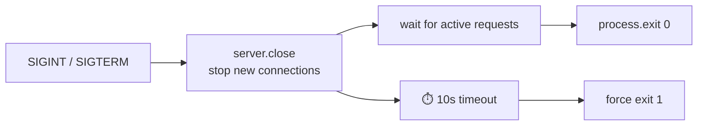

<div align="center">

# 🌐 Day 9 — Creating HTTP Servers with Node.js

### *Build a real web server with ZERO frameworks. Understand what Express hides from you.*


**20 Days • 20 Concepts — Node.js & Express.js Learning Series**

</div>

---

## 🗺️ How to Use This Material

This is a **workbook**. Every concept follows this loop:

```text
📖 Read  →  🧪 Type it yourself  →  💥 Break it on purpose  →  ✅ Check the answer
```

| Icon | Meaning |
|---|---|
| 💡 | Key idea, remember this |
| 🧪 | Hands-on lab |
| 🎯 | Task, solve it without copy-pasting |
| 🤔 | Think question, answer before opening the hint |
| ⚠️ | Common trap |
| 🚨 | Security warning |
| 🏆 | Challenge |

> 💡 **Setup for today:** Keep **two terminals** open. Terminal 1 runs your server. Terminal 2 sends requests with `curl`. Also keep your browser handy.

---

## 📑 Table of Contents

1. [What You Will Learn](#-1-what-you-will-learn)
2. [What Is HTTP?](#-2-what-is-http)
3. [Anatomy of a Request & Response](#-3-anatomy-of-a-request--response)
4. [Lab 1 — Your First HTTP Server](#-4-lab-1--your-first-http-server)
5. [Understanding `req` and `res`](#-5-understanding-req-and-res)
6. [Lab 2 — Spy on Incoming Requests](#-6-lab-2--spy-on-incoming-requests)
7. [HTTP Methods](#-7-http-methods)
8. [HTTP Status Codes](#-8-http-status-codes)
9. [Lab 3 — Routing Without Express](#-9-lab-3--routing-without-express)
10. [Sending JSON Properly](#-10-sending-json-properly)
11. [Lab 4 — Build a `sendJson` Helper](#-11-lab-4--build-a-sendjson-helper)
12. [404 vs 405 — Handling Wrong Requests](#-12-404-vs-405--handling-wrong-requests)
13. [Query Parameters](#-13-query-parameters)
14. [Lab 5 — Products API with Query Validation](#-14-lab-5--products-api-with-query-validation)
15. [Reading a POST Body](#-15-reading-a-post-body)
16. [Lab 6 — Create Users with POST](#-16-lab-6--create-users-with-post)
17. [Route Parameters the Manual Way](#-17-route-parameters-the-manual-way)
18. [Serving HTML](#-18-serving-html)
19. [Error Handling That Doesn't Crash Your Server](#-19-error-handling-that-doesnt-crash-your-server)
20. [Lab 7 — Config & Graceful Shutdown](#-20-lab-7--config--graceful-shutdown)
21. [Organizing the Project](#-21-organizing-the-project)
22. [Lab 8 — Automated Tests for Your Server](#-22-lab-8--automated-tests-for-your-server)
23. [Testing with curl, Browser & Postman](#-23-testing-with-curl-browser--postman)
24. [Node HTTP vs Express (Preview)](#-24-node-http-vs-express-preview)
25. [Production Mindset](#-25-production-mindset)
26. [🕵️ Spot the Mistakes (Code Review)](#-26-spot-the-mistakes-code-review)
27. [Debugging Challenges](#-27-debugging-challenges)
28. [Quiz Time](#-28-quiz-time)
29. [Mini Project — Student API](#-29-mini-project--student-api-capstone)
30. [Interview Questions](#-30-interview-questions)
31. [Cheat Sheet](#-31-cheat-sheet)
32. [Glossary](#-32-glossary)
33. [Progress Tracker](#-33-progress-tracker)
34. [Day 10 Preview](#-34-day-10-preview)

---

## 🎯 1. What You Will Learn

By the end of today you will be able to:

- ✅ Explain HTTP and the request-response cycle
- ✅ Read a raw HTTP request and response
- ✅ Create a server with `node:http`
- ✅ Use `req` and `res` confidently
- ✅ Build routes using only `req.method` and `req.url`
- ✅ Send JSON with correct headers and status codes
- ✅ Read query parameters and validate them
- ✅ Read and validate a POST JSON body safely
- ✅ Return correct `404`, `405`, `400`, `500` responses
- ✅ Shut a server down gracefully
- ✅ Test your API with curl and automated tests
- ✅ Understand exactly what Express does for you

---

## 🧠 2. What Is HTTP?

**HTTP = HyperText Transfer Protocol.** It is the set of rules that browsers, mobile apps and servers use to talk to each other.

### 🍽️ Restaurant analogy

| Restaurant | Web |
|---|---|
| 🧑 Customer | Client (browser / app / Postman) |
| 📝 Order | HTTP **request** |
| 🧑‍🍳 Kitchen | Your Node.js **server** |
| 🍛 Food delivered | HTTP **response** |
| ✅ "Order ready" / ❌ "Item not available" | **Status code** |
| 📍 Table number | **Port** |



### 🏠 Address analogy

```text
   http://localhost:3000/api/users?limit=5
   └─┬─┘  └───┬───┘ └─┬┘└───┬───┘└──┬───┘
  protocol  host   port  path   query string
```

| Part | Meaning |
|---|---|
| `http` | The protocol |
| `localhost` | "This computer" |
| `3000` | The port (which door of the computer) |
| `/api/users` | The path (which resource) |
| `?limit=5` | The query string (extra options) |

### 🤔 Think

*Your friend opens `http://localhost:3000` on **their** laptop while your server is running on **yours**. Will it work? Why or why not?*

<details>
<summary>💡 Answer</summary>

No. `localhost` always means **the computer you are on**. Their `localhost` is their own laptop. They would need your machine's network address (and your firewall/network must allow it).

</details>

---

## 🔬 3. Anatomy of a Request & Response

HTTP messages are just **plain text** with a fixed structure.

### 📤 A request

```text
GET /api/users?limit=5 HTTP/1.1          ← request line (method, path, version)
Host: localhost:3000                      ← headers
User-Agent: curl/8.4.0
Accept: */*
                                          ← blank line
(body goes here, if any)
```

### 📥 A response

```text
HTTP/1.1 200 OK                           ← status line
Content-Type: application/json; charset=utf-8   ← headers
Content-Length: 58
                                          ← blank line
[{"id":1,"name":"Arun"},{"id":2,"name":"Priya"}]   ← body
```

| Part | Request | Response |
|---|---|---|
| First line | Method + path | Status code + message |
| Headers | Info about the client/body | Info about the response/body |
| Body | Optional (POST/PUT/PATCH) | Usually data (JSON/HTML) |

> 💡 You can see these real messages with `curl -v http://localhost:3000` later today.

---

## 🧪 4. Lab 1 — Your First HTTP Server

### Step 1 — Setup

```bash
mkdir day-09-http-server
cd day-09-http-server
npm init -y
```

Open `package.json` and add:

```json
{
  "type": "module",
  "scripts": {
    "dev": "node --watch server.js",
    "start": "node server.js"
  }
}
```

> 💡 We use **ES Modules** (`import`) like earlier days. If you prefer CommonJS, use `const http = require("node:http");` and remove `"type": "module"`.

### Step 2 — Create `server.js`

```js
import http from "node:http";

const server = http.createServer((req, res) => {
  res.statusCode = 200;
  res.setHeader("Content-Type", "text/plain; charset=utf-8");
  res.end("Hello from Node.js HTTP Server!");
});

const PORT = 3000;

server.listen(PORT, () => {
  console.log(`Server running at http://localhost:${PORT}`);
});
```

### Step 3 — Run

```bash
npm run dev
```

Open `http://localhost:3000`. You should see:

```text
Hello from Node.js HTTP Server!
```

🎉 You just built a web server!

### 🔍 Line by line

| Code | What it does |
|---|---|
| `import http from "node:http"` | Load the **built-in** HTTP module (no `npm install` needed) |
| `http.createServer(callback)` | Create a server. The callback runs **for every request** |
| `req` | Incoming request (what the client sent) |
| `res` | Outgoing response (what you send back) |
| `res.statusCode = 200` | Set the status code |
| `res.setHeader(...)` | Set a response header |
| `res.end("...")` | Send the body and **finish** the response |
| `server.listen(PORT, cb)` | Start accepting connections on that port |

### 💥 Break it on purpose

| # | Experiment | What you'll learn |
|---|---|---|
| 1 | Remove `res.end(...)` and reload the browser | The page **hangs forever**. The client waits for a finished response |
| 2 | Change `Content-Type` to `text/html` and send `<h1>Hello</h1>` | Browser renders HTML instead of plain text |
| 3 | Visit `http://localhost:3000/anything/you/want` | **Same** response. We never check the URL yet! |
| 4 | Start a **second** terminal and run `node server.js` again | `EADDRINUSE: address already in use :::3000` |
| 5 | Change `res.end("Hello")` to `res.end({ a: 1 })` | `TypeError [ERR_INVALID_ARG_TYPE]`. `res.end` needs a string or Buffer |

### 🎯 Task 1

1. Change the port to `4000` and confirm it works
2. Respond with a different message
3. Print the **time** the server started in the console

<details>
<summary>⚠️ Browser shows "This site can't be reached"?</summary>

Check that the server is actually running (terminal shows the log), the port in the URL matches the code, and you typed `http://` (not `https://`).

</details>

---

## 📦 5. Understanding `req` and `res`

> 💡 **`req` = what the client sends. `res` = what you send back.**

### `req` (IncomingMessage), the most used parts

| Property | Meaning | Example |
|---|---|---|
| `req.method` | HTTP method | `"GET"` |
| `req.url` | Path **and** query string | `"/api/users?limit=5"` |
| `req.headers` | Headers (names are **lowercase**) | `req.headers["content-type"]` |
| the stream itself | The request body arrives in chunks | `for await (const chunk of req)` |

### `res` (ServerResponse), the most used parts

| Method / Property | Meaning |
|---|---|
| `res.statusCode = 201` | Set the status code |
| `res.setHeader(name, value)` | Set one header |
| `res.writeHead(status, headers)` | Set status + several headers at once |
| `res.write(chunk)` | Send part of the body (streaming) |
| `res.end(data)` | Send the last part and **finish** |
| `res.headersSent` | `true` once headers were already sent |

### ⚠️ The golden rules of `res`

1. **Every request must end with `res.end()`**, or the client hangs.
2. **Headers must be set before the body.** After `res.end()` (or `write()`) you can't change them.
3. **Call `res.end()` only once per request.**

### 🤔 Think

*Why must we set headers before calling `res.end()`?*

<details>
<summary>💡 Answer</summary>

In HTTP, headers are sent **first**, then the body. Once Node starts sending the body, the headers are already on their way to the client. Changing them is impossible, so Node throws `ERR_HTTP_HEADERS_SENT`.

</details>

---

## 🧪 6. Lab 2 — Spy on Incoming Requests

Replace the handler in `server.js`:

```js
import http from "node:http";

const server = http.createServer((req, res) => {
  console.log("-------------------------");
  console.log("Method :", req.method);
  console.log("URL    :", req.url);
  console.log("Host   :", req.headers.host);
  console.log("Agent  :", req.headers["user-agent"]);

  res.setHeader("Content-Type", "text/plain; charset=utf-8");
  res.end(`You sent a ${req.method} request to ${req.url}`);
});

server.listen(3000, () => console.log("Spy server on http://localhost:3000"));
```

### 🧪 Experiments

Open each URL in the browser and watch **Terminal 1**:

| Visit | Observe |
|---|---|
| `http://localhost:3000/` | method `GET`, url `/` |
| `http://localhost:3000/hello` | url `/hello` |
| `http://localhost:3000/search?q=node&page=2` | `req.url` contains the **query string too** |

### 🤯 Surprise!

You'll notice **extra requests** to `/favicon.ico`. Browsers automatically ask for the tab icon. This is normal, and it proves your server really handles *every* request.

Now use curl from **Terminal 2**:

```bash
curl http://localhost:3000/test
curl -X POST http://localhost:3000/test
curl -H "X-Custom: hello" http://localhost:3000/test
```

### 🎯 Task 2

1. Print **all** headers (`console.log(req.headers)`) for a browser request and a curl request. What differences do you see?
2. Print `req.headers["x-custom"]` after sending the custom header with curl
3. What is `req.method` for each of the three curl commands above?

<details>
<summary>✅ Observations</summary>

Browsers send many headers (`accept`, `accept-language`, `cookie`, `user-agent`, ...). curl sends very few. Header names always arrive **lowercase**, so `X-Custom` becomes `x-custom`. The three methods are `GET`, `POST`, `GET`.

</details>

---

## 🔀 7. HTTP Methods

Methods say **what action** the client wants.

| Method | Purpose | Example | Has body? |
|---|---|---|---|
| `GET` | Read data | Get all users | No |
| `POST` | Create / submit data | Create a user | Yes |
| `PUT` | **Replace** a resource | Replace whole user | Yes |
| `PATCH` | **Partially** update | Change only the name | Yes |
| `DELETE` | Remove | Delete a user | Usually no |

### 💡 CRUD mapping

```text
Create → POST
Read   → GET
Update → PUT / PATCH
Delete → DELETE
```

### Safe & idempotent (interview favorite 🎤)

| Method | Safe (doesn't change data)? | Idempotent (repeating = same result)? |
|---|---|---|
| `GET` | ✅ Yes | ✅ Yes |
| `PUT` | ❌ No | ✅ Yes |
| `DELETE` | ❌ No | ✅ Yes |
| `POST` | ❌ No | ❌ **No** (two POSTs can create two users) |

> ⚠️ **Never use GET to change data.** Browsers, crawlers and caches may call GET URLs automatically.

### Other methods you'll meet

| Method | Used for |
|---|---|
| `HEAD` | Like GET but **no body** (just headers) |
| `OPTIONS` | Asks what's allowed (important for CORS) |

---

## 🚦 8. HTTP Status Codes

Status codes tell the client **what happened**.


| Code | Name | When to use |
|---|---|---|
| `200` | OK | Successful GET / update |
| `201` | Created | A new resource was created (POST) |
| `204` | No Content | Success, **no body** (often DELETE) |
| `400` | Bad Request | Invalid input / malformed JSON |
| `401` | Unauthorized | Not logged in / invalid credentials |
| `403` | Forbidden | Logged in, but not allowed |
| `404` | Not Found | Unknown route or resource |
| `405` | Method Not Allowed | Route exists, but not for this method |
| `413` | Payload Too Large | Request body is too big |
| `415` | Unsupported Media Type | Wrong `Content-Type` |
| `500` | Internal Server Error | Unexpected bug on the server |

> 💡 **Mental shortcut:** `4xx` = **the client** made a mistake. `5xx` = **the server** made a mistake.

### 🎯 Task 3 — Pick the right code

| Situation | Status code? |
|---|---|
| User fetched the list of products | ? |
| New student was added successfully | ? |
| Client sent `{"name":` (broken JSON) | ? |
| Visited `/api/unicorns` (no such route) | ? |
| Sent `DELETE /api/health` (health only allows GET) | ? |
| Your code threw an unexpected error | ? |
| Student deleted, nothing to return | ? |
| Client sent a 50 MB body to a tiny API | ? |

<details>
<summary>✅ Answers</summary>

`200`, `201`, `400`, `404`, `405`, `500`, `204`, `413`.

</details>

### ⚠️ Anti-pattern

```js
// ❌ BAD: success status for an error
res.statusCode = 200;
res.end(JSON.stringify({ error: "User not found" }));
```

Clients (and monitoring tools) rely on the **status code**, not on your message text. Return `404` here.

---

## 🧪 9. Lab 3 — Routing Without Express

A **route** = **method + path** → a handler. Node has no router built in, so we use `if` statements.

```js
import http from "node:http";

const server = http.createServer((req, res) => {
  const url = new URL(req.url, "http://localhost");
  const { pathname } = url;

  res.setHeader("Content-Type", "application/json; charset=utf-8");

  if (req.method === "GET" && pathname === "/") {
    res.statusCode = 200;
    return res.end(JSON.stringify({ message: "Welcome to the Node.js API" }));
  }

  if (req.method === "GET" && pathname === "/api/health") {
    res.statusCode = 200;
    return res.end(JSON.stringify({ status: "ok" }));
  }

  if (req.method === "GET" && pathname === "/api/users") {
    res.statusCode = 200;
    return res.end(
      JSON.stringify([
        { id: 1, name: "Arun" },
        { id: 2, name: "Priya" }
      ])
    );
  }

  res.statusCode = 404;
  res.end(JSON.stringify({ error: "Route not found" }));
});

server.listen(3000, () => console.log("API on http://localhost:3000"));
```

### 🔍 Why `new URL(req.url, "http://localhost")`?

`req.url` = `"/api/users?page=2"`. It mixes path and query. The `URL` class splits them cleanly:

```js
const url = new URL("/api/users?page=2&limit=10", "http://localhost");

url.pathname;                    // "/api/users"
url.search;                      // "?page=2&limit=10"
url.searchParams.get("page");    // "2"
```

Without it, `req.url === "/api/users"` **fails** whenever a query string exists.

### ⚠️ Why `return`?

```js
// ❌ Without return, the code continues and tries to respond AGAIN
if (pathname === "/") {
  res.end("home");
}
res.end("not found");   // 💥 ERR_HTTP_HEADERS_SENT / write after end
```

Always `return res.end(...)` so the handler stops.

### 🧪 Test all four

```bash
curl -i http://localhost:3000/
curl -i http://localhost:3000/api/health
curl -i http://localhost:3000/api/users
curl -i http://localhost:3000/unknown
```

### 🎯 Task 4

Add these routes:

1. `GET /api/about` → returns your name and today's topic
2. `GET /api/time` → returns the current server time (`new Date().toISOString()`)
3. `GET /api/users` with a **trailing slash** (`/api/users/`). Does it work? Why or why not?

<details>
<summary>💡 Answer to #3</summary>

It returns `404`, because `"/api/users/"` is not exactly `"/api/users"`. Express handles this more gently. With raw Node you decide the rule yourself (for example, strip a trailing slash before matching).

</details>

---

## 📨 10. Sending JSON Properly

Three things make a correct JSON response:

```js
res.statusCode = 200;                                              // 1. status
res.setHeader("Content-Type", "application/json; charset=utf-8");  // 2. header
res.end(JSON.stringify({ message: "Hello" }));                     // 3. serialized body
```

| ❌ Wrong | ✅ Right |
|---|---|
| `res.end({ message: "Hello" })` | `res.end(JSON.stringify({ message: "Hello" }))` |
| No `Content-Type` header | `Content-Type: application/json; charset=utf-8` |
| `200` for everything | Correct status for each outcome |

> 💡 JavaScript objects live in memory. HTTP only carries **text/bytes**. `JSON.stringify` converts the object into text.

### Consistent response shape

Pick one style and stick to it:

```json
// success
{ "success": true, "data": { "id": 1, "name": "Arun" } }

// error
{ "success": false, "error": "Student not found" }
```

---

## 🧪 11. Lab 4 — Build a `sendJson` Helper

Repeating three lines everywhere is boring and error-prone. Make a helper:

```js
function sendJson(res, statusCode, data) {
  const body = JSON.stringify(data);

  res.writeHead(statusCode, {
    "Content-Type": "application/json; charset=utf-8",
    "Content-Length": Buffer.byteLength(body)
  });

  res.end(body);
}
```

Use it:

```js
if (req.method === "GET" && pathname === "/api/health") {
  return sendJson(res, 200, { status: "ok" });
}

return sendJson(res, 404, { error: "Route not found" });
```

### 🔍 What's new?

| Piece | Why |
|---|---|
| `res.writeHead(status, headers)` | Sets status + headers in one call |
| `Buffer.byteLength(body)` | `Content-Length` counts **bytes**, not characters. This matters for non-English text (e.g. Tamil or emoji) |

### 🧪 Try it with Unicode

```js
return sendJson(res, 200, { greeting: "வணக்கம் 👋" });
```

Check with `curl -i` that `Content-Length` is **larger than** the number of visible characters.

### 🎯 Task 5

Create a second helper `sendText(res, statusCode, text)` for plain-text responses, and a third helper `sendNoContent(res)` that responds with `204` and **no body**.

<details>
<summary>✅ Solution</summary>

```js
function sendText(res, statusCode, text) {
  res.writeHead(statusCode, {
    "Content-Type": "text/plain; charset=utf-8",
    "Content-Length": Buffer.byteLength(text)
  });
  res.end(text);
}

function sendNoContent(res) {
  res.writeHead(204);
  res.end();
}
```

</details>

---

## 🚫 12. 404 vs 405 — Handling Wrong Requests

| Situation | Code | Meaning |
|---|---|---|
| `GET /api/unicorns` | `404` | That route doesn't exist |
| `POST /api/health` (only GET is supported) | `405` | The route exists, but **not for this method** |

For `405`, the HTTP rules say you should also send an **`Allow`** header listing supported methods:

```js
function methodNotAllowed(res, allowedMethods) {
  res.setHeader("Allow", allowedMethods.join(", "));
  sendJson(res, 405, {
    error: `Method not allowed. Use: ${allowedMethods.join(", ")}`
  });
}
```

### Routing style that supports 405

Match the **path first**, then the method:

```js
if (pathname === "/api/health") {
  if (req.method !== "GET") return methodNotAllowed(res, ["GET"]);
  return sendJson(res, 200, { status: "ok" });
}

if (pathname === "/api/users") {
  if (req.method === "GET") return sendJson(res, 200, users);
  if (req.method === "POST") return createUser(req, res);
  return methodNotAllowed(res, ["GET", "POST"]);
}

return sendJson(res, 404, { error: "Route not found" });
```

### 🧪 Test it

```bash
curl -i -X POST http://localhost:3000/api/health
```

You should see `405 Method Not Allowed` and an `Allow: GET` header.

### 🎯 Task 6

Make `/api/users` accept `GET` and `POST`, and make `/api/health` accept `GET` only. Verify with curl that `DELETE /api/users` returns `405` with `Allow: GET, POST`.

---

## 🔎 13. Query Parameters

Query parameters send **optional filters** in the URL:

```text
/api/products?category=mobile&limit=5&sort=price
                └────┬─────┘ └──┬──┘ └───┬───┘
                  key=value   key=value  key=value
```

Used for **searching, filtering, sorting and pagination**.

```js
const url = new URL(req.url, "http://localhost");

const category = url.searchParams.get("category"); // "mobile" or null
const limit = url.searchParams.get("limit");       // "5" (a STRING!) or null
```

### ⚠️ Rules

1. A missing parameter gives `null` (not `undefined`)
2. Values are **always strings**
3. **Never trust them.** Validate!

### Safe `limit` parsing

```js
const rawLimit = url.searchParams.get("limit");
const limit = rawLimit === null ? 10 : Number(rawLimit);

if (!Number.isInteger(limit) || limit < 1 || limit > 100) {
  return sendJson(res, 400, { error: "limit must be an integer between 1 and 100" });
}
```

### 🧪 What these inputs do

| URL | `rawLimit` | Result |
|---|---|---|
| `/api/products` | `null` | uses default `10` ✅ |
| `?limit=5` | `"5"` | `5` ✅ |
| `?limit=abc` | `"abc"` | `NaN` → `400` ✅ |
| `?limit=` | `""` | `Number("")` is `0` → fails `< 1` → `400` ✅ |
| `?limit=1.5` | `"1.5"` | not an integer → `400` ✅ |
| `?limit=9999` | `"9999"` | too large → `400` ✅ |

### Repeated keys

```js
// /api/products?tag=a&tag=b
url.searchParams.get("tag");     // "a" (first only)
url.searchParams.getAll("tag");  // ["a", "b"]
```

---

## 🧪 14. Lab 5 — Products API with Query Validation

Add this data and route:

```js
const products = [
  { id: 1, name: "Phone X", category: "mobile", price: 15000 },
  { id: 2, name: "Phone Y", category: "mobile", price: 22000 },
  { id: 3, name: "Laptop A", category: "laptop", price: 55000 },
  { id: 4, name: "Laptop B", category: "laptop", price: 72000 },
  { id: 5, name: "Earbuds Z", category: "audio", price: 3000 }
];
```

```js
if (pathname === "/api/products") {
  if (req.method !== "GET") return methodNotAllowed(res, ["GET"]);

  const category = url.searchParams.get("category");
  const rawLimit = url.searchParams.get("limit");
  const limit = rawLimit === null ? 10 : Number(rawLimit);

  if (!Number.isInteger(limit) || limit < 1 || limit > 100) {
    return sendJson(res, 400, { error: "limit must be an integer between 1 and 100" });
  }

  let result = products;

  if (category !== null) {
    result = result.filter((p) => p.category === category);
  }

  return sendJson(res, 200, { count: result.length, data: result.slice(0, limit) });
}
```

### 🧪 Test it

```bash
curl "http://localhost:3000/api/products"
curl "http://localhost:3000/api/products?category=mobile"
curl "http://localhost:3000/api/products?limit=2"
curl "http://localhost:3000/api/products?category=laptop&limit=1"
curl -i "http://localhost:3000/api/products?limit=abc"
```

> 🪟 **Windows tip:** In PowerShell use `curl.exe` (plain `curl` is an alias for another command), and keep URLs in quotes.

### 🎯 Task 7

Add three more features:

1. `?search=phone` → case-insensitive name search
2. `?minPrice=10000&maxPrice=60000` → price range (validate both are numbers!)
3. `?sort=price` or `?sort=-price` (descending). Reject any other value with `400`

<details>
<summary>✅ Hint for sort</summary>

```js
const sort = url.searchParams.get("sort");
const allowedSorts = ["price", "-price"];

if (sort !== null && !allowedSorts.includes(sort)) {
  return sendJson(res, 400, { error: "sort must be price or -price" });
}

if (sort === "price") result = [...result].sort((a, b) => a.price - b.price);
if (sort === "-price") result = [...result].sort((a, b) => b.price - a.price);
```

Note `[...result]` copies the array first so we don't reorder the original data.

</details>

---

## 📥 15. Reading a POST Body

When a client sends data with `POST`, the body doesn't arrive in one piece. It arrives as **chunks** (a stream, remember Day 5!).



> 💡 Node's built-in HTTP module does **not** parse JSON bodies automatically. Express does that for you with middleware (Day 12). Today we do it ourselves.

### The helper

```js
async function readJsonBody(req, maxBytes = 1024 * 1024) {
  const contentType = req.headers["content-type"] ?? "";

  if (!contentType.includes("application/json")) {
    const error = new Error("Content-Type must be application/json");
    error.statusCode = 415;
    throw error;
  }

  const declaredLength = Number(req.headers["content-length"] ?? 0);

  if (declaredLength > maxBytes) {
    const error = new Error("Request body too large");
    error.statusCode = 413;
    throw error;
  }

  const chunks = [];
  let totalBytes = 0;

  for await (const chunk of req) {
    totalBytes += chunk.length;

    if (totalBytes > maxBytes) {
      const error = new Error("Request body too large");
      error.statusCode = 413;
      throw error;
    }

    chunks.push(chunk);
  }

  const rawBody = Buffer.concat(chunks).toString("utf8");

  try {
    return JSON.parse(rawBody);
  } catch {
    const error = new Error("Invalid JSON");
    error.statusCode = 400;
    throw error;
  }
}
```

### 🔍 What each part protects against

| Step | Protects against |
|---|---|
| Check `Content-Type` | Clients sending the wrong format (`415`) |
| Check `Content-Length` first | Rejecting a huge body **before** reading it (`413`) |
| Count bytes while reading | Clients that lie about or omit the length |
| `Buffer.concat` then `toString` | Multi-byte characters split across chunks |
| `try/catch` around `JSON.parse` | Malformed JSON crashing your handler (`400`) |

### ⚠️ Why Buffer.concat? Why not `body += chunk`?

A single character like `ந` takes several bytes. A chunk boundary can cut it in half. Joining the **raw buffers first** and decoding **once** avoids corrupt characters.

### 🚨 Why limit body size?

Without a limit, one client can send gigabytes and **eat all your server's memory** (a denial-of-service risk).

> 📝 **Honest note:** If a client keeps sending data after you reject it with `413`, some clients may see a connection reset instead of the `413` message. Real production servers (and frameworks) handle this edge case with extra care. The pre-check with `Content-Length` covers the common case.

### Don't forget `async`

Because the helper uses `await`, the handler that calls it must be `async`:

```js
const server = http.createServer(async (req, res) => {
  // ...
});
```

---

## 🧪 16. Lab 6 — Create Users with POST

Add an in-memory store and a POST route:

```js
const users = [
  { id: 1, name: "Arun" },
  { id: 2, name: "Priya" }
];
let nextId = 3;
```

```js
if (pathname === "/api/users") {
  if (req.method === "GET") return sendJson(res, 200, users);

  if (req.method === "POST") {
    const body = await readJsonBody(req);

    if (typeof body?.name !== "string" || body.name.trim() === "") {
      return sendJson(res, 400, { error: "name is required" });
    }

    const user = { id: nextId++, name: body.name.trim() };
    users.push(user);

    return sendJson(res, 201, { message: "User created", user });
  }

  return methodNotAllowed(res, ["GET", "POST"]);
}
```

Wrap the **whole handler** in `try/catch` (see [Section 19](#-19-error-handling-that-doesnt-crash-your-server)) so errors thrown by `readJsonBody` become proper responses.

### 🧪 Test cases

```bash
# ✅ Success → 201
curl -i -X POST http://localhost:3000/api/users \
  -H "Content-Type: application/json" \
  -d '{"name":"Karthik"}'

# ❌ Missing name → 400
curl -i -X POST http://localhost:3000/api/users \
  -H "Content-Type: application/json" \
  -d '{}'

# ❌ Broken JSON → 400
curl -i -X POST http://localhost:3000/api/users \
  -H "Content-Type: application/json" \
  -d '{"name":'

# ❌ Wrong content type → 415
curl -i -X POST http://localhost:3000/api/users \
  -H "Content-Type: text/plain" \
  -d 'name=Karthik'

# ✅ Verify the user was added
curl http://localhost:3000/api/users
```

> 🪟 **Windows quoting:** In **CMD** use `-d "{\"name\":\"Karthik\"}"`. In **PowerShell** it's easiest to use `curl.exe` with a here-string or a JSON file: `-d "@body.json"`. Or just use Postman.

### 💥 Think about restarts

Stop and restart the server, then call `GET /api/users`. Is Karthik still there?

<details>
<summary>💡 Answer</summary>

No. Data in a JavaScript array lives in **memory** and disappears when the process stops. Real apps use a database (you'll do that on Day 19).

</details>

### 🎯 Task 8

Extend the POST route:

1. Also accept `email` (must contain `@`)
2. Reject duplicate emails with `409 Conflict`
3. Reject a `name` longer than 50 characters

---

## 🧭 17. Route Parameters the Manual Way

So far we used `/api/students?id=1`. Real APIs usually use **path parameters**: `/api/students/1`.

Without Express, extract them yourself:

```js
const match = pathname.match(/^\/api\/users\/(\d+)$/);

if (match) {
  const id = Number(match[1]);
  const user = users.find((u) => u.id === id);

  if (req.method === "GET") {
    if (!user) return sendJson(res, 404, { error: "User not found" });
    return sendJson(res, 200, user);
  }

  if (req.method === "DELETE") {
    if (!user) return sendJson(res, 404, { error: "User not found" });
    users.splice(users.indexOf(user), 1);
    return sendNoContent(res);
  }

  return methodNotAllowed(res, ["GET", "DELETE"]);
}
```

### 🔍 The regex explained

```text
/^\/api\/users\/(\d+)$/
 │ │            │    │
 │ │            │    └─ end of string
 │ │            └────── capture one or more digits → match[1]
 │ └─────────────────── literal /api/users/
 └───────────────────── start of string
```

### ⚠️ The type trap

```js
const id = match[1];                 // "1"  (string)
users.find((u) => u.id === id);      // ❌ never matches: 1 === "1" is false
users.find((u) => u.id === Number(id));  // ✅
```

### 🤔 Think

*What would `/api/users/abc` return with this code? `/api/users/1/extra`?*

<details>
<summary>💡 Answer</summary>

Both return `404 Route not found`, because the regex only matches digits and exactly one segment. This is how raw routing becomes **messy** as routes grow, which is exactly why Express (Day 11) lets you write `/api/users/:id` instead.

</details>

### 🎯 Task 9

Add `GET /api/users/:id` and `DELETE /api/users/:id` to your server. Test: existing id, missing id, non-numeric id, and `DELETE` twice on the same id (first `204`, second `404`).

---

## 🖼️ 18. Serving HTML

A server can send **HTML** just as easily as JSON. The only difference is the `Content-Type`.

```js
if (req.method === "GET" && pathname === "/welcome") {
  const html = `<!DOCTYPE html>
<html>
  <head><meta charset="utf-8"><title>Welcome</title></head>
  <body>
    <h1>Welcome to my Node.js server 🚀</h1>
    <p>The time is ${new Date().toLocaleTimeString()}</p>
  </body>
</html>`;

  res.writeHead(200, {
    "Content-Type": "text/html; charset=utf-8",
    "Content-Length": Buffer.byteLength(html)
  });

  return res.end(html);
}
```

### Common content types

| Content-Type | Used for |
|---|---|
| `text/plain` | Plain text |
| `text/html` | HTML pages |
| `application/json` | JSON APIs |
| `text/css` | CSS files |
| `application/javascript` | JS files |
| `image/png` | PNG images |

### 🚨 Security warning

If you put **user input** into HTML without escaping it, attackers can inject scripts (XSS). Never do this:

```js
// ❌ DANGEROUS if "name" comes from the user
const html = `<h1>Hello ${url.searchParams.get("name")}</h1>`;
```

You'll learn proper protection on Day 18. For now, only insert trusted values into HTML.

### 🎯 Task 10

Create `GET /about` that returns a small HTML page with your name, a heading, and a list of three things you learned this week.

---

## 🛡️ 19. Error Handling That Doesn't Crash Your Server

An error thrown **inside an async handler** that nobody catches can crash your process or leave the client hanging.

### ✅ Wrap the whole handler

```js
const server = http.createServer(async (req, res) => {
  try {
    await handleRequest(req, res);
  } catch (error) {
    handleError(error, req, res);
  }
});

function handleError(error, req, res) {
  const statusCode = error.statusCode ?? 500;

  if (statusCode === 500) {
    console.error("Unexpected error:", error);   // log details on the SERVER only
  }

  if (res.headersSent) {
    return res.destroy();   // too late to send a clean error response
  }

  sendJson(res, statusCode, {
    error: statusCode === 500 ? "Internal server error" : error.message
  });
}
```

### 🔍 Key ideas

| Idea | Why |
|---|---|
| Errors with `statusCode` are **expected** (400, 413, 415) | Safe to show their message |
| Anything else is a **bug** → `500` | Show a **generic** message to the client |
| Log the real error on the server | So **you** can debug |
| Check `res.headersSent` | You can't send a second response |

### 🚨 Never leak internals

```js
// ❌ BAD: exposes stack traces, file paths, library details
sendJson(res, 500, { error: error.stack });

// ✅ GOOD
sendJson(res, 500, { error: "Internal server error" });
```

### 🧪 Try it: force a 500

Add this route and call it:

```js
if (pathname === "/api/crash") {
  throw new Error("Boom! Simulated bug");
}
```

```bash
curl -i http://localhost:3000/api/crash
```

Expected: `500` with a generic message, while the **terminal** shows the real error. The server keeps running. ✅

### Server-level error event

```js
server.on("error", (error) => {
  console.error("Server error:", error);
  process.exitCode = 1;
});
```

This catches problems like `EADDRINUSE` while starting up.

### 🎯 Task 11

1. Remove the `try/catch` and call `/api/crash`. What happens to the request? To the server?
2. Add a route that sends **invalid JSON in a POST** and confirm a clean `400`

<details>
<summary>💡 Observation</summary>

Without the catch, the rejected promise is unhandled. Depending on your Node version/settings it can terminate the process, and the client's request is left without a proper response. This is why a top-level safety net is essential.

</details>

---

## 🧪 20. Lab 7 — Config & Graceful Shutdown

### Part A — Read the port from the environment

```js
const rawPort = process.env.PORT ?? "3000";
const PORT = Number(rawPort);

if (!Number.isInteger(PORT) || PORT < 1 || PORT > 65535) {
  throw new Error(`Invalid PORT "${rawPort}"`);
}
```

Run with a different port:

```bash
PORT=4000 node server.js          # macOS / Linux
$env:PORT="4000"; node server.js  # PowerShell
```

> 💡 In a bigger project, use the validated `config/env.js` module from **Day 8**.

### Part B — Graceful shutdown

When you press `Ctrl+C` or a deployment platform stops your app, you want to:

1. **Stop accepting** new connections
2. **Finish** requests already in progress
3. **Then** exit

```js
function shutdown(signal) {
  console.log(`\n${signal} received. Closing server...`);

  server.close((error) => {
    if (error) {
      console.error("Error while closing:", error);
      process.exit(1);
    }
    console.log("Server closed cleanly. Bye 👋");
    process.exit(0);
  });

  server.closeIdleConnections();   // drop idle keep-alive connections (Node 18.2+)

  // Safety net: force exit if something hangs
  setTimeout(() => {
    console.error("Forced shutdown after timeout");
    process.exit(1);
  }, 10_000).unref();
}

process.on("SIGINT", () => shutdown("SIGINT"));    // Ctrl+C
process.on("SIGTERM", () => shutdown("SIGTERM"));  // sent by platforms/Docker
```



### 🧪 Test it

1. Start the server
2. Press `Ctrl+C`
3. You should see the "Closing server" and "Server closed cleanly" logs

### 💡 Extra: server timeouts (good to know)

```js
server.requestTimeout = 30_000;   // time allowed to receive the full request
server.headersTimeout = 10_000;   // time allowed to receive headers
server.keepAliveTimeout = 5_000;  // idle keep-alive connections
```

These protect you from slow or stuck clients. Node has sensible defaults, so tune them only when you understand your traffic.

### 🎯 Task 12

Add a `GET /api/slow` route that waits 5 seconds before replying (use `setTimeout`). Start a request to it, press `Ctrl+C` **during** the wait, and observe: does the in-flight request finish? 

<details>
<summary>✅ Solution + observation</summary>

```js
if (pathname === "/api/slow") {
  await new Promise((resolve) => setTimeout(resolve, 5000));
  return sendJson(res, 200, { message: "Finally done" });
}
```

`server.close()` waits for in-flight requests, so the slow request completes before the process exits (as long as it finishes before your 10 second safety timeout).

</details>

---

## 🏗️ 21. Organizing the Project

One giant file becomes painful. Split it by responsibility:

```text
day-09-http-server/
├── src/
│   ├── app.js             ← creates the server (no listen!)
│   ├── server.js          ← starts listening + graceful shutdown
│   ├── routes.js          ← handleRequest: routing logic
│   ├── helpers.js         ← sendJson, readJsonBody, methodNotAllowed
│   └── data.js            ← in-memory data
├── tests/
│   └── api.test.js
├── .gitignore
├── package.json
└── README.md
```

### Why separate `app.js` and `server.js`?

| File | Job | Why separate |
|---|---|---|
| `app.js` | `createServer(...)` and **export** it | Tests can import it **without** opening a fixed port |
| `server.js` | `listen()`, shutdown signals | Only the real app starts listening |

### `src/app.js`

```js
import http from "node:http";
import { handleRequest } from "./routes.js";
import { handleError } from "./helpers.js";

export const server = http.createServer(async (req, res) => {
  try {
    await handleRequest(req, res);
  } catch (error) {
    handleError(error, req, res);
  }
});
```

### `src/server.js`

```js
import { server } from "./app.js";

const PORT = Number(process.env.PORT ?? 3000);

server.listen(PORT, () => {
  console.log(`API running at http://localhost:${PORT}`);
});

// + graceful shutdown code from Lab 7
```

### 🎯 Task 13

Refactor your Lab 3-6 code into this structure. Everything should still work exactly as before.

---

## 🧪 22. Lab 8 — Automated Tests for Your Server

Manual curl testing doesn't scale. Let's automate using only built-ins: `node:test` and the global `fetch` (Node 18+).

`tests/api.test.js`:

```js
import test, { before, after } from "node:test";
import assert from "node:assert";
import { server } from "../src/app.js";

let baseUrl;

before(async () => {
  await new Promise((resolve) => server.listen(0, resolve));   // port 0 = any free port
  baseUrl = `http://localhost:${server.address().port}`;
});

after(async () => {
  server.closeAllConnections();                                 // Node 18.2+
  await new Promise((resolve) => server.close(resolve));
});

test("GET /api/health returns 200 and status ok", async () => {
  const response = await fetch(`${baseUrl}/api/health`);
  const body = await response.json();

  assert.strictEqual(response.status, 200);
  assert.strictEqual(body.status, "ok");
});

test("unknown route returns 404", async () => {
  const response = await fetch(`${baseUrl}/api/nope`);
  assert.strictEqual(response.status, 404);
});

test("POST /api/health returns 405 with Allow header", async () => {
  const response = await fetch(`${baseUrl}/api/health`, { method: "POST" });

  assert.strictEqual(response.status, 405);
  assert.strictEqual(response.headers.get("allow"), "GET");
});

test("POST /api/users rejects missing name with 400", async () => {
  const response = await fetch(`${baseUrl}/api/users`, {
    method: "POST",
    headers: { "Content-Type": "application/json" },
    body: JSON.stringify({})
  });

  assert.strictEqual(response.status, 400);
});

test("POST /api/users rejects malformed JSON with 400", async () => {
  const response = await fetch(`${baseUrl}/api/users`, {
    method: "POST",
    headers: { "Content-Type": "application/json" },
    body: '{"name":'
  });

  assert.strictEqual(response.status, 400);
});

test("POST /api/users creates a user with 201", async () => {
  const response = await fetch(`${baseUrl}/api/users`, {
    method: "POST",
    headers: { "Content-Type": "application/json" },
    body: JSON.stringify({ name: "Test User" })
  });
  const body = await response.json();

  assert.strictEqual(response.status, 201);
  assert.strictEqual(body.user.name, "Test User");
});
```

Add to `package.json`:

```json
{ "scripts": { "test": "node --test" } }
```

Run:

```bash
npm test
```

### 💡 Why `listen(0)`?

Port `0` tells the OS: *"give me any free port."* Tests then never clash with your running dev server on port 3000.

### 🎯 Task 14

Write three more tests:

1. `GET /api/products?limit=abc` returns `400`
2. `GET /api/products?category=mobile` returns only mobile products
3. `POST /api/users` with `Content-Type: text/plain` returns `415`

---

## 🧰 23. Testing with curl, Browser & Postman

| Tool | Best for | Weakness |
|---|---|---|
| 🌐 **Browser** | Quick `GET` checks, HTML pages | Can't easily send POST/headers |
| ⌨️ **curl** | Any method, headers, scripting, `-v` debugging | Quoting can be tricky |
| 📮 **Postman / Thunder Client** | Saved collections, friendly UI | Manual, not automated |
| 🤖 **Automated tests** | Repeatable, runs in CI | Takes time to write |

### 🧰 curl survival kit

| Goal | Command |
|---|---|
| Simple GET | `curl http://localhost:3000/api/health` |
| Show response headers | `curl -i http://localhost:3000/api/health` |
| **Verbose** (see raw request & response) | `curl -v http://localhost:3000/api/health` |
| Headers only | `curl -I http://localhost:3000/api/health` |
| POST JSON | `curl -X POST URL -H "Content-Type: application/json" -d '{"name":"A"}'` |
| DELETE | `curl -i -X DELETE http://localhost:3000/api/users/1` |
| Custom header | `curl -H "X-Test: 1" URL` |
| Query string | `curl "http://localhost:3000/api/products?limit=2"` |
| POST from a file | `curl -X POST URL -H "Content-Type: application/json" -d @body.json` |

### 🎯 Task 15

Run `curl -v http://localhost:3000/api/health` and **label** each part of the output: request line, request headers, status line, response headers, body. Compare it with the raw HTTP in [Section 3](#-3-anatomy-of-a-request--response).

---

## ⚔️ 24. Node HTTP vs Express (Preview)

Here is the **same endpoint** in both.

### Raw Node

```js
const server = http.createServer(async (req, res) => {
  const url = new URL(req.url, "http://localhost");

  if (url.pathname === "/api/users" && req.method === "POST") {
    const body = await readJsonBody(req);          // you wrote this
    // ... validate ...
    res.writeHead(201, { "Content-Type": "application/json" });
    res.end(JSON.stringify({ user: body }));
    return;
  }

  res.writeHead(404);
  res.end();
});
```

### Express (coming on Day 10)

```js
app.use(express.json());                           // body parsing, built in

app.post("/api/users", (req, res) => {
  res.status(201).json({ user: req.body });
});
```

| Feature | Node `http` | Express |
|---|---|---|
| Routing | Manual `if` statements / regex | `app.get("/users/:id")` |
| JSON body parsing | You write it | `express.json()` |
| Send JSON | `JSON.stringify` + headers | `res.json()` |
| Status chaining | `res.statusCode = ...` | `res.status(201).json(...)` |
| Middleware | You design it | Built-in concept |
| Learning value | 🧠 Shows how HTTP really works | ⚡ Productivity |

> 💡 **Express is NOT magic.** It's `node:http` plus helpers. Today's labs mean you now understand what Express does for you.

---

## 🏭 25. Production Mindset

A server that "works on my laptop" is **not** production-ready. Checklist for the real world:

| Area | What to do |
|---|---|
| ⚙️ **Config** | Read port and settings from environment variables (Day 8) |
| ✅ **Validation** | Validate body, query and headers |
| 🚦 **Status codes** | Return accurate codes and content types |
| 📏 **Limits** | Limit body size, set timeouts |
| 🙈 **Errors** | Never leak stack traces or internals |
| 🛑 **Shutdown** | Handle `SIGTERM`/`SIGINT` gracefully |
| 🔒 **HTTPS** | Terminate TLS properly (usually via a reverse proxy) |
| 📝 **Logging** | Structured logs, request IDs, no secrets |
| 🛡️ **Security** | Authentication, authorization, rate limiting |
| 🧪 **Tests** | Test success **and** failure paths |
| 🧰 **Framework** | Use one when routing/middleware complexity grows |

---

## 🕵️ 26. Spot the Mistakes (Code Review)

Find **all 12 problems** in this code.

```js
import http from "node:http";

const users = [];

const server = http.createServer((req, res) => {
  if (req.url === "/api/users") {
    if (req.method = "GET") {
      res.end(users);
    }
  }

  if (req.url === "/api/users" && req.method === "POST") {
    let body = "";
    req.on("data", (chunk) => (body += chunk));
    req.on("end", () => {
      const user = JSON.parse(body);
      users.push(user);
      res.statusCode = 200;
      res.end("created");
    });
  }

  res.end("Not found");
});

server.listen(3000);
```

<details>
<summary>✅ The 12 problems</summary>

1. `req.url === "/api/users"` breaks as soon as a **query string** exists. Use `new URL(...).pathname`
2. `req.method = "GET"` is **assignment**, not comparison (`===`). It overwrites the method and is always truthy
3. `res.end(users)` passes an **array**. It needs a string/Buffer. Use `JSON.stringify`
4. No `Content-Type` header for JSON
5. No `return` after responding, so the code continues to the next `if` / final `res.end`
6. `res.end("Not found")` **always runs**, causing a second `res.end` / `ERR_HTTP_HEADERS_SENT` risk
7. The "not found" response has no `404` status (defaults to `200`)
8. `JSON.parse(body)` is **not in a try/catch**. Malformed JSON throws inside an event callback and can crash the process
9. **No validation** of the parsed user (could be `null`, a string, or anything)
10. **No body size limit.** A huge body can exhaust memory
11. Success returns `200` and plain text instead of `201` and JSON
12. `body += chunk` can corrupt multi-byte characters. Collect buffers and decode once. Also: no `405` handling, no `server.on("error")`, and no port validation (bonus problems!)

</details>

---

## 🐞 27. Debugging Challenges

Try each **before** opening the answer.

### 🐞 Bug 1: The page loads forever

<details>
<summary>🔍 Cause & fix</summary>

A code path never calls `res.end()` (or it threw before reaching it). Make sure **every** branch ends the response, and wrap the handler in try/catch.

</details>

### 🐞 Bug 2

```text
Error [ERR_HTTP_HEADERS_SENT]: Cannot set headers after they are sent to the client
```

<details>
<summary>🔍 Cause & fix</summary>

You responded twice (missing `return`), or set headers **after** `res.end()`/`res.write()`. Add `return` before every `res.end(...)` / `sendJson(...)` and set headers first.

</details>

### 🐞 Bug 3

```text
TypeError [ERR_INVALID_ARG_TYPE]: The "chunk" argument must be of type string or an instance of Buffer...
```

<details>
<summary>🔍 Cause & fix</summary>

You passed an object/array to `res.end()`. Use `JSON.stringify(...)`.

</details>

### 🐞 Bug 4

```text
Error: listen EADDRINUSE: address already in use :::3000
```

<details>
<summary>🔍 Cause & fix</summary>

Another process (maybe your previous server) already uses port 3000. Stop it (`Ctrl+C`), change the port, or find the process:
- macOS/Linux: `lsof -i :3000`
- Windows: `netstat -ano | findstr :3000`

</details>

### 🐞 Bug 5

Your `GET /api/users?page=2` returns `404`, but `/api/users` works.

<details>
<summary>🔍 Cause & fix</summary>

You compare the full `req.url` (which includes `?page=2`). Compare `new URL(req.url, "http://localhost").pathname` instead.

</details>

### 🐞 Bug 6

`DELETE /api/users/1` never finds the user even though user `1` exists.

<details>
<summary>🔍 Cause & fix</summary>

The id from the URL is a **string** (`"1"`), but your data stores a **number** (`1`). `1 === "1"` is `false`. Convert with `Number(...)`.

</details>

### 🐞 Bug 7

Your POST handler says `Cannot read properties of undefined (reading 'name')` on valid-looking requests.

<details>
<summary>🔍 Cause & fix</summary>

You forgot to parse the body (Node doesn't do it for you), or the client sent no body. Use `readJsonBody`, then validate that `body` is an object before reading `body.name` (`body?.name`).

</details>

### 🐞 Bug 8

Tamil/emoji text in a JSON response looks broken (`வ...`) in the client.

<details>
<summary>🔍 Cause & fix</summary>

Missing `charset=utf-8` in `Content-Type`, or the client decodes incorrectly. Send `application/json; charset=utf-8` and make sure `Content-Length` uses `Buffer.byteLength`.

</details>

### 🐞 Bug 9: Postman works, browser fetch from your frontend fails with a CORS error

<details>
<summary>🔍 Cause & fix</summary>

Browsers enforce **CORS**; Postman/curl don't. Your server must send CORS headers (like `Access-Control-Allow-Origin`) and answer `OPTIONS` preflight requests. In Express you'll use the `cors` package; this is covered further in the backend security days.

</details>

### 🐞 Bug 10: `curl` prints nothing for `DELETE`

<details>
<summary>🔍 Cause & fix</summary>

You probably returned `204 No Content`, which **by definition has no body**. Use `curl -i` to see the status line.

</details>

---

## 📝 28. Quiz Time

Answer on paper first.

**Q1.** What does `http.createServer()`'s callback receive?

**Q2.** What's the difference between `req` and `res`?

**Q3.** What happens if you forget `res.end()`?

**Q4.** What type are query parameter values?
- A) number  B) boolean  C) string  D) it depends

**Q5.** Which status code for "created a new user"?
- A) 200  B) 201  C) 204  D) 301

**Q6.** `404` vs `405`?

**Q7.** Which is correct?
- A) `res.end({ ok: true })`
- B) `res.end(JSON.stringify({ ok: true }))`

**Q8.** Why do we use `new URL(req.url, base)`?

**Q9.** Why isn't a POST body available all at once?

**Q10.** Why limit request body size?

**Q11.** Which status family means "the client made a mistake"?
- A) 2xx  B) 3xx  C) 4xx  D) 5xx

**Q12.** Why separate `app.js` and `server.js`?

**Q13.** Is `POST` idempotent?

**Q14.** What does `server.close()` do?

**Q15.** Name three things Express gives you that raw `node:http` doesn't.

<details>
<summary>✅ Answers</summary>

1. `req` (incoming request) and `res` (outgoing response)
2. `req` = what the client sent. `res` = what the server sends back
3. The client waits (hangs) because the response is never completed
4. **C**: always strings (or `null` if missing)
5. **B**: `201 Created`
6. `404` = route/resource doesn't exist. `405` = route exists but not for that method
7. **B**. `res.end` needs a string or Buffer
8. To cleanly separate `pathname` from the query string and parse parameters
9. It arrives as a stream of chunks, so you must collect them
10. To prevent memory exhaustion (a denial-of-service risk)
11. **C**: 4xx
12. So tests can import the server without it listening on a fixed port
13. **No.** Repeating a POST can create multiple resources
14. Stops accepting new connections and lets existing ones finish before closing
15. Routing, JSON body parsing, `res.json()`/`res.status()`, middleware, route parameters (any three)

</details>

### 🏅 Scoring

| Score | Level |
|---|---|
| 14-15 | 🏆 HTTP Master |
| 11-13 | 🥈 Almost there |
| 7-10 | 🥉 Redo Labs 3-6 |
| 0-6 | 📚 Re-read and redo the labs |

---

## 🚀 29. Mini Project — Student API (Capstone)

### 📋 Goal

Build a **Student API** using only `node:http`. No Express, no npm packages.

### 📌 Endpoints

| Method | Endpoint | Behavior | Success | Errors |
|---|---|---|---|---|
| `GET` | `/api/health` | Server status | `200` | `405` |
| `GET` | `/api/students` | List all students | `200` | |
| `GET` | `/api/students?id=1` | Find one by id | `200` | `400`, `404` |
| `GET` | `/api/students?course=node` | Filter by course | `200` | |
| `POST` | `/api/students` | Validate and add student | `201` | `400`, `413`, `415` |
| `DELETE` | `/api/students?id=1` | Delete a student | `204` | `400`, `404` |
| any | anything else | Unknown route | | `404` |
| wrong method | known route | | | `405` + `Allow` |

### 📐 Student shape

```json
{ "id": 1, "name": "Arun", "age": 21, "course": "Node.js" }
```

### ✅ Validation rules

| Field | Rule |
|---|---|
| `name` | required string, 2-50 characters (after trim) |
| `age` | required integer, 5-100 |
| `course` | required string, not empty |
| `id` | server-generated, never accepted from the client |

### ✅ Checklist

#### Part A: Setup

- [ ] `npm init -y` and set `"type": "module"`
- [ ] Scripts: `dev` (`node --watch src/server.js`), `start`, `test` (`node --test`)
- [ ] `.gitignore` with `node_modules/` and `.env`
- [ ] Folder structure from Section 21

#### Part B: Core

- [ ] In-memory students array with 2-3 starting students
- [ ] `sendJson`, `sendNoContent`, `methodNotAllowed` helpers
- [ ] `readJsonBody` with `Content-Type` check and 1 MB size limit
- [ ] Path-first routing with correct `404` / `405`
- [ ] Single top-level `try/catch` with `handleError`

#### Part C: Behavior

- [ ] `GET` list, find by id, filter by course
- [ ] `POST` validates all fields, returns `201`
- [ ] `DELETE` returns `204`, or `404` if missing
- [ ] `id` query validated as a positive integer
- [ ] No stack traces in any response

#### Part D: Robustness

- [ ] `PORT` read from environment and validated
- [ ] `server.on("error", ...)` handler
- [ ] Graceful shutdown on `SIGINT` / `SIGTERM`
- [ ] `/api/crash` style test route proves the server survives errors (remove it afterwards!)

#### Part E: Tests (at least 10)

- [ ] Health OK, unknown route `404`, wrong method `405`
- [ ] List students, find by id, missing id `404`, bad id `400`
- [ ] Create student `201`, missing field `400`, broken JSON `400`, wrong content type `415`
- [ ] Delete `204`, delete again `404`

#### Part F: Documentation

- [ ] `README.md` with install/run/test steps, an endpoint table and 3 curl examples

### 🏆 Bonus Challenges

| Level | Challenge |
|---|---|
| 🥉 Easy | Add `GET /api/students/:id` style routing using a regex |
| 🥈 Medium | Add `PATCH /api/students/:id` to update only the provided fields |
| 🥇 Hard | Add pagination: `?page=2&limit=5` with a `total` count in the response |
| 💎 Expert | Add a tiny request logger (`METHOD /path STATUS 12ms`) by wrapping the handler and listening for `res.on("finish")` |

<details>
<summary>💡 Stuck? Reference solution for the core (try on your own first!)</summary>

```js
import http from "node:http";

const students = [
  { id: 1, name: "Arun", age: 21, course: "Node.js" },
  { id: 2, name: "Priya", age: 22, course: "Express" }
];
let nextId = 3;

function sendJson(res, status, data) {
  const body = JSON.stringify(data);
  res.writeHead(status, {
    "Content-Type": "application/json; charset=utf-8",
    "Content-Length": Buffer.byteLength(body)
  });
  res.end(body);
}

function sendNoContent(res) {
  res.writeHead(204);
  res.end();
}

function methodNotAllowed(res, allowed) {
  res.setHeader("Allow", allowed.join(", "));
  sendJson(res, 405, { error: `Method not allowed. Use: ${allowed.join(", ")}` });
}

async function readJsonBody(req, maxBytes = 1024 * 1024) {
  const type = req.headers["content-type"] ?? "";
  if (!type.includes("application/json")) {
    throw Object.assign(new Error("Content-Type must be application/json"), { statusCode: 415 });
  }

  if (Number(req.headers["content-length"] ?? 0) > maxBytes) {
    throw Object.assign(new Error("Request body too large"), { statusCode: 413 });
  }

  const chunks = [];
  let total = 0;
  for await (const chunk of req) {
    total += chunk.length;
    if (total > maxBytes) {
      throw Object.assign(new Error("Request body too large"), { statusCode: 413 });
    }
    chunks.push(chunk);
  }

  try {
    return JSON.parse(Buffer.concat(chunks).toString("utf8"));
  } catch {
    throw Object.assign(new Error("Invalid JSON"), { statusCode: 400 });
  }
}

function parseId(url) {
  const raw = url.searchParams.get("id");
  if (raw === null) return { missing: true };
  const id = Number(raw);
  if (!Number.isInteger(id) || id < 1) return { invalid: true };
  return { id };
}

function validateStudent(body) {
  if (typeof body !== "object" || body === null || Array.isArray(body)) {
    return "Body must be a JSON object";
  }
  const name = typeof body.name === "string" ? body.name.trim() : "";
  if (name.length < 2 || name.length > 50) return "name must be 2-50 characters";
  if (!Number.isInteger(body.age) || body.age < 5 || body.age > 100) {
    return "age must be an integer between 5 and 100";
  }
  const course = typeof body.course === "string" ? body.course.trim() : "";
  if (course === "") return "course is required";
  return null;
}

async function handleRequest(req, res) {
  const url = new URL(req.url, "http://localhost");

  if (url.pathname === "/api/health") {
    if (req.method !== "GET") return methodNotAllowed(res, ["GET"]);
    return sendJson(res, 200, { status: "ok" });
  }

  if (url.pathname === "/api/students") {
    if (req.method === "GET") {
      const parsed = parseId(url);
      if (parsed.invalid) return sendJson(res, 400, { error: "id must be a positive integer" });

      if (parsed.id !== undefined) {
        const student = students.find((s) => s.id === parsed.id);
        if (!student) return sendJson(res, 404, { error: "Student not found" });
        return sendJson(res, 200, student);
      }

      const course = url.searchParams.get("course");
      const result = course === null
        ? students
        : students.filter((s) => s.course.toLowerCase() === course.toLowerCase());
      return sendJson(res, 200, result);
    }

    if (req.method === "POST") {
      const body = await readJsonBody(req);
      const problem = validateStudent(body);
      if (problem) return sendJson(res, 400, { error: problem });

      const student = {
        id: nextId++,
        name: body.name.trim(),
        age: body.age,
        course: body.course.trim()
      };
      students.push(student);
      return sendJson(res, 201, student);
    }

    if (req.method === "DELETE") {
      const parsed = parseId(url);
      if (parsed.missing || parsed.invalid) {
        return sendJson(res, 400, { error: "id must be a positive integer" });
      }
      const index = students.findIndex((s) => s.id === parsed.id);
      if (index === -1) return sendJson(res, 404, { error: "Student not found" });
      students.splice(index, 1);
      return sendNoContent(res);
    }

    return methodNotAllowed(res, ["GET", "POST", "DELETE"]);
  }

  return sendJson(res, 404, { error: "Route not found" });
}

function handleError(error, req, res) {
  const status = error.statusCode ?? 500;
  if (status === 500) console.error("Unexpected error:", error);
  if (res.headersSent) return res.destroy();
  sendJson(res, status, { error: status === 500 ? "Internal server error" : error.message });
}

export const server = http.createServer(async (req, res) => {
  try {
    await handleRequest(req, res);
  } catch (error) {
    handleError(error, req, res);
  }
});
```

Split it into the files from Section 21, add `server.listen` in `src/server.js`, and write your tests.

</details>

### ✅ Self-evaluation rubric

| Criteria | Done? |
|---|---|
| All endpoints work with correct status codes | ☐ |
| `404` and `405` handled separately | ☐ |
| Malformed JSON never crashes the server | ☐ |
| Body size limit and content-type check exist | ☐ |
| No stack traces or internals in responses | ☐ |
| Validation covers every field | ☐ |
| Graceful shutdown works | ☐ |
| At least 10 passing tests | ☐ |
| README documents the API | ☐ |

---

## 💼 30. Interview Questions

### 🟢 Beginner

<details>
<summary><b>1. What is HTTP?</b></summary>

A request-response protocol used by clients and servers to communicate over the web.

</details>

<details>
<summary><b>2. What are <code>req</code> and <code>res</code>?</b></summary>

`req` represents the incoming HTTP request (method, URL, headers, body stream). `res` represents the outgoing response (status, headers, body).

</details>

<details>
<summary><b>3. What does <code>http.createServer()</code> do?</b></summary>

Creates an HTTP server whose callback runs for every incoming request. It doesn't listen until you call `server.listen()`.

</details>

<details>
<summary><b>4. GET vs POST?</b></summary>

GET reads data and should not change server state. POST submits data, usually to create something, and is not idempotent.

</details>

<details>
<summary><b>5. Why do status codes matter?</b></summary>

Clients, browsers, caches and monitoring tools rely on them to know what happened without parsing your message text.

</details>

### 🟡 Intermediate

<details>
<summary><b>6. How do you read query parameters in Node?</b></summary>

Parse the URL with `new URL(req.url, base)` and use `url.searchParams.get("name")`. Values are strings (or `null`), so validate them.

</details>

<details>
<summary><b>7. Why does Node expose request bodies as streams?</b></summary>

Bodies can be large and arrive in chunks. Streams let you process data incrementally and enforce limits instead of buffering everything blindly.

</details>

<details>
<summary><b>8. 404 vs 405 vs 500?</b></summary>

`404` route/resource not found. `405` route exists but the method isn't supported (send an `Allow` header). `500` unexpected server error.

</details>

<details>
<summary><b>9. Why set <code>Content-Type</code>?</b></summary>

So the client knows how to interpret the body (JSON, HTML, text...), including charset.

</details>

<details>
<summary><b>10. Why limit body size?</b></summary>

To avoid memory exhaustion and denial-of-service from huge uploads. Respond with `413`.

</details>

### 🔴 Advanced

<details>
<summary><b>11. Node <code>http</code> vs Express?</b></summary>

Express is a framework built on `node:http`. It adds routing, middleware, route params, JSON parsing and response helpers. Raw `http` gives you full control but you implement those yourself.

</details>

<details>
<summary><b>12. What is graceful shutdown and why does it matter?</b></summary>

On `SIGTERM`/`SIGINT` stop accepting new connections, let in-flight requests finish, then exit (with a timeout safety net). It prevents dropped requests during deployments and restarts.

</details>

<details>
<summary><b>13. Why separate the app from <code>listen()</code>?</b></summary>

So tests can start the app on an ephemeral port (`listen(0)`) without conflicts, and so the app can be reused.

</details>

<details>
<summary><b>14. What is idempotency and which methods have it?</b></summary>

An operation is idempotent if repeating it yields the same server state. `GET`, `PUT`, `DELETE` are idempotent. `POST` is not.

</details>

<details>
<summary><b>15. What should happen to an unexpected error in a request handler?</b></summary>

Log full details server-side, return a generic `500` to the client, and keep the server running. Never leak stack traces.

</details>

<details>
<summary><b>16. What is <code>ERR_HTTP_HEADERS_SENT</code> and how do you avoid it?</b></summary>

It occurs when you try to set headers or respond after the response has started. Avoid by returning after every response and setting headers before writing the body.

</details>

---

## 🧾 31. Cheat Sheet

### 🧱 Server skeleton

```js
import http from "node:http";

const server = http.createServer(async (req, res) => {
  try {
    const url = new URL(req.url, "http://localhost");
    // route by url.pathname + req.method
  } catch (error) {
    // log + send 4xx/500
  }
});

server.listen(3000);
```

### 📋 Quick reference

| I want to... | Code |
|---|---|
| Get the method | `req.method` |
| Get the path only | `new URL(req.url, "http://localhost").pathname` |
| Read a query param | `url.searchParams.get("limit")` |
| Read a header | `req.headers["content-type"]` |
| Set status | `res.statusCode = 201` |
| Set status + headers | `res.writeHead(201, { "Content-Type": "..." })` |
| Send JSON | `res.end(JSON.stringify(data))` |
| Send nothing (204) | `res.writeHead(204); res.end()` |
| Read the body | `for await (const chunk of req)` + `Buffer.concat` |
| Start listening | `server.listen(PORT, cb)` |
| Stop gracefully | `server.close(cb)` |
| Run tests | `node --test` |

### 🚦 Status codes

| Code | Meaning |
|---|---|
| `200` | OK |
| `201` | Created |
| `204` | No Content |
| `400` | Bad Request |
| `401` | Unauthorized |
| `403` | Forbidden |
| `404` | Not Found |
| `405` | Method Not Allowed |
| `409` | Conflict |
| `413` | Payload Too Large |
| `415` | Unsupported Media Type |
| `500` | Internal Server Error |

### 🧊 Before you say "done"

```text
□ Every code path ends the response (and returns)
□ Correct status code + Content-Type
□ Query/body input validated
□ Body size limited
□ Unknown route → 404, wrong method → 405
□ No stack traces in responses
□ Tested success AND failure cases
```

---

## 📖 32. Glossary

| Term | Simple meaning |
|---|---|
| **HTTP** | Rules for client-server communication |
| **Client** | Browser/app/tool that sends requests |
| **Server** | Program that receives requests and responds |
| **Request** | Message from client to server |
| **Response** | Message from server back to client |
| **Header** | Metadata about a message |
| **Body** | The actual data in a message |
| **Method** | The action wanted (GET, POST, ...) |
| **Status code** | Number describing the outcome |
| **Route** | A method + path mapped to a handler |
| **Query string** | `?key=value` part of a URL |
| **Path parameter** | A variable part of the path (`/users/5`) |
| **Port** | Numbered "door" on a computer |
| **Stream** | Data that arrives in pieces |
| **Chunk** | One piece of a stream |
| **Idempotent** | Repeating it has the same effect |
| **Payload** | The data being carried (usually the body) |
| **Graceful shutdown** | Stopping cleanly after finishing active work |
| **Middleware** | Reusable step that processes requests (Day 12) |
| **CORS** | Browser rules for cross-origin requests |

---

## ✅ 33. Progress Tracker

### Knowledge

- [ ] I can explain HTTP with an analogy
- [ ] I can read a raw request and response
- [ ] I can explain `req` and `res`
- [ ] I know the main methods and status codes
- [ ] I understand why `res.end()` and `return` matter
- [ ] I can route by method and pathname
- [ ] I can validate query parameters
- [ ] I can read a JSON body safely
- [ ] I know 404 vs 405 vs 500
- [ ] I understand graceful shutdown
- [ ] I can explain what Express adds on top of `node:http`

### Practice

- [ ] Completed Labs 1-8
- [ ] Completed Tasks 1-15
- [ ] Did the Code Review and Debugging challenges
- [ ] Scored 11+ on the quiz
- [ ] Finished the Student API with tests

### 🎖️ Badges

| Badge | Earned when |
|---|---|
| 🥉 **Server Starter** | Labs 1-2 done |
| 🥈 **Router** | Labs 3-5 done |
| 🥇 **Body Reader** | Lab 6 and Task 8 done |
| 🛡️ **Crash Proof** | Labs 7-8 done |
| 🏆 **HTTP Master** | Student API and quiz done |

---

## 🔮 34. Day 10 Preview

### ⚡ Express.js Fundamentals

Tomorrow you'll see how **much shorter** everything becomes:

- What Express is and why everyone uses it
- Installing and creating an Express server
- Cleaner routing (`app.get`, `app.post`)
- `res.json()` and `res.status()`
- A beginner-friendly first look at middleware
- Node `http` vs Express, side by side

> 💡 Because you built it by hand today, Express will feel **obvious** instead of magical.

---

## ⭐ Series Progress

```text
Day 0  → Getting Started & Roadmap             ✅
Day 1  → Node.js Runtime & Event Loop          ✅
Day 2  → CommonJS vs ES Modules                ✅
Day 3  → File System & File Handling           ✅
Day 4  → EventEmitter                          ✅
Day 5  → Streams & Buffers                     ✅
Day 6  → Callbacks, Promises & Async/Await     ✅
Day 7  → NPM & Package Management              ✅
Day 8  → Environment Variables & Configuration ✅
Day 9  → Creating HTTP Servers with Node.js    ✅ ← You are here
Day 10 → Express.js Fundamentals               🔜
...
Day 20 → Production-Ready Express Architecture 🔜
```

---

<div align="center">

## 🧠 Final Mental Model

```text
Client Request
      ↓
node:http server  (createServer callback)
      ↓
Parse URL → method + pathname + query
      ↓
Route → Validate → Do the work
      ↓
Set status + headers → res.end(body)
      ↓
Client Response
```

### *Receive → Decide → Respond.*

**Express is just this, with nicer tools.**

⭐ **Day 9 Complete** ⭐

*Keep learning. Keep building. Keep shipping.*

</div>
